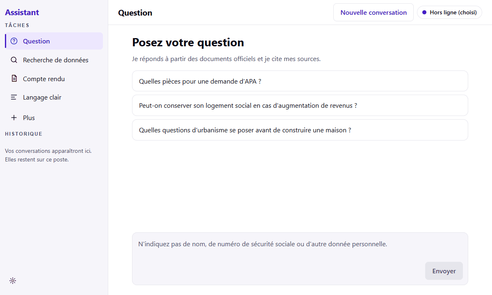

# Assistant SP

Un assistant pour les agents du service public : un modèle de langage qui tourne en local sur le poste (hors ligne), avec en option des modèles cloud.

*Réponse réelle de MiniCPM5-2B (jeu dev1), rejouée dans l'interface.*

## Installer

Prérequis : Windows 10 ou 11 64 bits avec Microsoft Edge WebView2 (présent sur Windows 11), environ 6 Go d'espace disque libre (téléchargement 2,7 Go, puis 3,1 Go installés) et environ 4 Go de mémoire vive pour MiniCPM5-2B (mesure faite sur le poste de développement).

1. Depuis la [dernière version](https://github.com/Aliquanto3/service-public-slm-fine-tuning/releases/latest), télécharger les trois fichiers `AssistantSP-Setup-<version>.exe`, `AssistantSP-Setup-<version>-1.bin` et `AssistantSP-Setup-<version>-2.bin`, **dans le même dossier**.
2. Vérifier les empreintes SHA-256 avec le fichier `.sha256` publié : `certutil -hashfile AssistantSP-Setup-<version>.exe SHA256` (idem pour les `.bin`).
3. Lancer le `.exe`. L'installation se fait **par utilisateur, sans droits administrateur** (`%LOCALAPPDATA%\Programs\AssistantSP`).
4. L'installateur n'est pas signé : si SmartScreen s'affiche, cliquer sur « Informations complémentaires », puis « Exécuter quand même ».

Installation silencieuse : `AssistantSP-Setup-<version>.exe /VERYSILENT /SUPPRESSMSGBOXES`. Détails pour la DSI : [docs/installation-dsi.md](docs/installation-dsi.md).

## Premiers pas

- L'assistant fonctionne **hors ligne** avec MiniCPM5-2B, embarqué dans l'installateur : rien à télécharger au premier lancement.
- Des modèles cloud sont optionnels : Paramètres, Fournisseurs externes (Mistral, OVHcloud, OpenRouter). La clé d'accès est chiffrée sur le poste.
- Les onglets **Modèles** (comparatif qualité, coût, vitesse) et **Observabilité** (dépense, énergie, CO₂e estimés) sont destinés à la DSI. Voir la [fiche de démonstration](docs/fiche-demonstration-hybride.md).

## Fine-tuning

Ce dépôt porte aussi des tentatives de fine-tuning de petits modèles (QLoRA, DoRA, ORPO, jeux de données vérifiés, sélection, interpolation, régularisation). Aucune ne bat le modèle de base sur l'ensemble des tâches : seul un adaptateur routé sur la correction tient. Le détail est dans le [bilan du fine-tuning](docs/bilan-fine-tuning.md).
