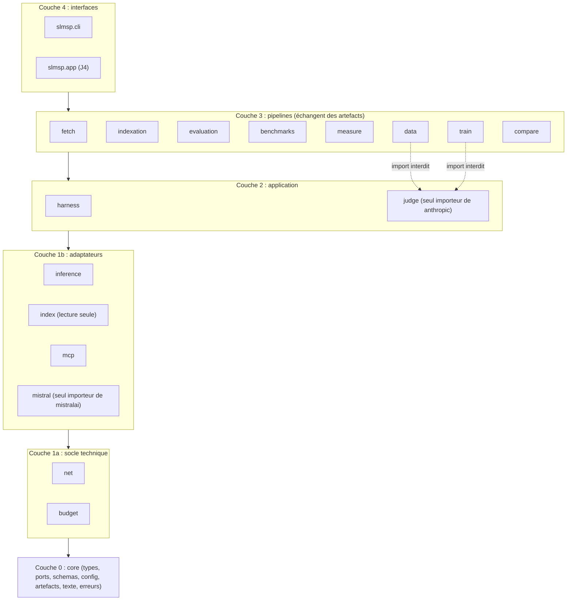
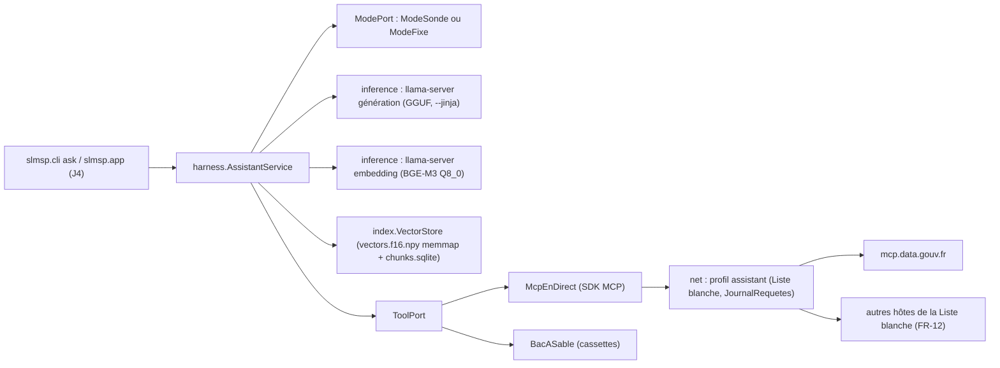
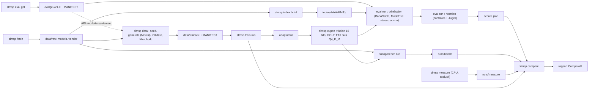

# Architecture Spine — Assistant IA local secteur public (`slmsp`)

Ce document fixe les invariants que les stories de J1 à J3 doivent partager. `decisions.md` fait autorité : ce spine l'applique et ne le redécide pas. Les justifications sont dans `.memlog.md`, les revues dans `reviews/`. Les hypothèses non mesurées figurent dans la section « Hypothèses à mesurer », chacune avec la story de mesure qui la tranche. Les décisions prises seul sont consignées dans `journal-decisions-nuit.md` (entrées `D-nuit-A1-n`).

## Design Paradigm

**Noyau hexagonal + pipelines à artefacts.**

- **Le Harnais est un noyau hexagonal.** Le service `AssistantService` ne connaît que des ports définis dans `slmsp.core.ports` :
  - `LlmPort` et `EmbedderPort` (modèle et embedding) ;
  - `VectorStore` (Index local) ;
  - `ToolPort` (outils MCP) ;
  - `NetGate` (Requêtes sortantes) ;
  - `ModePort` (Mode courant) ;
  - `JournalRequetes` (journal des Requêtes sortantes).

  Les adaptateurs sont interchangeables. Le banc d'évaluation branche le Bac à sable MCP et un Mode fixe là où l'Assistant branche le serveur réel et la sonde.
- **Le reste est une chaîne de pipelines** : fetch, indexation, évaluation, Benchmarks, mesures, données, entraînement, export, Comparatif. Chaque étape lit des artefacts versionnés sur disque et en écrit de nouveaux, décrits par les schémas de `slmsp.core.schemas`. Deux pipelines ne s'appellent jamais en mémoire.



## Invariants & Rules

### AD-1 — Direction des dépendances et isolement des pipelines

- **Binds:** tous les paquets de `src/slmsp/`, D6
- **Prevents:** deux pipelines couplés en mémoire, un cycle d'import, un adaptateur qui dépend du Harnais, un Comparatif qui charge du code d'entraînement.
- **Rule:** les couches sont ordonnées : core < 1a < 1b < 2 < 3 < 4. Un paquet n'importe que des paquets de couches strictement inférieures ; deux paquets d'une même couche ne s'importent jamais. Par exemple, `data` (couche 3) peut appeler `harness.prompts` (couche 2), mais jamais `evaluation`. Les pipelines de la couche 3 échangent des artefacts lus et écrits par `slmsp.core.artefacts`. Les ports vivent dans `slmsp.core.ports` ; un adaptateur reçoit ses dépendances par injection (exemple : `net` reçoit un `ModePort`, il n'importe jamais `harness`). Aucune dépendance de chemin vers `../wavelocalai` : le code utile y est recopié et adapté. Un test `tests/test_architecture.py` parcourt l'AST de chaque module et échoue sur toute importation interdite.

### AD-2 — Séparation entre le runtime de l'Assistant et l'outillage

- **Binds:** fermeture runtime (`core`, `net`, `budget`, `inference`, `index`, `mcp`, `harness`, `app`) ; `pyproject.toml` ; NFR-1, NFR-6
- **Prevents:** un exécutable PyInstaller de plusieurs Go et une RAM hors budget parce qu'un module runtime a tiré une bibliothèque lourde.
- **Rule:** la fermeture runtime n'importe jamais `torch`, `transformers`, `trl`, `peft`, `bitsandbytes`, `unsloth`, `lm_eval`, `bfcl_eval`, `anthropic`, `mistralai`, `datasets`, `duckdb` ni `pyarrow`. Les dépendances se répartissent ainsi :
  - un socle (runtime) ;
  - des extras uv : `fetch` (huggingface-hub), `data` (mistralai, duckdb, pyarrow), `judge` (anthropic), `bench` (lm-eval, sacrebleu), `train` (torch CUDA, transformers, trl, peft, bitsandbytes, accelerate), `app` (pywebview, pyinstaller).

  Deux environnements sont isolés, hors du lock principal parce que leurs épinglages sont incompatibles : Unsloth (variante de vitesse) et `bfcl-eval` (vérificateur BFCL). Ils sont appelés en sous-processus et échangent des fichiers JSON. La construction de l'index (`indexation`, couche 3) est séparée de sa lecture (`index`, runtime). Le même test AST le vérifie.

### AD-3 — Garde-fou D1.1 : Claude ne peut pas produire de Données d'entraînement [ADOPTED]

- **Binds:** `slmsp.data`, `slmsp.train`, `slmsp.judge`, `slmsp.mistral`, `config/prompts/`, `data/`, `var/appels-mistral.sqlite`, D1.1, D1.2, PRD §8
- **Prevents:** qu'une sortie de Claude atteigne un jeu d'entraînement, quelle que soit sa forme (réponse, exemple, few-shot, amorce, scénario, verdict, fixture), y compris quand elle a été reformulée par Mistral.
- **Rule:** six verrous, tous couverts par des tests.
  1. **Imports.** `anthropic` n'est importable que dans `slmsp/judge/`. La règle ruff `TID251` le bannit partout, et un `per-file-ignores` lève l'interdiction sur ce seul dossier. `slmsp.data` et `slmsp.train` n'importent jamais `slmsp.judge`.
  2. **Lectures.** Les lectures de `data` et `train` sont limitées par AD-24. Ni l'une ni l'autre ne lit `eval/` (en dehors de l'API anti-fuite), ni `runs/eval/`, ni un fichier écrit à la main.
  3. **Requête prouvée.** `slmsp.mistral.Generateur` ne reçoit jamais de texte libre. Il reçoit un `gabarit_id` et des `amorce_id`, qu'il résout lui-même à partir de l'artefact `seed`. Le journal `var/appels-mistral.sqlite` enregistre :
     - `session_id`, `usage` (`generation`, `juge-second` ou `validation`), le modèle résolu ;
     - la requête complète, avec SHA du gabarit et `amorce_id` ;
     - la réponse brute intégrale ;
     - la référence de l'entrée du `RegistreBudget`.
  4. **Réponse prouvée.** `slmsp data build` refabrique chaque exemple à partir des réponses brutes journalisées (`usage = generation` seulement), avec un extracteur pur et versionné (`slmsp.data.extraction`), puis compare octet par octet. Les seules transformations ajoutées après coup sont énumérées :
     - le prompt système de la Tâche (`config/prompts/taches/`, SHA consigné) ;
     - les passages formatés par `harness.prompts` ;
     - les messages `tool` tirés des cassettes de la même session.

     Dans une trace multi-tours, un message `assistant` n'est accepté que si son JSON canonique correspond à une réponse journalisée de la même `session_id`.
  5. **Amorces.** Une amorce vient soit d'une ligne d'un jeu public téléchargé (`jeu`, `revision`, `ligne`, relus et hachés au build), soit d'une réponse Mistral journalisée (par exemple des scénarios de réunions fictives générés à partir de thèmes MediaTech). Le `RegistreLicences` porte `auteur_contenu` ∈ {`public`, `mistral`, `anael`} et `genere_par`. `claude` et `inconnu` sont refusés, tout comme un jeu public déclaré distillé d'un modèle non autorisé. Les amorces d'Anaël attendent une décision de sa part (Deferred). Aucun fichier d'amorces rédigé dans le dépôt n'est accepté.
  6. **Gabarits et verdicts.** Les gabarits (`config/prompts/generateur/`) et les prompts de Tâche (`config/prompts/taches/`) passent une liste blanche structurelle :
     - front-matter ;
     - sections « Consigne » et « Emplacements » ;
     - longueur maximale ;
     - aucun bloc de code, aucun JSON, aucun exemple de sortie ;
     - SHA inscrit au MANIFEST du jeu.

     Aucun verdict ni aucune justification du Juge principal ne sert à filtrer, classer ou construire des Données d'entraînement ou des paires ORPO.

### AD-4 — Passerelle réseau unique, profils et Modes

- **Binds:** `slmsp.net`, `slmsp.mcp`, `slmsp.mistral`, `slmsp.judge`, `slmsp.fetch`, `slmsp.harness.modes`, `config/reseau.toml`, `config/liste-blanche.toml`, FR-10, FR-11, FR-38, NFR-4, NFR-5, D1.4, D1.5, D7
- **Prevents:** une Requête sortante non journalisée, un hôte hors liste contacté, un Mode hors ligne forcé qui laisse passer une requête, une publication ou une télémétrie déclenchée par une bibliothèque tierce.
- **Rule:**
  - **Construction des clients.** `httpx`, `httpx2`, `requests` et `urllib.request` sont bannis (ruff `TID251`) hors de `slmsp/net/`. Chaque client est obtenu par `slmsp.net.client(profil)` et injecté :
    - SDK MCP : `http_client=` ;
    - anthropic : `http_client=` ;
    - mistralai : `client=` et `async_client=` ;
    - huggingface_hub : `set_client_factory()`.

    Les relances automatiques des SDK sont désactivées (`max_retries=0`, voir AD-5). Chaque saut de redirection est revérifié.
  - **Trois profils.**
    - `assistant` : Liste blanche de l'addendum §B, correspondance exacte du nom d'hôte. Toute requête est inscrite par le port `JournalRequetes`.
    - `outillage` : services de D1.5. Hugging Face, PyPI, GitHub et les hôtes de la Liste blanche sont accessibles en lecture seule (GET et HEAD). POST n'est permis que vers l'API Mistral, l'API Anthropic et `mcp.data.gouv.fr`. Pour le profil `outillage`, Hugging Face couvre aussi ses CDN et ses hôtes Xet. Les transferts hf-xet échappent au client Python : ils sont journalisés au niveau de l'appel (dépôt, fichier, révision, octets).
    - `aucun` : utilisé par le banc d'évaluation. Toute requête est refusée et le test échoue.
  - **Environnement imposé** par `slmsp.core.config` à toute commande d'outillage : `HF_HUB_DISABLE_TELEMETRY=1`, `WANDB_MODE=disabled`, `DO_NOT_TRACK=1`. Dans les configs TRL : `report_to="none"`, `push_to_hub=False`. CodeCarbon n'est utilisé qu'en `OfflineEmissionsTracker`. Les fonctions d'upload de `huggingface_hub` et `push_to_hub` sont bannies (ruff `TID251`). Le code n'appelle jamais `git push`.
  - **Mode.** Le `ModePort` a deux implémentations :
    - `ModeSonde` (`harness.modes`) : `GET /health` en moins de 3 s, au démarrage, toutes les 5 min et avant chaque appel d'outil. La sonde reste permise en hors ligne détecté, jamais en hors ligne forcé.
    - `ModeFixe(mode)` : utilisé par le banc.

    Le réglage « hors ligne forcé » est une entrée fournie par l'appelant (option de la CLI, puis `app.stockage` en J4). `net` consulte le `ModePort` qu'on lui injecte. En Mode hors ligne, une requête du profil `assistant` est refusée avant toute connexion.
  - **Journal.** Le schéma d'une entrée du journal est figé dans `core.schemas` : `horodatage`, `profil`, `hote`, `methode`, `outil`, `termes` (JSON canonique des arguments), `statut` ∈ {`envoyee`, `echouee`, `bloquee-liste`, `bloquee-mode`}, `mode`. `net` fournit l'implémentation SQLite par défaut ; `app.stockage` la remplace en J4 sur le même schéma.

### AD-5 — Budget : registre unique par machine, réservation au pire cas

- **Binds:** `slmsp.budget`, `slmsp.mistral`, `slmsp.judge`, `config/budgets.toml`, `config/tarifs.toml`, D1.6, PRD §9.3
- **Prevents:** un dépassement de plafond (processus concurrents, copies de travail, relances, erreurs, lots batch, tarif manquant), un compteur perdu, une famine du second juge.
- **Rule:**
  - **Emplacement.** Le `RegistreBudget` est une base SQLite placée dans `SLMSP_VAR_DIR`, par défaut `%LOCALAPPDATA%\slmsp\var\`, hors dépôt et unique par machine pour tous les worktrees. Elle porte un `campagne_id` fixé dans `budgets.toml` et ne connaît aucune commande de remise à zéro.
  - **Plafonds** (EUR, `budgets.toml`) :

    | Poste | Plafond |
    | --- | --- |
    | `anthropic` | 10 |
    | `mistral` | 30 |
    | dont `mistral.generation` | 25 |
    | dont `mistral.juge` | 5 |
  - **Réservation.** Avant chaque tentative, le client réserve le coût pire cas : tokens d'entrée estimés avec une majoration fixée en config, plus `max_tokens` au tarif de sortie. La réservation se fait dans une transaction `BEGIN IMMEDIATE`, au tarif du **modèle résolu** et du **mode** (direct, batch, écriture ou lecture de cache). Un tarif inconnu lève une erreur : aucune valeur par défaut.
  - **Contrôle.** L'appel est refusé si dépensé + réservé + marge dépasse le plafond (`BudgetEpuise`).
  - **Régularisation.** Après l'appel, la réservation est remplacée par le coût réel (`usage`). Une tentative sans `usage` (erreur, délai dépassé) reste comptée au pire cas. Les relances se font dans `slmsp.budget`, une réservation par tentative.
  - **Lots batch.** La réservation d'un lot est faite au pire cas, au tarif batch. La taille du lot est calculée pour tenir sous le reste disponible. Le `batch_id` est persisté avant toute attente, et la réservation vit jusqu'à la collecte ou à l'annulation confirmée.
  - **Ordre de dépense.** Les pipelines payants consomment dans l'ordre de PRD §9.3 :
    1. Tâches prioritaires (Q, RD, CR, LC) ;
    2. NR et données génériques ;
    3. ordre de coupe inversé.

    Pour la Baseline, les modèles passent dans l'ordre de D4.
  - **Arrêt.** Sur `BudgetEpuise`, la commande marque son run `partiel-budget` (AD-25) et rend la main. Le `RegistreBudget` fait foi pour le rapport de dépense. Les tests n'appellent jamais une API payante.

### AD-6 — Inférence par llama-server géré

- **Binds:** `slmsp.inference`, `config/llamacpp.toml`, `config/modeles/`, `vendor/llama.cpp/`, NFR-1 à NFR-3, NFR-8
- **Prevents:** deux façons de lancer ou d'interroger le modèle ; deux versions de llama.cpp entre l'export et l'inférence ; un mode de raisonnement différent entre la Baseline et les Runs.
- **Rule:**
  - **Lancement.** Seul `slmsp.inference.serveur` lance des processus llama.cpp (`llama-server`, `llama-quantize`, `convert_hf_to_gguf.py`). Il les prend au tag figé dans `config/llamacpp.toml` : binaires `bin-cpu/` et `bin-cuda/` (avec `cudart`), et sources du même tag (`src/`, script de conversion et `gguf-py`).
  - **Serveur.** Il écoute sur `127.0.0.1`, sur un port libre, et se pilote en flux par l'API compatible OpenAI.
  - **Paramètres de chaque modèle.** Ils viennent de `config/modeles/<slug>.toml` :
    - contexte, cache KV, threads ;
    - `reasoning` et `chat_template_kwargs` (par exemple `enable_thinking=false`) ;
    - `protocole_outils` (`natif` ou `json-generique`).

    Ces mêmes valeurs s'appliquent à l'entraînement (AD-7) et sont archivées dans `run.json`.
  - **Évaluations.** Elles tournent avec `--parallel 1`. La variante (`cpu` ou `cuda`) est inscrite dans `run.json`.
  - **Instances.** L'Assistant en lance deux au plus : une de génération (`--jinja`), une d'embedding (AD-9).

### AD-7 — Format canonique des conversations et construction unique des prompts

- **Binds:** `slmsp.core.messages`, `slmsp.harness.prompts`, `slmsp.data`, `slmsp.train`, `slmsp.evaluation`, `config/prompts/taches/`, FR-7, FR-13, FR-34
- **Prevents:** un modèle entraîné sur une forme d'entrée qu'il ne voit jamais à l'inférence (passages, outils, prompt système, découpage des comptes rendus), un chat template réécrit à la main, une perte calculée sur autre chose que les réponses de l'assistant.
- **Rule:**
  - **Format des messages.** Partout, une conversation est une liste de messages au format OpenAI. Les rôles sont `system`, `user`, `assistant` et `tool`. Les messages `assistant` portent des `tool_calls` structurés, et les messages `tool` un `tool_call_id`.
  - **Construction de l'entrée.** Elle est faite par une seule fonction pure, `slmsp.harness.prompts.construire_messages(tache, entree, passages, outils)`, que `data` appelle. Personne d'autre ne compose de prompt. Les passages sont formatés par `harness.prompts.formater_passages`. Les prompts de morceau et de fusion des comptes rendus longs sont des fichiers de `config/prompts/taches/`.
  - **Schémas d'outils.** `tools` vient toujours de `config/outils-mcp.toml`, dont le SHA est inscrit dans le MANIFEST du jeu d'entraînement et dans `run.json`.
  - **Rendu en tokens.** Il est fait par le chat template officiel du modèle et par lui seul :
    - à l'entraînement, `tokenizer.apply_chat_template(messages, tools=...)` ;
    - à l'inférence, `llama-server --jinja`.

    Le `protocole_outils` du modèle (AD-6) est lu par le Harnais et par `train`.
  - **Masque de perte.** Il couvre exactement les tokens des tours `assistant` du rendu officiel. Une seule implémentation, `slmsp.train.masque`, est testée pour chaque modèle. Le mécanisme `assistant_only_loss` de TRL n'est pas requis, car les templates de Granite et de Ministral n'ont pas de balises `generation`.

### AD-8 — Outils exposés, schémas figés et appels contraints

- **Binds:** `slmsp.mcp`, `slmsp.harness`, `slmsp.data`, `config/outils-mcp.toml`, FR-7, FR-9, NFR-9
- **Prevents:** un appel non conforme envoyé au serveur, un outil ajouté sans décision, une dérive de schéma non détectée, des traces d'entraînement produites avec d'autres schémas que ceux de l'inférence.
- **Rule:**
  - **Sous-ensemble figé.** Les outils exposés au modèle sont 5 au plus : `search_datasets`, `get_dataset_info`, `list_dataset_resources`, `query_resource_data` et `get_resource_info`. Leurs schémas, éventuellement simplifiés, sont figés dans `config/outils-mcp.toml` avec l'empreinte du `tools/list` enregistré. Le générateur Mistral reçoit ces mêmes schémas.
  - **Validation avant envoi.** Le Harnais valide chaque appel avec `jsonschema` avant de l'envoyer. Un appel invalide n'est jamais envoyé : il devient un évènement `AppelNonConforme`.
  - **Contrôle du schéma serveur.** Au passage en Mode connecté, il est comparé au schéma figé :
    - un outil inconnu est ignoré ;
    - un outil absent ou modifié déclenche le repli FR-9 et une entrée de journal.
  - **Délais.** Ils sont dans `config/reseau.toml` (MCP : 10 s par défaut).

### AD-9 — Index local : format d'artefact et ports

- **Binds:** `slmsp.indexation`, `slmsp.index`, `index/<version>/`, `slmsp.data` (anti-fuite), FR-5, FR-6, NFR-1, NFR-3, D3, D4, D7
- **Prevents:** deux formats d'index, des vecteurs de requête incompatibles avec ceux du corpus, un index modifié par le runtime.
- **Rule:**
  - **Production.** Un index est un artefact en lecture seule, produit uniquement par `slmsp index build` (paquet `indexation`). La lecture des parquet MediaTech se fait directement, avec reprises après échec et sans datasets-server. L'artefact contient :
    - `vectors.f16.npy` : matrice N × 1024, float16, normalisée L2, ouverte en `numpy.memmap` ;
    - `chunks.sqlite` : métadonnées (`chunk_id`, `doc_id`, `source`, `titre`, `url`, `texte`, `date_snapshot`), la ligne `i` correspondant au vecteur `i` ;
    - `MANIFEST.json` : SHA-256, snapshot MediaTech daté, modèle d'embedding, nombre de chunks.
  - **Vecteurs du corpus.** Ce sont ceux de MediaTech, jamais recalculés en v1.
  - **Requête.** Elle est vectorisée par BGE-M3 GGUF Q8_0 servi par `llama-server --embedding --pooling cls`.
  - **Recherche.** Elle passe par le port `VectorStore`. L'implémentation v1 est exacte : produit scalaire par blocs sur le memmap.
  - **Embedder partagé.** Le même `EmbedderPort` sert au Harnais, au contrôle anti-fuite et à la déduplication.
  - **Périmètre v1.** service-public + catalogue data.gouv. Toute autre source attend la mesure de H-RAM (D4).

### AD-10 — Bac à sable MCP : cassettes, enregistrement et rejeu

- **Binds:** `slmsp.mcp`, `eval/cassettes/`, `data/cassettes/`, `eval/calibrage/cassettes/`, FR-9, FR-25, FR-30, FR-40, SPEC §4
- **Prevents:** deux formats ou deux conventions de chemin de cassette, deux enregistreurs, des scores non reproductibles, des cassettes d'évaluation qui fuient dans l'entraînement.
- **Rule:**
  - **Adaptateurs.** `ToolPort` en a deux :
    - `McpEnDirect` : SDK MCP officiel, Streamable HTTP, client fourni par AD-4 ;
    - `BacASable` : rejeu sans état, où l'`id` de la réponse est remplacé par celui de la requête.
  - **Format.** Une cassette correspond à une session dans un fichier, au format du calibrage : `server`, `recorded_at`, `initialize`, `interactions[{request, response}]`. Deux champs s'y ajoutent :
    - `tools_list_sha256` : obligatoire à l'écriture. Le banc refuse une cassette dont l'empreinte diffère de `config/outils-mcp.toml`.
    - `simulation` (facultatif, dans une interaction) : `{type: delai_depasse | erreur_http | injoignable, statut?}`, avec `response` nul. Le rejeu lève alors la même exception que `McpEnDirect`, ce qui déclenche `Repli`.
  - **Réponse vide normalisée.** `{"result": {"content": [{"type": "text", "text": <texte de config>}], "isError": false}}`.
  - **Appariement.**
    - Portée : les cassettes de l'item en évaluation, celles de la session côté données.
    - Ordre : (1) même outil et arguments en JSON canonique égaux ; (2) sinon, même outil avec le plus de paires (clé, valeur) égales, l'égalité étant départagée par l'ordre dans la cassette ; (3) sinon, réponse vide.
    - « Appel non prévu » est un évènement de trace, sans effet sur le score.
  - **Enregistrement.** Une seule API, `slmsp.mcp.enregistrer(session, magasin)`, appelée par :
    - `slmsp mcp record` : magasin `eval`, sous `eval/cassettes/<ITEM>/<session>.json`, refusé si l'item est déjà dans un manifeste gelé ;
    - `slmsp data generate` : magasin `data`, sous `data/cassettes/<session_id>.json`.

    Le pipeline de données ne lit jamais `eval/cassettes/`. `eval/calibrage/build_calibrage.py` est un script figé, hors du paquet, exclu de `TID251`.

### AD-11 — Jeu d'évaluation maison : lecteur unique, gel et contrôle

- **Binds:** `slmsp.core.items`, `slmsp.evaluation`, `slmsp.data`, `eval/`, FR-24, FR-39, D1.3, D6, SPEC §3, §6, §7 bis
- **Prevents:** une évaluation sur un jeu modifié, une génération de données avant le gel, deux lecteurs d'items qui divergent, des chemins de cassettes résolus différemment, un score RD calculé à partir de règles en prose.
- **Rule:**
  - **Lecteur unique.** `slmsp.core.items` lit les items. Le format cible est la SPEC §3, complétée par les précisions du calibrage. `entree` est du texte pour Q, RD et NR, et un objet à clés nommées pour CR, LC, CO, RE et CT. Pour CO, les fautes se repèrent par `debut` et `fin`.
  - **Adaptation du calibrage, à la lecture seulement.** Une table de correspondance s'applique :
    - `R` → `RD`, `RS` → `RE` ;
    - `cassette` → `cassettes` (liste) ;
    - `comportement_attendu = "absence_de_source"` → `sans_reponse = true` ;
    - `entree.longueur_demandee` → `longueur_demandee` ;
    - `entree.type` → `type_courrier` ;
    - valeurs par défaut explicites : `mode = "connecte"`, `version_item = 0`, `theme = "non-classe"`, `fictif` déduit de la provenance.
  - **Codes de Tâche.** Une table libellé ↔ code ; les codes font foi : Q, RD, CR, LC, CO, RE, CT, NR.
  - **Cassettes des items.** Le champ `cassettes` est une liste de chemins relatifs au dossier du jeu.
  - **Règles d'appels lisibles par machine.** Les items RD portent `appels_attendus[].regles`, à côté de la prose `regle` :
    - par argument : `exact`, `contient_un_de`, `optionnel` ;
    - par appel : `optionnel`, `ordre_libre`.
  - **Rendu en requête.** `core.items.vers_requete(item)` donne le code de Tâche, l'entrée et les options (Mode, longueur). C'est la seule voie de rendu.
  - **Gel.** `slmsp eval gel --version <v>` est le seul producteur de `eval/jeu/<v>/MANIFEST.json` (schéma `ManifesteJeu`, AD-25). Le manifeste contient :
    - SHA des items, des cassettes et de la grille ;
    - `statut` (`provisoire` ou `relu`) et date ;
    - l'échantillon du second juge (au moins 3 items par Tâche) ;
    - l'échantillon de relecture (20 % stratifié par Tâche × difficulté).

    Ces deux échantillons sont tirés une seule fois, avec une graine, et sont identiques pour tous les modèles.
  - **Contrôle à chaque évaluation.** Toute évaluation revérifie les SHA du manifeste.
  - **Contrôle avant génération.** `slmsp data generate` vérifie les SHA, `git diff --quiet HEAD --` sur les seuls chemins du manifeste, et que le commit de gel est un ancêtre de `HEAD`.
  - **Écriture sous `eval/`.** Seuls `eval gel` (nouvelle version) et `mcp record` (nouveaux fichiers) y écrivent. Une version gelée n'est jamais modifiée ; le passage en v1.1 relance toutes les évaluations.

### AD-12 — Juges : schéma de verdict, cache et conditions

- **Binds:** `slmsp.judge`, `slmsp.core.schemas`, `config/juges.toml`, FR-25, FR-39, SPEC §7, grille v1
- **Prevents:** un verdict payé deux fois ou réutilisé contre une référence périmée, deux formats de verdict entre les juges, un Juge qui calcule les scores, un lot batch qui dépasse la fin de nuit.
- **Rule:**
  - **Juge principal.** `claude-opus-5-5`. Le paramètre `temperature` n'est pas envoyé, car ce modèle le refuse ; l'effort est fixé dans `juges.toml`. `mode_appel` vaut `batch` par défaut. Au-delà de `delai_max_lot`, les items restants passent en appel direct, dans la limite du budget.
  - **Second juge.** Mistral stable, avec `temperature=0`, sur l'échantillon tiré au gel.
  - **Cécité.** Le Juge ne connaît ni le modèle évalué ni la méthode. Aucune comparaison par paires n'a lieu en v1 : l'ordre aléatoire de la SPEC §7 est sans objet.
  - **Contenu envoyé au Juge.** L'entrée rendue, le texte final, les sources citées (URL et titre), les références de l'item et la section de grille de la Tâche.
  - **Sortie.** Un modèle `Verdict` commun aux deux juges (`core.schemas`), au format de la grille : `id`, `criteres`, `inventions`, `confiance`. Les critères sont fermés par Tâche :

    | Tâche | Critères et échelles |
    | --- | --- |
    | Q | `exactitude` {0, 1, 2}, `pertinence_source` {0, 1}, `cas_sans_reponse` {0, 1} si `sans_reponse` |
    | CR | `presence_elements[{ref, present ∈ {0, 0.5, 1}}]`, `absence_invention` {0, 1}, `structure` {0, 1} |
    | LC | `fidelite` {0, 1, 2}, `termes_juridiques` {0, 1}, `clarte_percue` {1..5} |
    | RE | `fidelite` {0, 1}, `presence_elements[{ref, present ∈ {0, 1}}]` |
    | CT | `conformite` {0, 1, 2} |
    | NR | `exactitude` {0, 1} |
    | RD (litige seulement) | `libelle_correct` {0, 1} |

    Le Juge juge la présence élément par élément ; le rappel est calculé par `evaluation.scores`. Après deux sorties non conformes au schéma, le verdict est `invalide` : l'item est exclu du score et compté à part.
  - **Cache des verdicts.** La clé combine :
    - le SHA du JSON canonique de l'item ;
    - le SHA de la `sortie_canonique` (`{texte, appels_outils, sources}`) ;
    - le SHA de la section de grille ;
    - le SHA du gabarit et du schéma du prompt Juge ;
    - le modèle et l'effort.

    Un verdict n'est jamais redemandé.
  - **Accord entre juges.** Le kappa est calculé dans `evaluation.scores` : pondération quadratique pour les critères ordinaux, kappa simple pour les binaires, rien sur les rappels. CO et RD sont exclus. Une Tâche sous 0,6 est marquée `fragile`.
  - **Statuts.** `jeu_statut` (`provisoire` ou `relu`) et `verdicts_relus`, ce dernier levé par un fichier `relecture-validee.json` daté.

### AD-13 — Banc d'évaluation en deux phases, sans réseau

- **Binds:** `slmsp.evaluation`, `runs/eval-generation/`, `runs/eval-notation/`, FR-25, FR-35, FR-40, NFR-8
- **Prevents:** regénérer pour rejuger, repayer le Juge pour une même sortie, des sorties obtenues hors Harnais, des scores qui dépendent de la disponibilité de data.gouv, l'absence de mesure avant quantification.
- **Rule:**
  - **Phase génération** (run de type `eval-generation`). Le Harnais complet produit pour chaque item la sortie et la trace d'évènements (`generations.jsonl`). Il tourne avec `BacASable`, `ModeFixe(item.mode)` et le profil réseau `aucun`, en décodage glouton (température 0 côté SLM) avec une graine fixe. Un test vérifie qu'aucune requête ne sort pendant une évaluation.
  - **Phase notation** (run de type `eval-notation`, avec la génération comme parent). Contrôles automatiques, Juges et Scores produisent `verdicts.jsonl`, `scores.json` et l'export de relecture.
  - **Modèle évalué.** Il est désigné par un `ModeleRef` : `base:<slug>` ou `ft:<export_run_id>`, avec `quantification` ∈ {`f16`, `q4_k_m`}.
  - **Avant et après quantification.** « Avant » désigne le GGUF F16 issu de la même conversion (AD-19), évalué par le même Harnais.
  - **Baseline.** C'est une évaluation comme une autre, sur `base:<slug>` en Q4_K_M. Si le chat template embarqué dans le GGUF téléchargé diffère de celui du tokenizer HF (comparaison des SHA), `--chat-template-file` impose celui du tokenizer.

### AD-14 — Harnais sans état, flux d'évènements et table des Tâches

- **Binds:** `slmsp.harness`, `slmsp.cli`, `slmsp.app`, `slmsp.evaluation`, `config/taches.toml`, FR-1, FR-2, FR-3, FR-5, FR-8, FR-9, FR-13 à FR-17, FR-38
- **Prevents:** deux propriétaires de l'historique de conversation, des formats de réponse différents entre la CLI, l'application et le banc, une Requête sortante déclenchée par un texte collé, une valeur de tableau inventée par le modèle.
- **Rule:**
  - **Service sans état.** `AssistantService.repondre(tache, messages, options)` reçoit toute la conversation de l'appelant, qui la conserve. Il renvoie un itérateur d'évènements typés (`core.evenements`) : `Jeton`, `AppelOutil`, `ResultatOutil`, `AppelNonConforme`, `Sources`, `Avertissement`, `Progression`, `Repli`, `Fin`, `Erreur`.
  - **Table des Tâches.** `config/taches.toml` déclare les 8 codes et la Traduction, les Tâches actives (pour l'ordre de coupe de §9.3) et `outils_autorises`. Cette liste est vide pour les Tâches de rédaction : aucun outil n'est passé au modèle, aucun appel à `NetGate` n'est possible. Le test du document témoin (FR-38) vérifie ce point.
  - **Ordre d'interrogation en Mode connecté.** Le MCP d'abord, puis l'Index local en repli.
  - **Tableaux de valeurs (FR-8).** Le Harnais les rend à partir de `ResultatOutil`, jamais à partir du texte généré.
  - **Vérification des URL (FR-3).** Une seule fonction, `harness.citations`, réutilisée par le banc.
  - **Comptes rendus longs.** Le découpage puis la fusion (FR-13) se font dans le Harnais.

### AD-15 — Mesures techniques : protocole unique

- **Binds:** `slmsp.measure`, `config/mesures.toml`, FR-26, NFR-1 à NFR-3, NFR-6, SM-5
- **Prevents:** des RAM mesurées différemment selon les stories, des mesures GPU ou faussées par une autre charge présentées comme celles du PC cible.
- **Rule:**
  - **RAM.** Pic de la somme des working sets de l'arbre de processus de l'Assistant (Python, les deux `llama-server`, puis WebView2 en J4), échantillonné toutes les 100 ms par psutil pendant une génération, Index local chargé.
  - **Débit et latence.** Mesurés sur le binaire `cpu` uniquement, threads plafonnés.
  - **Taille installée.** Approchée par la taille sur disque du GGUF, de l'index et des binaires.
  - **Exclusivité.** `slmsp measure` exige qu'aucune autre commande `slmsp` ne tourne (AD-27) et enregistre l'empreinte de la machine. Les rapports précisent que la machine de dev n'est pas le PC cible.

### AD-16 — Benchmarks standardisés déclaratifs

- **Binds:** `slmsp.benchmarks`, `config/benchmarks/*.toml`, `runs/bench/`, FR-27, FR-28, FR-35
- **Prevents:** un benchmark ajouté en modifiant l'orchestrateur, des résultats sans version ni configuration, un BFCL qui ne passe pas par le même chemin d'appel d'outils que le Harnais.
- **Rule:**
  - **Déclaration.** Chaque benchmark est un fichier de config : moteur (`lm_eval`, `bfcl` ou `sacrebleu`), tâche, nombre d'exemples few-shot, limite d'items, cible (`hf` ou `gguf`). L'orchestrateur ne connaît que les moteurs.
  - **QCM.** Ils tournent sous lm-eval sur les poids HF (GPU), avant quantification seulement.
  - **Benchmarks génératifs** (ifeval, traduction sacrebleu, BFCL). Ils tournent contre `llama-server`, avant et après quantification.
  - **BFCL.** Un lanceur maison envoie les questions par le même chemin d'inférence que le Harnais (`tools` natifs). Le vérificateur AST de `bfcl-eval` tourne dans son environnement isolé (AD-2).
  - **Archivage.** Chaque résultat archive la version du benchmark et de l'outil, la configuration et l'environnement.

### AD-17 — Pipeline de Données d'entraînement

- **Binds:** `slmsp.data`, `data/`, `runs/data-*/`, `config/prompts/generateur/`, `config/donnees.toml`, `data/registre-licences.toml`, FR-29, FR-30, FR-31, D1.2, D1.3, D4
- **Prevents:** un exemple sans provenance, une source sans licence ou non commerciale dans la variante diffusable, une fuite du Jeu d'évaluation, une validation tautologique, un jeu modifié après coup, une génération repayée.
- **Rule:**
  - **Étapes.** Chacune est un run `runs/data-<etape>/<run_id>/` qui prend `--depuis <run_id>` du parent :
    - `seed` : amorces conformes à AD-3.5. Sont exclues dès cette étape les amorces dont le texte normalisé ou l'identifiant source correspond à une `amorce_usager` ou à une `provenance` du jeu gelé, ainsi que les `dataset_id` et `resource_id` des `appels_attendus`.
    - `generate` : idempotent, la clé (amorce, gabarit, version) est cherchée dans le journal avant tout appel. Les appels d'outils sont exécutés en direct et enregistrés par `mcp.enregistrer` (magasin `data`).
    - `validate` : appels conformes à `config/outils-mcp.toml`, URL et valeurs de la réponse finale présentes dans les réponses d'outils (`harness.citations`), contrôle par Mistral si besoin (`usage = validation`).
    - `filter` : doublons, puis anti-fuite par Jaccard de n-grammes normalisés et cosinus BGE-M3 contre l'API anti-fuite de `core.items`, avec seuils en config.
    - `build`.
  - **Préalables de `generate`.** La commande refuse de démarrer si `config/donnees.toml` ne porte pas une date de vérification des conditions Mistral égale au jour même et un modèle de la liste stable autorisée.
  - **Build.**
    - Il attribue `vN` par incrément et écrit `data/train/vN/train.jsonl`. Chaque ligne a le schéma `LigneEntrainement` : `messages`, `tools`, `tache`, `meta{generateur, appel_ids, session_id, version_gabarit, version_extracteur, source, licence, date}`, avec `messages[0]` = prompt de Tâche.
    - Il écrit aussi `MANIFEST.json` : SHA, comptes par Tâche, rejets par motif, instantané du `RegistreLicences`, SHA des gabarits, des prompts et de `outils-mcp.toml`.
    - Il échoue si une source manque au Registre. `--variante diffusable` échoue sur toute source dont l'usage n'est pas `diffusable`. Les sources `evaluation_seulement` sont refusées dès `seed`.
    - Il exporte un échantillon pour relecture humaine, non bloquant.
  - **Paires ORPO.** Elles sont produites par `data build --preferences`. La réponse rejetée est une génération du Modèle de base local (`slm:<slug>`), journalisée de la même façon.
  - **Immuabilité.** Une version est immuable.

### AD-18 — Runs d'entraînement pilotés par configuration

- **Binds:** `slmsp.train`, `config/runs/*.toml`, `runs/train/`, FR-32, FR-33, FR-34, D1.7, D2, D7
- **Prevents:** une méthode qui exige du code, des Runs non comparables, une suppression de checkpoint, une contrainte matérielle découverte en cours de nuit.
- **Rule:**
  - **Un Run, un TOML.** Le fichier fixe le Modèle de base, la méthode, les hyperparamètres, la graine et la version du jeu, validés par pydantic.
  - **Méthode = donnée.** Valeurs possibles : `qlora`, `lora`, `dora`, `orpo` (`trl.experimental.orpo`, après SFT), et les variantes `rslora`, `pissa`, `qlora-unsloth` (environnement isolé).
  - **Campagne.** Elle partage données, ordre, longueur maximale de séquence, chat template officiel et masque de perte (AD-7).
  - **Coût.** Un seul callback calcule débit, VRAM maximale et énergie ; le protocole est en config.
  - **Checkpoints.** `save_total_limit` n'est jamais défini.
  - **Contraintes vérifiées au chargement.**
    - Aucune couche Mamba (Granite H refusé).
    - Aucun poids FP8 : préférer le dépôt officiel bf16 ; sinon, conversion consignée.
    - Encodeur vision de Ministral 3 exclu.
  - **Lecture.** `slmsp train run` ne lit que ce qu'AD-24 autorise et revérifie la provenance du jeu.

### AD-19 — Export GGUF et réévaluation

- **Binds:** `slmsp.train.export`, `slmsp.inference`, FR-35
- **Prevents:** un GGUF produit avec une autre version de llama.cpp que celle qui l'exécute, un chat template différent entre entraînement et inférence, des modèles exportés non comparables, un score publié sans réévaluation après quantification.
- **Rule:**
  - **Fusion en 16 bits.** Pour LoRA, QLoRA et DoRA, elle se fait sur la base bf16 d'origine. Pour PiSSA, elle se fait sur le modèle résiduel.
  - **Conversion et quantification.** `convert_hf_to_gguf.py` et `gguf-py` du tag figé produisent un GGUF F16, qui est conservé. `llama-quantize` du même tag produit ensuite le Q4_K_M.
  - **Chat template.** Le GGUF embarque celui du tokenizer d'entraînement.
  - **Réévaluation.** Tout GGUF exporté passe par AD-13 (F16 et Q4_K_M) et AD-16, appels d'outils compris, avant d'entrer dans le Comparatif.

### AD-20 — Comparatif : fonction pure des artefacts

- **Binds:** `slmsp.compare`, `runs/`, FR-36, SM-1, SM-6, PRD §9.3 (chemin no-go)
- **Prevents:** un rapport qui dépend d'un état non archivé ou d'un appel réseau, des résultats partiels présentés comme complets, deux versions du jeu mélangées.
- **Rule:**
  - **Entrées.** `slmsp compare` ne lit que les artefacts de `runs/` décrits par les schémas d'AD-25. Il n'appelle ni modèle ni réseau.
  - **Sélection.**
    - Tout run dont le statut n'est pas `complet` est exclu ou marqué comme tel.
    - Pour une génération donnée, la notation retenue est la plus récente parmi les complètes.
    - Le rapport refuse de mélanger deux versions du jeu.
  - **Contenu.** Deux vues : à tokens vus égaux et à budget de temps égal. La dérogation d'ORPO est écrite dans le rapport. Le rapport fonctionne même sans aucun modèle fine-tuné gagnant (chemin no-go).
  - **Reproductibilité.** Un test régénère le rapport à partir de fixtures et compare le résultat à l'octet près.

### AD-21 — Artefacts immuables, versionnement et disque

- **Binds:** toutes les commandes qui écrivent dans `runs/`, `data/`, `index/`, `models/`, `.gitignore`, D1.7, NFR-8
- **Prevents:** un résultat écrasé ou supprimé, un résultat impossible à rattacher à sa configuration, un commit de centaines de Mo, un disque saturé sans prévenir.
- **Rule:**
  - **Un run, un dossier.** Chaque exécution écrit dans `runs/<type>/<run_id>/`, avec `run_id` = `AAAAMMJJ-HHMMSS-<slug>-<4 hex>`. Le slug vaut le modèle pour `eval`, `bench` et `measure`, le nom du TOML pour `train`, la version pour `data-build`.
  - **`run.json`** (schéma `RunManifest`, AD-25). Il contient la config résolue, la graine, le commit et l'indicateur de modifications non commitées, l'empreinte de l'environnement (OS, CPU, GPU, pilote, CUDA, paquets, tag et variante llama.cpp, SHA du chat template) et les SHA des entrées.
  - **Aucune suppression, aucune réécriture.** Le code n'efface ni ne réécrit un artefact. Une reprise complète le même run en ajout seul (AD-26).
  - **Versionné dans git.** `run.json`, `scores.json`, `verdicts.jsonl`, les rapports, `data/train/*/MANIFEST.json` et `data/registre-licences.toml`.
  - **`.gitignore` écrit par le squelette.** `index/`, `var/`, `vendor/`, `models/`, `data/raw/`, `data/train/*/train.jsonl` (lourd), `runs/**/checkpoints/`, `runs/**/adaptateur/`, `*.gguf`, `*.safetensors`. Les règles actuelles `runs/` et `checkpoints/` en bloc sont retirées.
  - **Espace disque.** Toute commande qui écrit plus de 1 Go vérifie d'abord l'espace libre (seuil en config).

### AD-22 — Configuration et secrets

- **Binds:** `slmsp.core.config`, `config/`, `.env`, D2
- **Prevents:** un identifiant de modèle, un hôte, un tarif ou un seuil codé en dur, ou divergent d'un module à l'autre ; une clé versionnée ou transmise à un outil tiers.
- **Rule:**
  - **Configuration.** Toute valeur réglable vit dans un fichier TOML de `config/`, lu par `tomllib` et validé par un modèle pydantic. Fichiers nommés :
    - `modeles/`, `runs/`, `benchmarks/` ;
    - `prompts/taches/`, `prompts/generateur/` ;
    - `taches.toml`, `budgets.toml`, `tarifs.toml`, `juges.toml`, `llamacpp.toml` ;
    - `outils-mcp.toml`, `liste-blanche.toml` (profil `assistant`), `reseau.toml` (profils, délais, sonde) ;
    - `donnees.toml`, `mesures.toml`.
  - **Secrets.** `MISTRAL_API_KEY`, `ANTHROPIC_API_KEY` et `HF_TOKEN` sont lus par `dotenv_values`, jamais injectés dans `os.environ`. Ils ne sont remis qu'aux fabriques de clients. Les sous-processus (`llama-server`, lm-eval, BFCL, Unsloth) sont lancés avec un environnement filtré, sans `*_API_KEY`. Aucun secret n'est écrit dans un artefact ou un journal.

### AD-23 — Frontière de l'application J4 (esquisse)

- **Binds:** `slmsp.app`, FR-1, FR-4, FR-19 à FR-23, FR-38, UX EXPERIENCE.md
- **Prevents:** une interface qui contourne le Harnais, deux propriétaires de l'historique ou du journal.
- **Rule:**
  - **Accès au Harnais.** L'application pywebview n'appelle que `AssistantService` (AD-14), via une classe pont exposée en `js_api` dont les méthodes prennent et renvoient du JSON.
  - **Flux.** Les évènements sont poussés à l'interface par `evaluate_js`.
  - **Stockage.** `slmsp.app.stockage` est le seul propriétaire de l'historique, des Retours, du réglage « Rester hors ligne » et de l'implémentation J4 de `JournalRequetes` (même schéma, 30 jours glissants). Il stocke tout en SQLite dans `%LOCALAPPDATA%\AssistantSP\`.
  - **Journal technique.** Il ne contient jamais le texte collé par l'Agent.
  - **Racine de composition partagée (amendement du 2026-10-17, décision Q10 d'Anaël).** `assembler` vit dans `slmsp.harness.assemblage` (couche 3), partagé par la CLI et l'application ; `cli/_assemblage.py` n'en est qu'un ré-export. Cela déroge à la règle initiale, qui plaçait la racine de composition dans la CLI : `app` et `cli` sont de même couche et ne peuvent pas s'importer (AD-1).
  - **Racines de lecture et d'écriture (amendement du 2026-10-17, story 12.1).** En mode installé, les ressources se lisent dans le dossier gelé (`racine_projet()`) et toute écriture (`runs/`, état, données) va sous `%LOCALAPPDATA%\AssistantSP\` (`racine_ecriture()`), jamais sous `_MEIPASS` ni dans le dossier d'installation.

### AD-24 — Entrées autorisées des pipelines de données et d'entraînement

- **Binds:** `slmsp.data`, `slmsp.train`, `slmsp.core.artefacts`, D1.1
- **Prevents:** qu'un pipeline respecte tous les imports mais lise un fichier écrit par Claude : verdicts, items, références, fixture de secours, jeu « de dépannage » écrit à la main.
- **Rule:**
  - **Point de passage.** Toute lecture de fichier dans `data/` et `train/` passe par `slmsp.core.artefacts.lire(chemin, lecteur=...)`, qui applique une liste par lecteur. Un test AST interdit `open`, `Path.read_*` et `json.load` ailleurs dans ces paquets.
  - **`data` peut lire :**
    - `data/raw/` et `data/cassettes/` ;
    - ses propres runs `runs/data-*` ;
    - `config/prompts/`, `config/outils-mcp.toml`, `data/registre-licences.toml` ;
    - les journaux de `SLMSP_VAR_DIR` ;
    - l'Index local.

    Le Jeu d'évaluation ne lui est accessible que par l'API anti-fuite de `core.items`, qui expose des empreintes et des n-grammes, jamais des textes.
  - **`train` peut lire :** `data/train/<version>/` et `models/`, rien d'autre. Au chargement, il vérifie que le MANIFEST vient d'un run `data-build` et recontrôle les `appel_ids` contre le journal.
  - **Tests.** Les fixtures d'entraînement des tests sont aléatoires (tokens aléatoires).
  - **Blocage.** Sans jeu construit, un Run n'a pas lieu. Il est consigné comme bloqué : jamais de jeu de dépannage.

### AD-25 — Schémas d'artefacts partagés

- **Binds:** `slmsp.core.schemas`, tous les pipelines, AD-11, AD-12, AD-13, AD-17, AD-20, AD-21
- **Prevents:** deux pipelines qui écrivent et lisent le même fichier avec des formes différentes, un Comparatif inconstructible, un résultat partiel pris pour complet.
- **Rule:** les fichiers échangés sont écrits et lus uniquement via les modèles pydantic de `slmsp.core.schemas`. Chaque modèle porte un `schema_version`.

  | Modèle | Fichier | Champs ou rôle |
  | --- | --- | --- |
  | `RunManifest` | `run.json` | `type`, `run_id`, `parents`, `modele_ref`, `quantification`, `variante_llamacpp`, `jeu_version`, `index_version`, `statut` ∈ {`en_cours`, `complet`, `partiel-budget`, `partiel-erreur`, `interrompu`, `degrade`}, `couverture`, config, graine, environnement, SHA des entrées |
  | `ManifesteJeu` | `eval/jeu/<v>/MANIFEST.json` | voir AD-11 |
  | `Generation` | `generations.jsonl` | une ligne par item : `item_id`, `sortie_canonique`, trace d'évènements |
  | `Verdict` | `verdicts.jsonl` | voir AD-12 |
  | `Scores` | `scores.json` | par Tâche : score, composantes, effectifs (notés, jugés, invalides), statuts (`jeu_statut`, `verdicts_relus`, `fragile`, `plafonne_lc`), kappa, coût du Juge, SHA du manifeste |
  | `LigneEntrainement`, `ManifesteJeuEntrainement` | `data/train/<v>/` | voir AD-17 |
  | `Cassette` | `*.json` sous `cassettes/` | voir AD-10 |
  | `EntreeJournalRequetes` | journal des Requêtes sortantes | voir AD-4 |
  | `ResultatBench`, `ResultatMesure` | `runs/bench/`, `runs/measure/` | résultats de benchmark et de mesure |

  Le statut `degrade` marque tout résultat obtenu avec un stub ou une doublure (D5).

### AD-26 — Reprise après interruption

- **Binds:** `slmsp.evaluation`, `slmsp.data`, `slmsp.train`, `slmsp.budget`, `slmsp.judge`, D5, D1.6, D1.7
- **Prevents:** une génération ou un lot Juge repayés après un crash, des réservations orphelines qui bloquent ou font dépasser le budget, deux conventions de reprise.
- **Rule:**
  - **Reprise d'un run.** `--reprendre <run_id>` complète le même dossier en ajout seul :
    - les items, exemples ou pas déjà présents sont sautés ;
    - le statut repasse à `en_cours` ;
    - l'entraînement reprend sur les checkpoints de ce dossier.
  - **Démarrage de `RegistreBudget`.** Il régularise au pire cas, et garde comptées comme dépensées, les réservations sans lot dont le `pid` est mort. Les réservations liées à un `batch_id` restent ouvertes jusqu'à la collecte : une relance commence par relire les lots en cours.
  - **Réponses déjà payées.** `data generate` et le Juge réutilisent toujours une réponse déjà payée : journal Mistral pour l'un, cache de verdicts pour l'autre.

### AD-27 — Ressources partagées et processus

- **Binds:** `slmsp.inference`, `slmsp.train`, `slmsp.evaluation`, `slmsp.benchmarks`, `slmsp.measure`, `SLMSP_VAR_DIR`
- **Prevents:** des erreurs de mémoire GPU dues à deux charges superposées sur 8 Go, des mesures faussées, des `llama-server` orphelins qui retiennent RAM et VRAM, des accès SQLite qui se bloquent.
- **Rule:**
  - **Verrou GPU.** Toute commande qui utilise CUDA (`train`, `export`, `eval` CUDA, `bench`) prend le verrou exclusif `gpu.lock` dans `SLMSP_VAR_DIR`. Une seconde commande attend ou échoue avec un message clair.
  - **Processus.** `slmsp.inference` lance chaque processus dans un Job Object Windows `KILL_ON_JOB_CLOSE`, inscrit son PID et son port dans `SLMSP_VAR_DIR/pids/`, et nettoie les orphelins au démarrage.
  - **SQLite.** Toutes les bases sont ouvertes en WAL avec `busy_timeout` de 30 s.

### AD-28 — Téléchargements, poids et environnement

- **Binds:** `slmsp.fetch`, `config/modeles/`, `config/llamacpp.toml`, `models/`, `vendor/`, `pyproject.toml`, D2, D7, NFR-8
- **Prevents:** un téléchargeur par story, des révisions non épinglées, un torch CPU installé à la place du CUDA, un `gguf-py` désaligné du tag llama.cpp.
- **Rule:**
  - **Seul téléchargeur.** `slmsp fetch {modeles, llamacpp, benchmarks, sources}` (profil `outillage`).
  - **Disposition des poids.** `models/<slug>/{hf, hf-bf16, gguf}/`, avec `HF_HOME=models/.cache-hf`.
  - **Épinglage.** Chaque `config/modeles/<slug>.toml` épingle `revision` (commit HF), le fichier GGUF attendu et son SHA-256. Les jeux téléchargés sont épinglés de la même façon.
  - **llama.cpp.** `vendor/llama.cpp/<tag>/{bin-cpu, bin-cuda, src}`.
  - **`gguf`.** Installé depuis `vendor/llama.cpp/<tag>/src/gguf-py` (dépendance par chemin), pas depuis PyPI.
  - **torch.** Épinglé sur l'index PyTorch CUDA (`[tool.uv.index]` avec `explicit = true`, puis `[tool.uv.sources]`). Un test marqué `gpu` vérifie `torch.cuda.is_available()`.

### AD-29 — Calcul des Scores de Tâche

- **Binds:** `slmsp.evaluation.scores`, `slmsp.core.texte`, grille v1, PRD §10.1
- **Prevents:** deux calculs d'un même score, un gain de Kandel-Moles calculé avec deux syllabations différentes, un Juge qui calcule.
- **Rule:** les formules de la grille sont implémentées dans le seul `slmsp.evaluation.scores`. Les fonctions de texte partagées vivent dans `slmsp.core.texte`, versionnées, et servent aussi à la construction du jeu :
  - normalisation ;
  - comptage de mots ;
  - extraction de nombres écrits à la française ;
  - Kandel-Moles avec syllabation.

  | Tâche | Contrôles automatiques | Juge | Score |
  | --- | --- | --- | --- |
  | Q | URL inventées (`harness.citations`, sur la sortie et les `Sources`) | `exactitude`, `pertinence_source`, `cas_sans_reponse` | % d'items réussis selon la grille |
  | RD | appel valide (micro, tous appels attendus confondus, contre `regles`) ; réponse exacte (identifiants de jeux, valeurs numériques) | litige seulement | moyenne des deux taux |
  | CR | — | `presence_elements`, `absence_invention` | moyenne de (rappel × 100) et (% sans invention) |
  | LC | gain de Kandel-Moles (indices d'entrée et de sortie calculés à la notation) | `fidelite`, `termes_juridiques` | % fidèles, plafonné à 50 et signalé si le gain moyen < +10 |
  | CO | rappel des fautes, taux de modification hors faute (tolérances en config) | — | rappel × (1 − hors faute) |
  | RE | longueur (`courte`, `moyenne`, `detaillee` → 80, 200, 400 mots, en config) | `fidelite`, `presence_elements` | moyenne de (% fidèles) et (rappel × 100) |
  | CT | emplacements : libellé exact entre crochets de `champs_a_laisser_en_emplacement`, et absence des `valeurs_interdites` | `conformite` | moyenne de (conformité ÷ 2 × 100) et (% d'emplacements réussis) |
  | NR | — | `exactitude` | % exacts |

  Un item RD sans appel attendu (mode hors ligne ou repli) est exclu du dénominateur « appel valide ».

## Consistency Conventions

| Sujet | Convention |
| --- | --- |
| Langue du code | Termes du domaine en français sans accents, alignés sur le glossaire et la SPEC (`tache`, `entree`, `appels_attendus`, `passage`, `cassette`) ; termes techniques en anglais acceptés. Noms distincts : `RegistreBudget` et `RegistreLicences`. |
| Identifiants | Tâches : Q, RD, CR, LC, CO, RE, CT, NR. Modèles : slug de `config/modeles/<slug>.toml` (`granite-4.0-1b`, `ministral-3-3b`, `smollm3-3b`, `qwen-4b`, `ministral-3-8b`) ; `ModeleRef` = `base:<slug>` ou `ft:<export_run_id>`. Méthodes : `qlora`, `lora`, `dora`, `orpo`, `rslora`, `pissa`, `qlora-unsloth`. |
| Fichiers de données | UTF-8, fins de ligne LF, JSONL (un objet par ligne, `ensure_ascii=False`). JSON canonique pour hachage et appariement : clés triées, séparateurs compacts. SHA-256 en hexadécimal minuscule. |
| Dates et argent | ISO 8601 avec fuseau ; `consulte_le` en date seule. Budget en euros ; tarifs USD convertis au taux daté de `tarifs.toml`. |
| Erreurs | Hiérarchie unique sous `slmsp.core.erreurs.SlmspError` (`BudgetEpuise`, `HoteBloque`, `ManifesteInvalide`, `AppelNonConforme`, `SchemaOutilModifie`, `SourceSansLicence`, `ProvenanceInvalide`, `LectureInterdite`). Codes de sortie de la CLI : 0 succès, 1 erreur, 2 usage, 3 budget épuisé, 4 manifeste invalide, 5 ressource occupée. |
| Journalisation | `logging` standard, en JSON lines dans `runs/<type>/<run_id>/log.jsonl` ; côté Assistant, fichier local sans contenu saisi par l'Agent. |
| CLI | Une seule commande `slmsp` (argparse) : `fetch`, `index`, `ask`, `mcp`, `eval` (`run`, `gel`), `bench`, `measure`, `data`, `train`, `export`, `compare`. Lancée par `uv run slmsp …` ; `sys.stdout` reconfiguré en UTF-8 ; option `--reprendre` sur les commandes longues. |
| Tests | pytest ; marqueurs `reseau`, `gpu` et `lent`, exclus par défaut ; fixtures d'évaluation tirées de `eval/calibrage/` (lecture seule) ; aucune API payante appelée ; `ruff check` et `ruff format` propres. |
| Windows | `pathlib` partout ; sous-processus sans fenêtre (`CREATE_NO_WINDOW`), dans un Job Object ; encodage explicite ; jamais la commande `python` du PATH. |

## Stack

Versions relevées sur PyPI, GitHub et Hugging Face le 2026-10-12 ; `uv.lock` fait foi une fois créé. Contraintes : Unsloth 2026.10.3 exige `transformers<=5.17.0` et `trl<=1.13.0`, d'où les épinglages de campagne ci-dessous.

| Name | Version |
| --- | --- |
| Python (via uv) | 3.12 |
| uv (installé) | 0.12.23 |
| llama.cpp (binaires `win-cpu-x64`, `win-cuda-12.4-x64` + `cudart`, sources du même tag) | b11429 (base de la release stable v0.6.0) |
| mcp (SDK Python officiel v2, Streamable HTTP, `httpx2`) | 2.3.0 |
| Protocole MCP du serveur data.gouv (enregistré) | 2025-06-18, serveur 1.28.1 |
| BGE-M3 GGUF | ggml-org/bge-m3-Q8_0-GGUF (Q8_0) |
| numpy | 2.5.4 |
| pydantic | 2.14.1 |
| jsonschema | 4.26.0 |
| psutil | 7.2.2 |
| nvidia-ml-py | 13.615.71 |
| python-dotenv | 1.2.4 |
| huggingface-hub (extra `fetch`) | 2.2.0 |
| anthropic (extra `judge`) | 1.13.0 |
| mistralai (extra `data`) | 3.2.0 |
| duckdb (extra `data`) | 1.5.6 |
| pyarrow (extra `data`) | 26.0.0 |
| torch (index PyTorch CUDA, extra `train`) | 2.14.1 |
| transformers (épinglé pour la campagne) | 5.17.0 |
| trl (épinglé pour la campagne ; ORPO dans `trl.experimental.orpo`) | 1.13.0 |
| peft | 0.21.2 |
| accelerate | 1.15.0 |
| bitsandbytes | 0.50.2 |
| unsloth (environnement isolé) | 2026.10.3 |
| gguf (depuis `vendor/llama.cpp/<tag>/src/gguf-py`) | celle du tag b11429 |
| lm-eval (extra `bench`) | 0.4.13 |
| bfcl-eval (environnement isolé, vérificateur) | 2026.3.23 |
| sacrebleu | 2.6.0 |
| pywebview (extra `app`, J4) | 6.2.1 |
| pyinstaller (J4) | 6.22.3 |
| pytest | 9.1.1 |
| ruff | 0.17.0 |

## Structural Seed

### Vue runtime de l'Assistant (CLI en J1, application en J4)



### Chaîne des pipelines (J1 à J3)



### Environnements et services externes

| Environnement | Rôle | Contraintes |
| --- | --- | --- |
| Poste de dev (Windows 11 natif, RTX 3050 8 Go Ampere, 31 Go RAM) | Tout J1 à J3 : index, évaluations, Benchmarks, données, entraînement, export | Pas de WSL ; pas de FP8 ; pas de noyaux Mamba ; CUDA pour la qualité et l'entraînement (un seul usage GPU à la fois, AD-27) ; binaire CPU pour FR-26 |
| PC cible (Windows 10/11 x64, 16 Go, sans GPU) | Assistant installé (J4) | Mesures FR-26 approchées sur le poste de dev en CPU tant qu'aucun PC cible n'est disponible |
| Profil réseau `outillage` | Hugging Face (et ses CDN et hôtes Xet), PyPI, GitHub, index PyTorch CUDA, hôtes de la Liste blanche en lecture ; API Mistral, API Anthropic, MCP data.gouv | D1.5 ; budgets AD-5 ; aucune publication |
| Profil réseau `assistant` | Liste blanche de l'addendum §B | Correspondance exacte du nom d'hôte ; journal FR-38 |
| Profil réseau `aucun` | Banc d'évaluation | Toute requête est refusée |

### Arborescence de départ

```text
pyproject.toml            # socle runtime + extras ; index PyTorch CUDA ; ruff (TID251) et pytest
uv.lock
.env.example
.gitignore                # liste d'AD-21
config/                   # fichiers nommés par AD-22
src/slmsp/
  core/                   # types, ports, schemas, config, artefacts, items, texte, messages, evenements, erreurs
  net/  budget/           # couche 1a
  inference/  index/  mcp/  mistral/          # couche 1b
  harness/  judge/                            # couche 2
  fetch/  indexation/  evaluation/  benchmarks/  measure/  data/  train/  compare/   # couche 3
  app/  cli.py                                # couche 4
tests/                    # dont test_architecture.py (AD-1, AD-2, AD-3, AD-4, AD-24)
eval/                     # existant : SPEC, grille, calibrage ; jeu/<version>/, cassettes/<ITEM>/, revue/
data/
  raw/                    # téléchargements (hors git)
  cassettes/              # cassettes des traces d'entraînement
  train/<version>/        # jeux d'entraînement + MANIFEST
  registre-licences.toml
index/<version>/          # hors git
models/<slug>/{hf,hf-bf16,gguf}/   # hors git
runs/<type>/<run_id>/     # eval-generation, eval-notation, bench, measure, data-*, train, export, compare
vendor/llama.cpp/<tag>/   # bin-cpu, bin-cuda, src (hors git)
```

`SLMSP_VAR_DIR` (`%LOCALAPPDATA%\slmsp\var\`, hors dépôt) contient `budget.sqlite`, `appels-mistral.sqlite`, le cache des verdicts, `gpu.lock` et `pids/`. Ces fichiers ne sont jamais supprimés.

## Hypothèses à mesurer

Chaque hypothèse devient une story de mesure dans les epics. Tant qu'elle n'est pas mesurée, l'architecture applique le choix par défaut.

| Id | Hypothèse (choix par défaut) | Seuil de confirmation | Story de mesure | Repli si infirmée |
| --- | --- | --- | --- | --- |
| H-RAM | Assistant complet ≈ 3,7 à 4,2 Go : 3B Q4_K_M, cache KV q8_0 sur un contexte de 8k, BGE-M3 Q8_0, index f16, Harnais | ≤ 5 Go obligatoire, ≤ 4 Go visé (NFR-1) | Mesure FR-26 par modèle candidat, J1 | Leviers de l'addendum §D dans l'ordre : contexte réduit, cache KV q4 (vérifier s'il exige Flash Attention), usearch i8 (H-VEC), embedding plus léger, corpus restreint |
| H-VEC | Recherche exacte f16 par blocs sur ~143 k chunks (35 758 service-public + 107 679 catalogue) | p95 ≤ 300 ms et ≤ 350 Mo résidents | Story « Index local » | Index usearch HNSW i8 en vue mappée, dérivé du même `.npy`, derrière `VectorStore` |
| H-EMB | BGE-M3 GGUF Q8_0 via llama-server reproduit les vecteurs MediaTech | Cosinus ≥ 0,99 sur 200 chunks tirés au hasard ; recall@10 à −2 points au plus | Story « Embedder » | GGUF F16 ; sinon, réindexation avec le modèle retenu |
| H-TOOLS | Le parseur d'appels d'outils de llama-server (`--jinja`) fonctionne pour chaque candidat | Appels valides sur R-001 et R-002 du calibrage | Story « Sonde tool calling » | Par modèle : `protocole_outils = "json-generique"` (JSON contraint par `response_format`) |
| H-MASQUE | Le masque de perte par rendu du template officiel isole exactement les tours `assistant` | Test de rendu sur chaque candidat | Story « Données → tokens » | Variante d'entraînement du template, limitée aux balises `generation`, testée par égalité de rendu avec l'officiel |
| H-JUGE-COUT | ≈ 170 items notés par le Juge par modèle, ≈ 0,018 $ par item en batch, soit ≈ 3 $ par évaluation ; environ 3 évaluations complètes dans 10 € | Coût réel mesuré sur les 16 items du calibrage | Story « Juge » | Effort réduit, mise en cache du préfixe de la grille, priorité aux modèles dans l'ordre de D4 |
| H-BATCH | Un lot batch revient avant la fin du run | Durée mesurée sur le calibrage | Story « Juge » | `delai_max_lot` court puis appels directs (coût doublé) |
| H-SOCLE-2H | Socle de Benchmarks en moins de 2 h pour un 3B en 4 bits sur la RTX 3050 (FR-27) | Durée mesurée | Story « Benchmarks : socle » | Limites d'items réduites en config |
| H-WIN-TRAIN | bitsandbytes et Unsloth fonctionnent sous Windows natif avec le pilote 610 | Un pas QLoRA sur Granite 4.0 1B | Story « Environnement d'entraînement » | Sans Unsloth : TRL + PEFT seuls ; sans bitsandbytes : LoRA bf16 sur le 1B seulement, consigné |

Hypothèse infirmée par la vérification : lm-eval `hf` + `gguf_file` ne charge pas Granite, Ministral 3 ni SmolLM3 en transformers 5.x. Les QCM sont donc rapportés avant quantification seulement (AD-16), et l'écart est écrit dans le Comparatif.

## Capability → Architecture Map

| Exigence | Vit dans | Gouverné par |
| --- | --- | --- |
| FR-1, FR-2, FR-13 à FR-17 (dialogue, Tâches) | `harness`, `config/taches.toml`, `config/prompts/taches/` | AD-7, AD-14 |
| FR-3, FR-5 (sources, réponse fondée) | `harness` (`citations`, `prompts`), `index` | AD-9, AD-14 |
| FR-6 (date de l'Index) | `index` (`MANIFEST.json`) | AD-9 |
| FR-7, FR-8, FR-9 (outils data.gouv, valeurs, repli) | `harness`, `mcp` | AD-7, AD-8, AD-10, AD-14 |
| FR-10, FR-11, FR-38, NFR-4, NFR-5 (Modes, Liste blanche, journal) | `net`, `harness.modes`, `app.stockage` | AD-4, AD-14, AD-23 |
| FR-24, FR-39 (jeu figé, grille) | `core.items`, `eval/` | AD-11 |
| FR-25 (évaluation automatisée) | `evaluation`, `judge` | AD-12, AD-13, AD-29 |
| FR-26, SM-5 (mesures) | `measure` | AD-15, AD-27 |
| FR-27, FR-28 (Benchmarks) | `benchmarks` | AD-16 |
| FR-29, FR-30, FR-31 (données, validation, registre) | `data`, `mistral` | AD-3, AD-5, AD-17, AD-24 |
| FR-32, FR-33, FR-34 (Runs, coûts, équité) | `train` | AD-7, AD-18, AD-24 |
| FR-35 (export, quantification) | `train.export`, `inference` | AD-6, AD-13, AD-19 |
| FR-36, SM-1, SM-6 (Comparatif, no-go) | `compare` | AD-20, AD-25 |
| FR-40 (Bac à sable MCP) | `mcp` | AD-10 |
| NFR-8 (reproductibilité) | `core.artefacts`, `core.schemas` | AD-13, AD-21, AD-25, AD-26 |
| NFR-9 (schémas d'outils) | `mcp` | AD-8 |
| D1.1, D1.2, D1.3 (garde-fous données) | `data`, `mistral`, `judge`, `core.artefacts` | AD-3, AD-11, AD-17, AD-24 |
| D1.4, D1.5 (pas de publication, services autorisés) | `net`, `core.config` | AD-4, AD-22 |
| D1.6 (budgets) | `budget` | AD-5, AD-26 |
| D1.7 (rien n'est supprimé) | tous | AD-18, AD-21 |
| D2, D7 (Windows, RTX 3050, modèles) | `fetch`, `inference`, `train` | AD-18, AD-27, AD-28 |
| FR-4, FR-19 à FR-23 (application J4) | `app` | AD-14, AD-23 |

## Deferred

- **Application J4 au-delà de la frontière AD-23** : structure HTML/CSS/JS, détail du pont `js_api`, spec PyInstaller, installateur Inno Setup par utilisateur, instance unique, mémorisation de la fenêtre. Ces points attendent J4, qui n'est pas au programme de la nuit.
- **Anonymisation des Retours (FR-20)** : choix de la bibliothèque de reconnaissance d'entités. Elle attend J4 et ne doit rien ajouter de lourd au runtime (AD-2).
- **FR-12 (vérification en ligne d'une page)** : c'est le premier élément de l'ordre de coupe. Elle passera par le profil `assistant` (AD-4).
- **Recherche hybride (SQLite FTS5) et reranking** : leviers de qualité si la Baseline montre des passages manqués. Ils ne changent pas le format d'index.
- **Extension de l'Index (LEGI, travail-emploi, CNIL, Constitution)** : elle attend H-RAM (D4).
- **Amorces rédigées par Anaël** : il faut d'abord qu'Anaël décide comment en prouver l'origine (AD-3, verrou 5). Il n'y en a aucune cette nuit.
- **Repli local du générateur (Qwen3.6-35B-A3B)** : non outillé en v1. Son activation exigerait d'étendre le verrou 3 d'AD-3, sur décision d'Anaël.
- **Choix du Modèle embarqué et décision go/no-go** : ils appartiennent à Anaël, après la Baseline.
- **Publication (FR-37), Tâches secondaires de J5** : hors nuit. D1.4 interdit toute publication.
- **Énergie mesurée avec CodeCarbon** : optionnelle, en `OfflineEmissionsTracker` seulement. La référence reste l'échantillonnage de nvidia-smi.
- **Mise à jour de l'Index et du modèle (v2)**, corpus propres aux collectivités, déploiement par la DSI.

## Questions ouvertes et écarts signalés

Ces points sont détaillés dans le journal des décisions de la nuit.

- **Température du Juge.** La SPEC §7 demande une température de 0, mais l'API refuse `temperature` pour `claude-opus-5-5`. AD-12 n'envoie donc pas ce paramètre et stabilise les verdicts par le cache (D-nuit-A1-5).
- **Index PyTorch CUDA hors de la liste D1.5.** D2 exige torch avec CUDA, que PyPI ne fournit pas pour Windows. `download.pytorch.org` est ajouté au profil `outillage` comme source de dépendances (D-nuit-A1-17). À valider par Anaël.
- **Ministral 3 3B.** D7 indique qu'il n'existe ni GGUF officiel ni poids non FP8. Pourtant, `mistralai/Ministral-3-3B-Instruct-2512-GGUF` et un dépôt officiel BF16 existent au 2026-10-12, et le fetch les privilégie (D-nuit-A1-11).
- **Prompts système des Tâches dans les Données d'entraînement.** Ce sont des instructions sans exemple, placées en entrée et hors du calcul de la perte (AD-7). Cette lecture prudente de D1.1 est à valider par Anaël (D-nuit-A1-10).
- **Format du calibrage et SPEC §3.** Le calibrage est adapté à la lecture, sans modification de `eval/`. Le jeu complet, construit cette nuit, doit suivre la SPEC complétée et porter les `regles` lisibles par machine (AD-11, D-nuit-A1-19).
- **Couverture du budget Juge.** Avec 10 € et H-JUGE-COUT, environ trois évaluations complètes tiennent dans la nuit. La Baseline couvre les modèles dans l'ordre de D4 jusqu'au plafond.
- **Mesures sur PC cible.** Les mesures FR-26 de la nuit sont faites en CPU sur le poste de dev. Un passage sur un vrai PC 16 Go sans GPU reste à faire avant SM-5.
