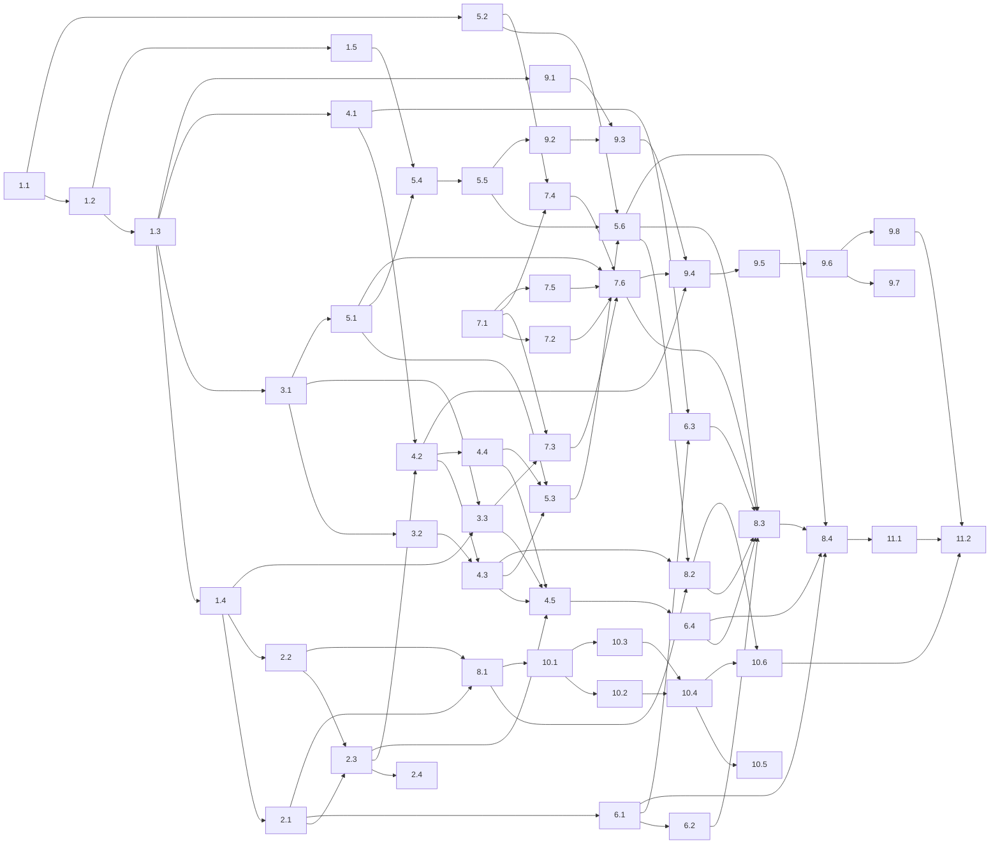

# service-public-slm-fine-tuning - Découpage en epics et stories

## Vue d'ensemble

Ce document découpe le PRD, l'addendum, l'architecture (spine AD-1 à AD-29) et l'UX en epics et stories. `decisions.md` fait autorité ; les règles D1 sont bloquantes.

- **J1 à J3 (PRD §9.3)** : stories détaillées et prêtes au développement (Epics 1 à 11).
- **Jeu d'évaluation maison complet** : piste à part, isolée dans l'Epic 7, qui ne modifie pas `src/`.
- **J4 et J5** : epics seulement (Epics 12 et 13).
- L'ordre de développement de la nuit et les lots parallélisables sont dans la section « Graphe de dépendances et lots parallélisables », en fin de document.
- Les décisions prises seul pour ce découpage sont consignées dans `_bmad-output/implementation-artifacts/journal-decisions-nuit.md` (entrées `D-nuit-A2-n`).

## Inventaire des exigences

### Exigences fonctionnelles

FR-1 : Dialogue en français, réponse token par token, suivi tenant compte des échanges, « Nouvelle conversation » vide le contexte.
FR-2 : Sélection explicite de la Tâche ; chaque Tâche applique son prompt système et son format ; par défaut, Question.
FR-3 : Citation des Sources officielles ; « Ne vaut pas avis juridique » sous chaque réponse Question ; aucune URL inventée (vérifié automatiquement) ; sans source pertinente, le dire et orienter.
FR-4 : Historique local dans le profil Windows, sans synchronisation, suppression immédiate.
FR-5 : Réponse fondée sur les passages de l'Index local, dans les deux Modes, carte réseau désactivée ; extrait dépliable.
FR-6 : Date de constitution de l'Index local dans « À propos » et dans le détail de chaque source.
FR-7 : Recherche de jeux de données (titre, producteur, date, lien) ; appels d'outils générés sous contrainte du schéma JSON, jamais envoyés s'ils sont non conformes ; chaque jeu vient d'une réponse d'outil ou de l'Index.
FR-8 : Interrogation d'une ressource tabulaire en Mode connecté ; valeurs affichées identiques à celles de l'outil ; hors ligne, renvoi au Mode connecté et lien de la ressource.
FR-9 : Repli sur l'Index local si un appel MCP échoue ou dépasse le délai (10 s par défaut, configurable) ; message « non vérifié en ligne ».
FR-10 : Mode courant visible, Mode hors ligne forçable ; sonde `GET /health` < 3 s au démarrage, toutes les 5 min et avant chaque appel d'outil ; doute = hors ligne ; hors ligne forcé = aucune requête.
FR-11 : Liste blanche configurable par fichier, correspondance exacte du nom d'hôte ; hôte hors liste bloqué et journalisé ; liste affichée dans « À propos ».
FR-12 : Vérification en ligne d'une page officielle (secondaire), citée avec sa date de consultation.
FR-13 : Compte rendu structuré (participants, points, décisions, actions avec responsable et échéance) ; entrée ≥ 6 000 mots ; traitement par morceaux puis fusion obligatoire au-delà du contexte.
FR-14 : Courrier type au format administratif ; champ non fourni = emplacement explicite « [Nom de l'usager] », vérifié automatiquement.
FR-15 : Résumé court, moyen ou détaillé ; fidélité et couverture notées par le Juge.
FR-16 : Réécriture en langage clair ; sens, montants, dates, obligations conservés ; gain Kandel-Moles moyen ≥ 10 ; passages non simplifiés signalés.
FR-17 : Correction orthographique, grammaticale et typographique, différences visibles, copie en un clic.
FR-18 : Traduction EN, ES, AR, PT, DE avec la mention « Traduction automatique, à vérifier » ; mesurée par Benchmarks standardisés.
FR-19 : Retour (pouce haut ou bas, commentaire) stocké en local avec Tâche, question, réponse et sources.
FR-20 : Export anonymisé des Retours (NIR, e-mail, téléphone, IBAN, adresse, noms masqués), sans télémétrie.
FR-21 : Installation en un clic sans droits administrateur, Modèle embarqué et Index local inclus, premier lancement hors ligne.
FR-22 : Désinstallation sans droits administrateur, conservation ou suppression de l'historique et des Retours.
FR-23 : « À propos » : versions (application, modèle, index), Liste blanche, licences, avertissement juridique.
FR-24 : Jeu d'évaluation maison figé (225 items), empreinte vérifiée à chaque évaluation, contrôle anti-fuite automatique.
FR-25 : Commande unique d'évaluation d'un modèle (base ou fine-tuné, avant ou après quantification) avec le Harnais complet, contre le Bac à sable MCP ; Juges autorisés ; 20 % exportés pour relecture humaine, scores « non relus » jusqu'à validation.
FR-26 : Mesures techniques selon un protocole fixe : débit, latence au premier token, RAM maximale de l'Assistant complet, taille installée.
FR-27 : Commande unique du socle de Benchmarks standardisés, archivage version, configuration et environnement ; < 2 h pour un 3B en 4 bits sur RTX 3050 ; récupération par script.
FR-28 : Ajout d'un benchmark par configuration, sans modifier l'orchestration.
FR-29 : Génération des Données d'entraînement par un générateur autorisé, budget plafonné, arrêt au plafond, provenance par exemple (générateur, version du prompt, source, date).
FR-30 : Validation et filtrage : rejeu des traces contre le Bac à sable, vérification contre la source, doublons et fuites exclus ; taux de rejet par motif ; échantillon de relecture non bloquant.
FR-31 : Registre des licences ; construction en échec si une source manque ; version diffusée sans source non commerciale ; variante « recherche » marquée.
FR-32 : Runs d'entraînement configurables (modèle, méthode, hyperparamètres) sans code ; méthodes M1 QLoRA, M2 LoRA bf16, M3 DoRA, M4 ORPO ; variantes Unsloth, rsLoRA, PiSSA.
FR-33 : Mesures de coût de chaque Run (durée, débit hors padding après chauffe, VRAM max, énergie, configuration, graine, environnement) ; reprise depuis le dernier checkpoint.
FR-34 : Protocole de comparaison équitable (mêmes données, ordre, chat template, masque) ; vues à tokens vus égaux et à budget de temps égal ; dérogation ORPO documentée.
FR-35 : Fusion 16 bits, conversion, quantification au format de l'Assistant, réévaluation FR-25 et FR-27 ; tool calling re-testé après quantification.
FR-36 : Rapport Comparatif régénérable à l'identique (gain par Tâche, Benchmarks, coûts, recommandation, section méthode et limites).
FR-37 : Publication manuelle sur Hugging Face (fiche modèle, Comparatif), jamais automatique.
FR-38 : Requêtes sortantes limitées aux termes et paramètres formulés par le Harnais ; journal consultable ; un texte collé pour une Tâche de rédaction ne déclenche jamais de Requête sortante (test du document témoin).
FR-39 : Grille du Juge versionnée, livrée et figée avec FR-24 avant la première Baseline.
FR-40 : Bac à sable MCP : réponses enregistrées une fois, versionnées, rejouées à l'identique.

### Exigences non fonctionnelles

NFR-1 : RAM maximale de l'Assistant complet ≤ 5 Go, cible 4 Go, mesurée pendant une génération.
NFR-2 : Débit ≥ 8 tokens/s en génération sur le PC cible.
NFR-3 : Premier token < 5 s pour une Question avec recherche dans l'Index local.
NFR-4 : Confidentialité : seules des Requêtes sortantes conformes à FR-38 quittent le poste.
NFR-5 : Hors ligne : toutes les Tâches fonctionnent sans réseau sauf FR-7 en Mode connecté, FR-8 et FR-12.
NFR-6 : Installation sans droits administrateur, Windows 10/11 x64, taille installée ≤ 4 Go.
NFR-7 : Accessibilité RGAA 4.1 visée ; v1 : clavier complet, contraste ≥ 4,5:1, libellés accessibles.
NFR-8 : Reproductibilité des évaluations, Runs et Comparatif à partir de la configuration versionnée, de la graine et du Bac à sable MCP.
NFR-9 : Robustesse des outils : schéma versionné comparé au serveur ; outil inconnu ignoré ; outil absent ou modifié = repli FR-9 et journal.

### Exigences complémentaires (architecture et décisions)

- **Pas de starter template** : projet greenfield, la story 1.1 crée le squelette (`pyproject.toml` uv, Python 3.12, layout `src/slmsp`, ruff, pytest, `test_architecture`).
- **AD-1** : couches core < 1a (net, budget) < 1b (inference, index, mcp, mistral) < 2 (harness, judge) < 3 (fetch, indexation, evaluation, benchmarks, measure, data, train, compare) < 4 (cli, app) ; imports strictement vers le bas, contrôlés par `tests/test_architecture.py` (AST).
- **AD-2** : la fermeture runtime (core, net, budget, inference, index, mcp, harness, app) n'importe ni torch, transformers, trl, peft, bitsandbytes, unsloth, lm_eval, bfcl_eval, anthropic, mistralai, datasets, duckdb, pyarrow ; extras uv `fetch`, `data`, `judge`, `bench`, `train`, `app` ; Unsloth et bfcl-eval en environnements isolés.
- **AD-3 (D1.1)** : six verrous testés (imports, lectures, requête prouvée, réponse prouvée, amorces, gabarits et verdicts).
- **AD-4** : passerelle réseau unique `slmsp.net`, profils `assistant`, `outillage`, `aucun` ; journal des Requêtes sortantes ; télémétrie tierce coupée ; uploads bannis.
- **AD-5 (D1.6)** : `RegistreBudget` SQLite unique par machine dans `SLMSP_VAR_DIR`, réservation au pire cas, plafonds anthropic 10 €, mistral 30 € (generation 25, juge 5), `max_retries=0`.
- **AD-6** : inférence par `llama-server` géré (tag b11429, binaires cpu et cuda), paramètres par `config/modeles/<slug>.toml`.
- **AD-7** : messages au format OpenAI partout ; `harness.prompts.construire_messages` seule construction de prompt ; rendu par le chat template officiel ; masque de perte `slmsp.train.masque`.
- **AD-8** : 5 outils MCP au plus, schémas figés dans `config/outils-mcp.toml`, validation jsonschema avant envoi.
- **AD-9** : Index local = `vectors.f16.npy` (memmap) + `chunks.sqlite` + `MANIFEST.json` ; vecteurs MediaTech jamais recalculés ; requête BGE-M3 GGUF Q8_0 ; recherche exacte.
- **AD-10** : cassettes au format du calibrage + `tools_list_sha256` + `simulation` ; appariement fixé ; magasins `eval` et `data` séparés ; une seule API `mcp.enregistrer`.
- **AD-11** : lecteur unique `slmsp.core.items` (adaptation du calibrage à la lecture), `slmsp eval gel` seul producteur du manifeste, contrôle à chaque évaluation et avant génération.
- **AD-12** : Juge `claude-opus-5-5` sans `temperature`, Batch API, cache de verdicts ; second juge Mistral `temperature=0` ; `Verdict` commun ; kappa dans `evaluation.scores`.
- **AD-13** : évaluation en deux runs (génération, notation), sans réseau, `ModeleRef` `base:`/`ft:`.
- **AD-14** : `AssistantService` sans état, flux d'évènements typés, table des Tâches `config/taches.toml`.
- **AD-15** : protocole unique de mesure (RAM arbre de processus 100 ms, binaire CPU, exclusivité).
- **AD-16** : Benchmarks déclaratifs (`config/benchmarks/*.toml`), QCM sur poids HF avant quantification, génératif contre `llama-server`.
- **AD-17** : pipeline de données `seed → generate → validate → filter → build`, préalables de `generate`, jeu immuable `data/train/vN/`.
- **AD-18** : un Run = un TOML ; méthode = donnée ; contraintes vérifiées au chargement ; `save_total_limit` jamais défini.
- **AD-19** : export (fusion 16 bits, GGUF F16 conservé, Q4_K_M du même tag, chat template du tokenizer) puis réévaluation.
- **AD-20** : Comparatif = fonction pure des artefacts, régénération à l'octet près.
- **AD-21** : `runs/<type>/<run_id>/`, `run.json`, aucune suppression ni réécriture, `.gitignore` ciblé.
- **AD-22** : configuration TOML + pydantic sous `config/` ; secrets par `dotenv_values`, jamais dans `os.environ` ni dans un artefact.
- **AD-23** : frontière de l'application J4 (esquisse).
- **AD-24** : entrées autorisées de `data` et `train` via `core.artefacts.lire`.
- **AD-25** : schémas d'artefacts partagés dans `slmsp.core.schemas`, `schema_version`, statuts dont `degrade`.
- **AD-26** : reprise `--reprendre` en ajout seul, réservations orphelines régularisées, réponses déjà payées réutilisées.
- **AD-27** : verrou GPU, Job Object `KILL_ON_JOB_CLOSE`, registre des PID, SQLite WAL + `busy_timeout`.
- **AD-28** : `slmsp fetch` seul téléchargeur, révisions épinglées, `models/<slug>/{hf,hf-bf16,gguf}`, torch depuis l'index PyTorch CUDA explicite, `gguf` depuis le tag llama.cpp.
- **AD-29** : Scores de Tâche calculés dans le seul `evaluation.scores` ; fonctions de texte dans `core.texte`.
- **Hypothèses à mesurer** : H-RAM, H-VEC, H-EMB, H-TOOLS, H-MASQUE, H-JUGE-COUT, H-BATCH, H-SOCLE-2H, H-WIN-TRAIN (chacune portée par une story ci-dessous).
- **Épinglages** : Python 3.12, llama.cpp b11429, mcp 2.3.0, transformers 5.17.0, trl 1.13.0, peft 0.21.2, torch 2.14.1 (index CUDA), lm-eval 0.4.13, bfcl-eval 2026.3.23 (isolé), unsloth 2026.10.3 (isolé), anthropic 1.13.0, mistralai 3.2.0, pytest 9.1.1, ruff 0.17.0 (tableau Stack du spine).
- **Conventions** : identifiants de Tâche Q, RD, CR, LC, CO, RE, CT, NR ; slugs `granite-4.0-1b`, `ministral-3-3b`, `smollm3-3b`, `qwen-4b`, `ministral-3-8b` ; JSONL UTF-8 LF ; JSON canonique ; erreurs sous `SlmspError` ; codes de sortie 0 à 5 ; marqueurs pytest `reseau`, `gpu`, `lent` exclus par défaut.

### Exigences de design UX

Elles portent sur l'application J4 et J5 (Epics 12 et 13). Aucune story de la nuit ne les implémente.

UX-DR1 : Tokens de `DESIGN.md` (couleurs, typographie en rem, espacements base 4, rayons, ombres) déclarés en variables CSS ; vert jamais en texte ; jaune et rouge seulement en icônes et bordures.
UX-DR2 : Disposition trois colonnes et barre supérieure ; panneau Sources qui pousse (≥ 1 280 px) ou recouvre (1 024 à 1 279 px) ; volets de rédaction empilés sous 1 200 px ; fenêtre minimale 1 024 × 640.
UX-DR3 : Navigation des Tâches (`task-nav-item`), section « Plus » repliable et mémorisée, Tâche active annoncée au lecteur d'écran, travail en cours conservé par Tâche pendant la session.
UX-DR4 : Zone de saisie (`composer`) : Entrée envoie, Maj+Entrée nouvelle ligne, Envoyer inactif si vide, « Arrêter » pendant la génération, rappel sur les données personnelles dans le champ vide.
UX-DR5 : Réponse au fil de l'eau, puces et actions affichées en fin de génération, « Réponse interrompue », « Régénérer » remplace sur place, `legal-notice` sous les réponses Question seulement.
UX-DR6 : Puces de citation (`citation-chip`) et panneau Sources (`source-card` : origine, date, extrait dépliable, « Ouvrir » ; hors ligne, « Lien copié… ») ; réponse sélectionnée ; fermeture par Échap ou ×.
UX-DR7 : Indicateur de Mode (pastille, menu à trois éléments, « Hors ligne (choisi) » persistant, annonce unique du changement).
UX-DR8 : Journal des Requêtes sortantes (`dialog`, colonnes Heure, Hôte, Termes, Statut ; état vide ; 30 jours glissants ; « Effacer le journal »).
UX-DR9 : Carte de jeu de données (`dataset-card`) ; tableau (`data-table`) plafonné à 50 lignes, mention d'extrait, pied sourcé, « Copier le tableau » en texte tabulé.
UX-DR10 : Vue de rédaction (`editor-pane`) : compteur de mots, un seul bouton principal visible, Résultat au fil de l'eau, « Copier » copie le texte brut final.
UX-DR11 : Barre d'actions du Résultat (Copier, Régénérer, Affiner, Retour) ; `inline-confirmation` effacée après 3 s, sans toast.
UX-DR12 : Passages signalés en Langage clair (`flagged-passage`, infobulle au survol et au focus).
UX-DR13 : Différences de Correction (`diff-insert`, `diff-delete`), lisibles sans la couleur.
UX-DR14 : Formulaire Courrier type et emplacements (`letter-placeholder`).
UX-DR15 : Sélecteur de langue de Traduction, volet arabe en RTL, mention « Traduction automatique, à vérifier avant envoi ».
UX-DR16 : Retour : pouce haut immédiat, pouce bas avec champ facultatif, confirmation discrète.
UX-DR17 : Historique groupé par jour, titres automatiques, « Supprimer » sans confirmation avec « Annuler » 5 s, état vide.
UX-DR18 : Paramètres (`dialog` à trois onglets Général, Retours, À propos) ; taille du texte en cinq crans (100 à 150 %), Ctrl+/Ctrl−/Ctrl 0 ; « Effacer tout l'historique » annulable.
UX-DR19 : États : bienvenue au premier lancement, « Préparation de l'assistant… », Question vide avec trois exemples, génération en cours, aucune source, hors ligne, repli data.gouv (`callout-warning` + « Réessayer »), valeurs hors ligne, entrée trop longue (« Partie i sur n »), erreur interne (`callout-danger`), aperçu d'export des Retours avec [masqué].
UX-DR20 : Raccourcis clavier (Entrée, Maj+Entrée, Ctrl+N, Ctrl+1 à 4, Ctrl+Maj+C, Échap, Ctrl+/−/0).
UX-DR21 : Accessibilité : ordre de tabulation fixé, focus visible (anneau violet 2 px), `aria-live` poli en fin de génération, puces lues « Source n : titre », information jamais portée par la seule couleur, 150 % sans défilement horizontal à 1 024 × 640, « Réduire les animations » respecté.
UX-DR22 : Voix et ton : vouvoiement, aucun jargon d'IA, mentions fixes (transparence, données personnelles, avertissement juridique).
UX-DR23 : Plateforme Windows : instance unique, taille et position mémorisées, raccourci du menu Démarrer, installateur en trois écrans sans droits administrateur, case « Lancer l'assistant », désinstallation à une question.
UX-DR24 : « Vérifier en ligne » (FR-12, J5) : bouton secondaire en Mode connecté, encart « concordant » ou « Différence relevée », page ajoutée aux sources.

### Carte de couverture des FR

FR-1 : Epic 4 (service sans état, conversation détenue par l'appelant, `slmsp ask --conversation`) ; Epic 12 (interface).
FR-2 : Epic 4 (table des Tâches, `--tache`) ; Epic 12 (navigation).
FR-3 : Epic 4 (citations, avertissement, absence de source) ; Epic 5 (contrôle URL inventées au banc).
FR-4 : Epic 12.
FR-5 : Epic 2 (Index local) ; Epic 4 (réponse fondée).
FR-6 : Epic 2 (date du snapshot dans le manifeste) ; Epic 4 (affichée par la CLI) ; Epic 12 (À propos).
FR-7 : Epic 3 (schémas figés, validation) ; Epic 4 (boucle d'outils).
FR-8 : Epic 4 (tableaux rendus depuis `ResultatOutil`).
FR-9 : Epic 3 (exceptions de délai et d'erreur) ; Epic 4 (repli).
FR-10 : Epic 1 (refus réseau selon le Mode) ; Epic 4 (`ModeSonde`, `ModeFixe`) ; Epic 12 (indicateur).
FR-11 : Epic 1 (Liste blanche, correspondance exacte, journal) ; Epic 12 (affichage).
FR-12 : Epic 13.
FR-13 : Epic 4 (découpage et fusion) ; Epic 12 (vue de rédaction).
FR-14 : Epic 4 (Tâche CT au Harnais, évaluée au banc) ; Epic 13 (formulaire de l'application).
FR-15 : Epic 4 (Tâche RE) ; Epic 13.
FR-16 : Epic 4 (Tâche LC) ; Epic 5 (Kandel-Moles) ; Epic 12.
FR-17 : Epic 4 (Tâche CO) ; Epic 13.
FR-18 : Epic 6 (Benchmarks de traduction) ; Epic 13 (Tâche et vue).
FR-19 : Epic 12.
FR-20 : Epic 12.
FR-21 : Epic 12.
FR-22 : Epic 12.
FR-23 : Epic 12.
FR-24 : Epic 5 (lecteur, gel, contrôle, anti-fuite) ; Epic 7 (construction et gel du jeu complet).
FR-25 : Epic 5 (banc en deux phases, Juges, relecture) ; Epic 8 (Baseline).
FR-26 : Epic 6 (mesures) ; Epic 8 (mesures par candidat).
FR-27 : Epic 6 ; Epic 8.
FR-28 : Epic 6.
FR-29 : Epic 9.
FR-30 : Epic 9.
FR-31 : Epic 9.
FR-32 : Epic 10 ; Epic 11 (essai M1).
FR-33 : Epic 10.
FR-34 : Epic 10 (invariants de campagne, masque) ; Epic 9 (paires ORPO) ; Epic 11 (deux vues).
FR-35 : Epic 10 (export) ; Epic 11 (réévaluation de l'essai).
FR-36 : Epic 11 (et socle de chargement en Epic 8).
FR-37 : Epic 13 (hors nuit, D1.4).
FR-38 : Epic 1 (journal) ; Epic 4 (Tâches de rédaction sans outil, test du document témoin) ; Epic 12 (affichage).
FR-39 : Epic 5 (grille lue par le Juge, SHA au manifeste) ; Epic 7 (gel avec la grille).
FR-40 : Epic 3 (cassettes, rejeu) ; Epic 7 (cassettes du jeu complet).

## Liste des epics

### Epic 1 : Socle outillé et garde-fous vérifiés par le code
Anaël dispose d'un projet installable par `uv` où les garde-fous de la nuit sont du code testé : couches d'import, passerelle réseau unique, budget persistant avec arrêt au plafond, artefacts immuables.
**FRs couvertes :** FR-10 (refus selon le Mode), FR-11, FR-38 (journal). **NFR :** NFR-4, NFR-5, NFR-8. **AD :** AD-1, AD-2, AD-3 (verrou 1), AD-4, AD-5, AD-21, AD-22, AD-24, AD-25, AD-26, AD-27.

### Epic 2 : Moteurs locaux : modèles servis et Index local interrogeable
Anaël peut télécharger de façon épinglée llama.cpp, le corpus MediaTech et BGE-M3, lancer `llama-server` proprement sous Windows et interroger un Index local daté, avec les hypothèses H-VEC et H-EMB mesurées.
**FRs couvertes :** FR-5, FR-6. **NFR :** NFR-1, NFR-3. **AD :** AD-6, AD-9, AD-27, AD-28.

### Epic 3 : Outils data.gouv : client MCP et Bac à sable rejouable
Le Harnais peut appeler les 5 outils data.gouv validés par schéma, en direct ou en rejeu de cassettes, avec des pannes simulables.
**FRs couvertes :** FR-7, FR-9, FR-40. **NFR :** NFR-9. **AD :** AD-8, AD-10.

### Epic 4 : Harnais en ligne de commande
Anaël pose une question, cherche des données ou fait rédiger un compte rendu depuis la ligne de commande, avec sources citées, Modes, repli et journal des Requêtes sortantes.
**FRs couvertes :** FR-1, FR-2, FR-3, FR-5, FR-7, FR-8, FR-9, FR-10, FR-13, FR-14, FR-15, FR-16, FR-17, FR-38. **NFR :** NFR-4, NFR-5. **AD :** AD-7, AD-14.

### Epic 5 : Banc d'évaluation reproductible
Une commande unique évalue un modèle sur le Jeu d'évaluation maison, sans réseau, avec Juge Claude, second juge Mistral sur 20 %, Scores de Tâche et export de relecture.
**FRs couvertes :** FR-3 (contrôle), FR-16 (Kandel-Moles), FR-24, FR-25, FR-39, FR-40. **NFR :** NFR-8. **AD :** AD-11, AD-12, AD-13, AD-29.

### Epic 6 : Benchmarks standardisés et mesures techniques
Une commande exécute le socle de Benchmarks déclaratif ; une autre mesure RAM, débit, latence et taille selon un protocole unique.
**FRs couvertes :** FR-18 (mesure), FR-26, FR-27, FR-28. **NFR :** NFR-1, NFR-2, NFR-3, NFR-6. **AD :** AD-15, AD-16.

### Epic 7 : Jeu d'évaluation maison complet v1.0-provisoire (piste à part)
Le Jeu d'évaluation maison de 225 items est construit sur sources réelles, doublement vérifié et gelé avec un manifeste SHA-256 et un commit dédié. Cette piste ne modifie pas `src/` : elle utilise un outil dédié sous `eval/outils/` et les commandes `slmsp mcp record` et `slmsp eval gel`.
**FRs couvertes :** FR-24, FR-39, FR-40. **Règles :** D1.3, SPEC §2 à §6.

### Epic 8 : Modèles candidats et Baseline
Anaël dispose des Modèles de base candidats préparés, de la Baseline de chacun (Jeu maison, Benchmarks, mesures) et d'un rapport qui prépare sa décision go/no-go.
**FRs couvertes :** FR-25, FR-26, FR-27 (exécution) ; FR-36 (socle de chargement des artefacts). **AD :** AD-13, AD-28. **Règles :** D4, D7.

### Epic 9 : Données d'entraînement prouvées
Anaël dispose d'un jeu d'entraînement versionné, généré par Mistral seul, validé, filtré, sans fuite du Jeu d'évaluation, tracé au Registre des licences, dont la provenance est re-dérivable octet par octet.
**FRs couvertes :** FR-29, FR-30, FR-31, FR-34 (paires ORPO). **AD :** AD-3, AD-5, AD-17, AD-24. **Règles :** D1.1, D1.2, D1.3.

### Epic 10 : Runs d'entraînement et export GGUF
Anaël lance un Run d'entraînement par configuration, avec coûts mesurés et reprise, puis exporte le Modèle fine-tuné en GGUF réévaluable.
**FRs couvertes :** FR-32, FR-33, FR-34, FR-35. **AD :** AD-7, AD-18, AD-19, AD-24, AD-27.

### Epic 11 : Comparatif et essai de fine-tuning de la nuit
Anaël dispose d'un Comparatif régénérable et du mini-rapport de l'essai M1 QLoRA (gain par Tâche, non-régression, coûts, limites).
**FRs couvertes :** FR-32 (essai), FR-34 (vues), FR-35 (réévaluation), FR-36. **AD :** AD-20.

### Epic 12 : Application Windows de l'Agent (J4, epic seulement)
Un Agent installe l'Assistant sans droits administrateur et l'utilise hors ligne pour les Tâches prioritaires, avec Modes, Liste blanche, journal, historique et Retours.
**FRs couvertes :** FR-1, FR-2, FR-4, FR-6, FR-10, FR-11, FR-13, FR-16, FR-19, FR-20, FR-21, FR-22, FR-23, FR-38 (interface). **NFR :** NFR-1, NFR-6, NFR-7. **UX-DR :** UX-DR1 à UX-DR23.

### Epic 13 : Tâches secondaires dans l'application, vérification en ligne et publication (J5, epic seulement)
L'Agent dispose des vues Correction, Résumé, Courrier type et Traduction, et de « Vérifier en ligne » ; Anaël publie manuellement le Modèle embarqué et le Comparatif.
**FRs couvertes :** FR-12, FR-14, FR-15, FR-17, FR-18, FR-37. **UX-DR :** UX-DR12 à UX-DR15, UX-DR24.

## Conventions communes à toutes les stories (définition de « terminé »)

Ces règles s'appliquent à chaque story ; elles ne sont pas répétées dans les critères.

1. **Qualité.** `uv run ruff check`, `uv run ruff format --check` et `uv run pytest` passent. Les marqueurs `reseau`, `gpu` et `lent` sont exclus par défaut ; quand une story les utilise, elle exécute aussi ces tests au moins une fois et consigne le résultat dans son compte rendu.
2. **Aucune API payante dans les tests**, même marqués `reseau`. Les clients Anthropic et Mistral sont testés avec un transport factice injecté par `slmsp.net` (`httpx.MockTransport` ou équivalent) et des réponses JSON factices.
3. **Réseau dans les tests.** Une garde (`tests/conftest.py`) fait échouer toute connexion hors boucle locale. Les accès réels (Hugging Face, data.gouv) sont marqués `reseau` et restent dans la liste D1.5.
4. **D1.1.** Aucun test, aucune fixture et aucun fichier du dépôt ne contient d'exemple d'entraînement rédigé. Les réponses Mistral factices et les données d'entraînement de test sont des chaînes ou des tokens aléatoires produits par le code de test dans `tmp_path` (AD-24, D-nuit-A2-19).
5. **Propriété des fichiers.** Une story ne modifie que les fichiers listés dans sa rubrique « Fichiers et modules ». Les sous-commandes CLI vivent dans `src/slmsp/cli/<commande>.py`, un module par commande, déclaré d'avance par la story 1.1 (D-nuit-A2-6). Les schémas d'artefacts vivent dans `src/slmsp/core/schemas/<nom>.py`, un module par schéma, créé par la première story qui en a besoin (D-nuit-A2-7).
6. **Tests miroir.** Les tests d'un paquet `slmsp.
` sont sous `tests/
/`.
7. **Configuration.** Toute valeur réglable est dans un TOML de `config/`, validé par un modèle pydantic défini dans le paquet propriétaire (`<paquet>/config.py`), sauf les schémas partagés de `core/schemas/`.
8. **Commit.** Un commit local par story terminée : `feat(<epic>): <story> (story X.Y)` avec la ligne d'attribution. Pas de push.
9. **Blocage.** Après deux tentatives infructueuses sur un même problème : consigner dans le journal, contourner (stub, mock, fixture) en marquant les résultats `degrade` (AD-25), puis passer à la suite (D5).

## Epic 1 : Socle outillé et garde-fous vérifiés par le code

Le projet est greenfield. Cet epic pose le squelette et transforme les règles bloquantes de la nuit (D1.1 verrou 1, D1.4, D1.5, D1.6, D1.7) en code testé, avant tout appel réseau ou payant. C'est une exception assumée au principe « un epic = une valeur utilisateur » : la valeur pour Anaël est un projet dont les garde-fous ne dépendent pas de la discipline des agents.

### Story 1.1 : Squelette du projet et outillage

En tant qu'Anaël, porteur du projet,
je veux un squelette `uv` / Python 3.12 avec ruff, pytest et un test d'architecture AST,
afin que chaque story suivante démarre sur un projet installable dont les couches et les imports interdits sont vérifiés automatiquement.

**Couvre :** NFR-8 ; AD-1, AD-2, AD-3 (verrou 1), AD-4 (bannissements), AD-21 (`.gitignore`), AD-22 (`.env.example`), AD-24 (test AST), AD-28 (index CUDA) ; D2, D3 ; D-nuit-A1-1, A1-15, A1-17, A1-25.

**Fichiers et modules :**
- `pyproject.toml`, `uv.lock`, `.python-version`, `.gitignore`, `.env.example`
- `src/slmsp/__init__.py`, `src/slmsp/__main__.py`
- `src/slmsp/{core,net,budget,inference,index,mcp,mistral,harness,judge,fetch,indexation,evaluation,benchmarks,measure,data,train,compare,app}/__init__.py` (vides)
- `src/slmsp/cli/__init__.py` (point d'entrée `main`, registre des sous-commandes)
- `tests/conftest.py`, `tests/test_architecture.py`, `tests/test_cli.py`, `tests/test_gitignore.py`

**Dépendances :** aucune.

**Critères d'acceptation :**
1. **Étant donné** un poste Windows avec uv 0.12.x, **quand** on lance `uv sync --python 3.12`, **alors** l'environnement du projet est créé sans les extras **et** `uv run slmsp --help` liste les sous-commandes `fetch`, `index`, `ask`, `mcp`, `eval`, `bench`, `measure`, `data`, `train`, `export`, `compare`, `budget`.
2. **Étant donné** le registre de `slmsp/cli/__init__.py`, **quand** une sous-commande dont le module `slmsp/cli/<commande>.py` n'existe pas encore est appelée, **alors** la CLI affiche « commande non implémentée » et sort avec le code 2 ; chaque module, une fois créé, expose `enregistrer(sous_parseurs)` et est chargé sans modifier `__init__.py`.
3. **Étant donné** `pyproject.toml`, **quand** on le lit, **alors** `requires-python = "==3.12.*"`, le socle runtime déclare numpy, pydantic, jsonschema, psutil, nvidia-ml-py, python-dotenv et mcp aux versions du tableau Stack, **et** les extras `fetch`, `data`, `judge`, `bench`, `train`, `app` sont déclarés selon AD-2, **et** torch est tiré d'un index PyTorch CUDA déclaré dans `[tool.uv.index]` avec `explicit = true` et relié par `[tool.uv.sources]` ; l'index CUDA retenu (cu130, sinon cu128 ; roue cp312 win_amd64 de torch 2.14.1) est consigné dans le journal ; `uv lock` réussit.
4. **Étant donné** la configuration ruff, **quand** on lance `uv run ruff check`, **alors** la règle `TID251` bannit `anthropic` hors de `src/slmsp/judge/**`, `mistralai` hors de `src/slmsp/mistral/**`, `httpx`, `httpx2`, `requests` et `urllib.request` hors de `src/slmsp/net/**`, ainsi que les fonctions d'upload de `huggingface_hub` et `push_to_hub` partout ; `eval/calibrage/build_calibrage.py` et `eval/outils/` sont exclus ; le dépôt passe `ruff check` et `ruff format --check`.
5. **Étant donné** la configuration pytest, **quand** on lance `uv run pytest`, **alors** les marqueurs `reseau`, `gpu` et `lent` sont déclarés et exclus par défaut, **et** une fixture automatique de `conftest.py` fait échouer tout `socket.connect` vers une adresse autre que la boucle locale, **et** pointe `SLMSP_VAR_DIR` vers un dossier temporaire.
6. **Étant donné** `tests/test_architecture.py`, **quand** il parcourt l'AST de chaque module de `src/slmsp`, **alors** il échoue sur : un import vers une couche égale ou supérieure (table des couches d'AD-1, `cli` et `app` en couche 4) ; un import d'une bibliothèque lourde d'AD-2 dans la fermeture runtime (calculée transitivement à partir de core, net, budget, inference, index, mcp, harness, app) ; un import d'`anthropic` hors `judge` ; un import de `slmsp.judge` depuis `data` ou `train` ; un import d'un client HTTP hors `net` ; un appel à `open`, `Path.read_text`, `Path.read_bytes` ou `json.load` dans `data` ou `train` ailleurs que via `slmsp.core.artefacts`.
7. **Étant donné** des modules synthétiques écrits dans `tmp_path`, **quand** le test d'architecture les analyse, **alors** chaque règle du critère 6 détecte sa violation (test paramétré, une violation par règle).
8. **Étant donné** le `.gitignore`, **quand** on interroge `git check-ignore`, **alors** `index/`, `var/`, `vendor/`, `models/`, `data/raw/`, `data/train/v1/train.jsonl`, `runs/train/x/checkpoints/a`, `runs/train/x/adaptateur/a`, `a.gguf`, `a.safetensors` et `.env` sont ignorés, **et** `runs/eval-notation/x/run.json`, `runs/eval-notation/x/scores.json`, `runs/eval-notation/x/verdicts.jsonl`, `data/train/v1/MANIFEST.json`, `data/registre-licences.toml` et `.env.example` ne le sont pas ; les anciennes règles `runs/` et `checkpoints/` en bloc ont disparu.
9. **Étant donné** `.env.example`, **quand** on le lit, **alors** il contient `MISTRAL_API_KEY=`, `ANTHROPIC_API_KEY=` et `HF_TOKEN=` sans valeur, et `SLMSP_VAR_DIR` en commentaire.
10. **Étant donné** la CLI, **quand** elle démarre, **alors** `sys.stdout` est reconfiguré en UTF-8 et les codes de sortie (0 succès, 1 erreur, 2 usage, 3 budget épuisé, 4 manifeste invalide, 5 ressource occupée) sont des constantes nommées.

**Stratégie de test :** pytest seul, sans réseau. `test_architecture.py` (AST via `ast.parse`, sans importer les modules) avec auto-test sur modules synthétiques ; `test_cli.py` appelle `main([...])` en processus ; `test_gitignore.py` lance `git check-ignore` en sous-processus sur des chemins fictifs.

### Story 1.2 : Noyau : configuration, secrets, erreurs, JSON canonique et ressources partagées

En tant qu'Anaël,
je veux un chargement de configuration validé, des secrets jamais exposés, une hiérarchie d'erreurs unique et des primitives partagées (JSON canonique, `SLMSP_VAR_DIR`, SQLite, verrou GPU),
afin qu'aucune valeur ne soit codée en dur et que les ressources de la machine soient partagées sans conflit.

**Couvre :** AD-22, AD-27 (verrou GPU, SQLite), AD-4 (environnement imposé), conventions « Erreurs » et « Fichiers de données » ; D2 (secrets) ; D-nuit-A1-20, D-nuit-A2-8.

**Fichiers et modules :**
- `src/slmsp/core/config.py`, `src/slmsp/core/secrets.py`, `src/slmsp/core/erreurs.py`, `src/slmsp/core/canonique.py`, `src/slmsp/core/var.py`
- `src/slmsp/cli/__init__.py` (correspondance `SlmspError` → code de sortie, environnement imposé au démarrage)
- `tests/core/test_config.py`, `test_secrets.py`, `test_erreurs.py`, `test_canonique.py`, `test_var.py`

**Dépendances :** 1.1.

**Critères d'acceptation :**
1. **Étant donné** un fichier TOML de `config/` et un modèle pydantic, **quand** on appelle `charger_toml(chemin, Modele)`, **alors** le contenu est lu par `tomllib` et validé avec `extra="forbid"` ; une clé inconnue ou un type faux lève une erreur qui cite le fichier et la clé.
2. **Étant donné** un `.env` contenant `MISTRAL_API_KEY`, **quand** on appelle `secret("MISTRAL_API_KEY")`, **alors** la valeur vient de `dotenv_values`, `os.environ` n'est pas modifié et la valeur est un `SecretStr` dont le `repr` est masqué ; une clé absente lève une erreur explicite qui ne cite aucune valeur.
3. **Étant donné** l'environnement courant, **quand** on appelle `env_sous_processus()`, **alors** le dictionnaire retourné ne contient aucune variable `*_API_KEY` ni `HF_TOKEN`, et contient `HF_HUB_DISABLE_TELEMETRY=1`, `WANDB_MODE=disabled`, `DO_NOT_TRACK=1` et `HF_HOME` pointant sur `models/.cache-hf` en chemin absolu ; `appliquer_environnement_impose()` pose les trois variables de télémétrie dans le processus au démarrage de la CLI.
4. **Étant donné** `core/erreurs.py`, **quand** on l'importe, **alors** il définit `SlmspError` et ses sous-classes `BudgetEpuise` (3), `ManifesteInvalide` (4), `RessourceOccupee` (5), `HoteBloque`, `AppelNonConforme`, `SchemaOutilModifie`, `SourceSansLicence`, `ProvenanceInvalide`, `LectureInterdite`, `TarifInconnu` (1), chacune avec son `code_sortie` ; la CLI convertit toute `SlmspError` non rattrapée en ce code, avec un message sans trace technique.
5. **Étant donné** un objet Python, **quand** on appelle `json_canonique(obj)`, **alors** les clés sont triées, les séparateurs compacts, `ensure_ascii=False`, et le résultat est en octets UTF-8 ; `sha256_hex` renvoie l'empreinte en hexadécimal minuscule ; `sha256_fichier` lit en flux.
6. **Étant donné** `SLMSP_VAR_DIR` absent, **quand** on appelle `dossier_var()`, **alors** le chemin vaut `%LOCALAPPDATA%\slmsp\var\` et il est créé ; aucune fonction du module ne supprime un fichier.
7. **Étant donné** une base SQLite, **quand** on l'ouvre par `ouvrir_sqlite(chemin)`, **alors** elle est en mode WAL avec un `busy_timeout` de 30 000 ms.
8. **Étant donné** un premier processus qui détient `verrou_gpu()`, **quand** un second le demande sans attente, **alors** il reçoit `RessourceOccupee` (code 5) avec le PID et la commande du détenteur ; avec attente, il obtient le verrou à la libération ; un verrou dont le PID est mort est récupéré.

**Stratégie de test :** pytest, `tmp_path`, `monkeypatch` des variables d'environnement ; test du verrou GPU avec deux processus `multiprocessing` ; aucun réseau.

### Story 1.3 : Noyau : runs immuables, lecteur contrôlé, ports, messages et évènements

En tant qu'Anaël,
je veux que chaque exécution écrive un dossier de run immuable décrit par `run.json`, que les lectures des pipelines sensibles passent par un point de contrôle et que les ports du Harnais soient définis,
afin que tout résultat soit rattaché à sa configuration, que rien ne soit écrasé et que les adaptateurs restent interchangeables.

**Couvre :** NFR-8 ; AD-1 (ports), AD-7 (messages), AD-14 (évènements), AD-21, AD-24, AD-25, AD-26 ; D1.7 ; D-nuit-A2-7, A2-18.

**Fichiers et modules :**
- `src/slmsp/core/schemas/__init__.py` (base `SchemaBase` avec `schema_version`, sans réexport)
- `src/slmsp/core/schemas/run.py` (`RunManifest`, statuts), `src/slmsp/core/schemas/config_modele.py` (`ConfigModele`), `src/slmsp/core/schemas/config_llamacpp.py` (`ConfigLlamacpp`)
- `src/slmsp/core/artefacts.py`, `src/slmsp/core/ports.py`, `src/slmsp/core/messages.py`, `src/slmsp/core/evenements.py`
- `tests/core/test_artefacts.py`, `test_lecteur.py`, `test_messages.py`, `test_evenements.py`, `test_schemas_run.py`

**Dépendances :** 1.2.

**Critères d'acceptation :**
1. **Étant donné** un type et un slug, **quand** on appelle `nouveau_run(type, slug, config, parents, entrees, graine)`, **alors** le dossier `runs/<type>/<run_id>/` est créé avec un `run_id` conforme à `^\d{8}-\d{6}-[a-z0-9.-]+-[0-9a-f]{4}$`, et `run.json` est valide pour `RunManifest` : `type`, `run_id`, `parents`, `modele_ref`, `quantification`, `variante_llamacpp`, `jeu_version`, `index_version`, `statut = en_cours`, `couverture`, config résolue, graine, empreinte de l'environnement (OS, CPU, GPU et pilote via NVML s'il est présent, CUDA, versions des paquets, commit git et indicateur de modifications non commitées) et SHA-256 des entrées.
2. **Étant donné** un fichier déjà écrit dans un run, **quand** on tente de l'écrire à nouveau, **alors** une erreur est levée ; `ajouter_jsonl` n'ouvre qu'en ajout ; aucune fonction du module ne supprime ni ne tronque un fichier.
3. **Étant donné** un run, **quand** on appelle `terminer(statut)`, **alors** `statut` ∈ {`complet`, `partiel-budget`, `partiel-erreur`, `interrompu`, `degrade`} est inscrit en ajout dans `etat.jsonl` sans réécrire `run.json` ; le statut courant est la dernière ligne de ce fichier.
4. **Étant donné** un run interrompu, **quand** on appelle `reprendre(run_id)`, **alors** le statut repasse à `en_cours`, les lignes déjà présentes sont conservées et la fonction renvoie l'ensemble des clés déjà traitées.
5. **Étant donné** `lire(chemin, lecteur="data")`, **quand** le chemin résolu (liens et `..` résolus) est hors de `data/raw/`, `data/cassettes/`, `runs/data-*`, `config/prompts/`, `config/outils-mcp.toml`, `data/registre-licences.toml`, `index/` ou du journal `appels-mistral.sqlite` de `SLMSP_VAR_DIR`, **alors** `LectureInterdite` est levée ; en particulier `eval/**`, `runs/eval-*` et le cache des verdicts sont refusés.
6. **Étant donné** `lire(chemin, lecteur="train")`, **quand** le chemin est hors de `data/train/`, `models/` et du journal `appels-mistral.sqlite` (lecture seule, pour le recontrôle des `appel_ids`), **alors** `LectureInterdite` est levée.
7. **Étant donné** une écriture prévue de plus de 1 Go, **quand** on appelle `verifier_espace(chemin, octets)`, **alors** une erreur explicite est levée si l'espace libre est sous le seuil configuré.
8. **Étant donné** `core/ports.py`, **quand** on l'importe, **alors** il définit les protocoles `LlmPort` (`generer` en flux avec `tools` et options, `compter_tokens`), `EmbedderPort`, `VectorStore`, `ToolPort`, `NetGate`, `ModePort` et `JournalRequetes`.
9. **Étant donné** une conversation, **quand** on appelle `valider_conversation(messages)`, **alors** seuls les rôles `system`, `user`, `assistant` et `tool` sont acceptés, `tool_calls` est structuré (`id`, `type = function`, `function.name`, `function.arguments` en JSON) et tout message `tool` porte un `tool_call_id` existant.
10. **Étant donné** `core/evenements.py`, **quand** on sérialise un évènement (`Jeton`, `AppelOutil`, `ResultatOutil`, `AppelNonConforme`, `Sources`, `Avertissement`, `Progression`, `Repli`, `Fin`, `Erreur`), **alors** on obtient un dict JSON stable et l'aller-retour reconstruit l'évènement.
11. **Étant donné** `ConfigModele` et `ConfigLlamacpp`, **quand** on valide un TOML de test, **alors** les champs d'AD-6 et d'AD-28 sont présents : `depot_hf`, `revision`, fichiers, GGUF et SHA-256, contexte, cache KV, threads, `reasoning`, `chat_template_kwargs`, `protocole_outils` ∈ {`natif`, `json-generique`}, `exclure_vision`, `chat_template_force` ; tag, assets, SHA des binaires et des sources.

**Stratégie de test :** pytest ; racine de projet factice dans `tmp_path` avec `git init` pour le commit et l'indicateur de modifications ; tests de traversée de chemin (`..`, lien symbolique, sauté si Windows refuse sa création) ; aucun réseau.

### Story 1.4 : Passerelle réseau unique (profils, Liste blanche, journal des Requêtes sortantes)

En tant qu'Anaël et en tant que DSI,
je veux que toute requête HTTP passe par une fabrique unique qui applique un profil, la Liste blanche, le Mode et la journalisation,
afin qu'aucun hôte non autorisé ne soit contacté, qu'aucune requête ne parte en Mode hors ligne forcé et que chaque Requête sortante soit consultable.

**Couvre :** FR-10 (refus hors ligne), FR-11, FR-38 (journal), NFR-4, NFR-5 ; AD-4 ; D1.4, D1.5 ; D-nuit-A1-7, A1-17, D-nuit-A2-10.

**Fichiers et modules :**
- `src/slmsp/net/profils.py`, `src/slmsp/net/client.py`, `src/slmsp/net/transport.py`, `src/slmsp/net/journal.py`, `src/slmsp/net/config.py`
- `src/slmsp/core/schemas/journal_requetes.py` (`EntreeJournalRequetes`)
- `config/reseau.toml` (profils `outillage` et `aucun` ; délais : MCP 10 s, sonde 3 s ; hôtes CDN et Xet de Hugging Face, GitHub, `download.pytorch.org`, page des conditions de Mistral en GET seul), `config/liste-blanche.toml` (profil `assistant`, addendum §B)
- `tests/net/test_profils.py`, `test_client.py`, `test_journal.py`, `test_redirections.py`

**Dépendances :** 1.3.

**Critères d'acceptation :**
1. **Étant donné** la fabrique, **quand** on appelle `client(profil, lib="httpx"|"httpx2", asynchrone=False, mode=..., journal=..., transport_interne=None)`, **alors** on obtient un client dont le transport gardé vérifie chaque requête avant de la confier au transport interne ; `client_local(port)` n'accepte que `127.0.0.1` sur ce port (pour `llama-server`) ; `fabrique_hf()` est utilisable par `huggingface_hub.set_client_factory`.
2. **Étant donné** le profil `assistant`, **quand** une requête vise un hôte absent de `liste-blanche.toml` (y compris `mcp.data.gouv.fr.exemple.com`, `evil-data.gouv.fr`, une adresse IP ou un schéma `http`), **alors** `HoteBloque` est levée sans appel au transport interne et une entrée `bloquee-liste` est journalisée ; la correspondance est exacte sur le nom d'hôte, insensible à la casse et au point final.
3. **Étant donné** un `ModePort` qui renvoie « hors ligne forcé », **quand** une requête du profil `assistant` est émise, y compris la sonde `GET /health`, **alors** elle est refusée avant toute connexion avec le statut `bloquee-mode` ; en « hors ligne détecté », seule la sonde passe.
4. **Étant donné** une requête envoyée, échouée ou bloquée du profil `assistant`, **quand** elle est journalisée, **alors** l'entrée contient exactement `horodatage`, `profil`, `hote`, `methode`, `outil`, `termes` (JSON canonique des arguments d'outil), `statut` ∈ {`envoyee`, `echouee`, `bloquee-liste`, `bloquee-mode`} et `mode`, et ne contient ni en-têtes, ni corps hors `termes`, ni secret ; l'implémentation SQLite par défaut est dans `SLMSP_VAR_DIR`.
5. **Étant donné** le profil `outillage`, **quand** une requête GET ou HEAD vise Hugging Face (et ses CDN et hôtes Xet), PyPI, GitHub, `download.pytorch.org`, un hôte de la Liste blanche ou la page des conditions de Mistral, **alors** elle passe et elle est journalisée ; un POST n'est accepté que vers `api.mistral.ai`, `api.anthropic.com` et `mcp.data.gouv.fr` ; toute autre requête lève `HoteBloque`.
6. **Étant donné** le profil `aucun`, **quand** une requête est émise, **alors** `HoteBloque` est levée et le transport interne n'est jamais appelé.
7. **Étant donné** une réponse 30x, **quand** la redirection vise un hôte non autorisé pour le profil, **alors** le saut est bloqué ; chaque saut est revérifié et journalisé.
8. **Étant donné** les délais de `reseau.toml`, **quand** un client est créé pour MCP ou pour la sonde, **alors** il porte le délai configuré (10 s et 3 s par défaut).

**Stratégie de test :** transports internes factices (`httpx.MockTransport` et son équivalent `httpx2`) qui comptent leurs appels ; assertion « transport interne jamais appelé » sur chaque refus ; journal SQLite dans `tmp_path` ; aucun réseau réel.

### Story 1.5 : Registre de budget persistant avec arrêt au plafond

En tant qu'Anaël,
je veux un compteur de dépense persistant et partagé par tous les processus, qui réserve le coût pire cas avant chaque appel payant et refuse l'appel au plafond,
afin que les budgets de 30 € (Mistral) et de 10 € (Anthropic) ne puissent pas être dépassés, même en parallèle ou après un crash.

**Couvre :** D1.6 ; AD-5, AD-26 (réservations orphelines, lots batch) ; D-nuit-A1-8, A1-20, D-nuit-A2-6, A2-9.

**Fichiers et modules :**
- `src/slmsp/budget/registre.py`, `src/slmsp/budget/tarifs.py`, `src/slmsp/budget/config.py`
- `config/budgets.toml` (`campagne_id` ; plafonds anthropic 10, mistral 30, `mistral.generation` 25, `mistral.juge` 5 ; marge ; majoration des tokens d'entrée), `config/tarifs.toml` (tarifs datés par modèle et par mode : direct, batch, écriture et lecture de cache ; taux USD → EUR daté)
- `src/slmsp/cli/budget.py` (`slmsp budget etat [--json]`, lecture seule)
- `tests/budget/test_registre.py`, `test_tarifs.py`, `test_concurrence.py`, `test_lots.py`, `tests/cli/test_budget.py`

**Dépendances :** 1.2.

**Critères d'acceptation :**
1. **Étant donné** `SLMSP_VAR_DIR`, **quand** le registre s'ouvre, **alors** il utilise `budget.sqlite` dans ce dossier, porte le `campagne_id` de `budgets.toml` et n'expose aucune commande ni fonction de remise à zéro.
2. **Étant donné** un appel prévu, **quand** on appelle `reserver(poste, sous_poste, modele, mode, tokens_entree_estimes, max_tokens)`, **alors** le coût pire cas (entrée majorée + `max_tokens` au tarif de sortie, au tarif du modèle résolu et du mode) est réservé dans une transaction `BEGIN IMMEDIATE` ; si dépensé + réservé + marge dépasse le plafond du sous-poste ou du poste, `BudgetEpuise` (code 3) est levée et rien n'est réservé.
3. **Étant donné** une réservation, **quand** l'appel aboutit avec `usage`, **alors** la réservation est remplacée par le coût réel ; **quand** l'appel échoue sans `usage` (erreur, délai), **alors** le pire cas reste compté comme dépensé.
4. **Étant donné** un modèle ou un mode absent de `tarifs.toml`, **quand** on réserve, **alors** `TarifInconnu` est levée ; il n'existe aucune valeur par défaut.
5. **Étant donné** les tarifs de départ, **quand** on lit `tarifs.toml`, **alors** `claude-opus-5-5` vaut 4 $ / 20 $ par million de tokens en direct et −50 % en batch ; `mistral-large-latest` porte une valeur prudente datée, avec la mention « à vérifier par Anaël » ; le taux USD → EUR est prudent et daté (D-nuit-A2-9).
6. **Étant donné** deux processus qui réservent en même temps des montants dont la somme dépasse le plafond, **quand** ils s'exécutent, **alors** l'un des deux reçoit `BudgetEpuise` et le total réservé + dépensé ne dépasse jamais le plafond.
7. **Étant donné** une réservation sans `batch_id` dont le PID est mort, **quand** un registre démarre, **alors** elle est régularisée au pire cas et reste comptée ; une réservation liée à un `batch_id` reste ouverte jusqu'à `collecter_lot` ou à une `annuler_lot` confirmée.
8. **Étant donné** un lot batch, **quand** on appelle `reserver_lot(batch_id, ...)`, **alors** le `batch_id` est persisté avant toute attente et la taille maximale du lot est calculée pour tenir sous le reste disponible.
9. **Étant donné** `executer_avec_relances(appel, tentatives)`, **quand** une tentative échoue, **alors** chaque tentative fait sa propre réservation.
10. **Étant donné** les usages Mistral, **quand** on réserve, **alors** `juge-second` s'impute à `mistral.juge`, et `generation` et `validation` à `mistral.generation`.
11. **Étant donné** la commande `uv run slmsp budget etat --json`, **quand** on la lance, **alors** elle affiche, par poste et sous-poste, le plafond, le dépensé, le réservé et le reste, sans rien modifier.

**Stratégie de test :** pytest, base dans `tmp_path` ; concurrence avec `multiprocessing` (deux processus, plafond bas) ; PID mort simulé ; aucun appel d'API.

## Epic 2 : Moteurs locaux : modèles servis et Index local interrogeable

Cet epic fournit les briques locales dont dépendent le Harnais, le banc et les mesures : le téléchargeur unique, le pilotage de `llama-server` sous Windows et l'Index local. Il mesure H-VEC et H-EMB.

### Story 2.1 : Téléchargeur unique `slmsp fetch` (llama.cpp, corpus MediaTech, BGE-M3)

En tant qu'Anaël,
je veux une seule commande qui télécharge, à des révisions épinglées et vérifiées par SHA-256, les binaires llama.cpp, le corpus MediaTech et le GGUF de BGE-M3,
afin que l'environnement soit reproductible et que rien ne soit téléchargé hors du profil réseau `outillage`.

**Couvre :** AD-28, AD-21 (espace disque), AD-4 (profil `outillage`, client HF injecté) ; D3, D4, D7 ; D-nuit-A1-18 (tag b11429).

**Fichiers et modules :**
- `src/slmsp/fetch/hf.py` (téléchargement HF par fichier, révision épinglée, reprise, contrôle SHA), `src/slmsp/fetch/llamacpp.py`, `src/slmsp/fetch/sources.py`, `src/slmsp/fetch/modeles.py` (mécanisme générique piloté par `config/modeles/<slug>.toml`), `src/slmsp/fetch/config.py`
- `src/slmsp/cli/fetch.py` (sous-commandes `llamacpp`, `sources`, `modeles`, `benchmarks` ; `benchmarks` délègue à `slmsp.fetch.benchmarks`, « non implémentée » tant que ce module n'existe pas)
- `config/llamacpp.toml` (tag `b11429`, assets `win-cpu-x64`, `win-cuda-12.4-x64` + `cudart`, archive des sources du même tag, SHA-256), `config/sources.toml` (`AgentPublic/service-public` et `AgentPublic/data-gouv-datasets-catalog`, révision épinglée, fichiers parquet), `config/modeles/bge-m3.toml` (`ggml-org/bge-m3-Q8_0-GGUF`)
- `tests/fetch/test_hf.py`, `test_llamacpp.py`, `test_sources.py`, `test_modeles.py`

**Dépendances :** 1.4.

**Critères d'acceptation :**
1. **Étant donné** `config/llamacpp.toml`, **quand** on lance `uv run slmsp fetch llamacpp`, **alors** les binaires CPU et CUDA (avec `cudart`) et les sources du tag sont installés sous `vendor/llama.cpp/b11429/{bin-cpu,bin-cuda,src}` et chaque archive est vérifiée par SHA-256 ; `fetch` ne lance aucun binaire llama.cpp (AD-6 : le contrôle `--version` est fait par la story 2.2).
2. **Étant donné** `config/sources.toml`, **quand** on lance `uv run slmsp fetch sources`, **alors** les parquet de service-public et du catalogue data.gouv sont lus directement (sans datasets-server) et écrits sous `data/raw/mediatech/<jeu>/<revision>/`, avec reprises après échec (erreurs 429 et 500) et révision épinglée par commit.
3. **Étant donné** `config/modeles/bge-m3.toml`, **quand** on lance `uv run slmsp fetch modeles bge-m3`, **alors** le GGUF Q8_0 est écrit sous `models/bge-m3/gguf/` et son SHA-256 correspond à la config.
4. **Étant donné** un fichier déjà présent avec le bon SHA, **quand** on relance la commande, **alors** il n'est pas retéléchargé ; un fichier partiel `.part` est repris et n'est jamais supprimé ; un SHA faux lève une erreur et le fichier final n'est pas créé.
5. **Étant donné** une écriture de plus de 1 Go, **quand** la commande démarre, **alors** l'espace libre est vérifié avant tout téléchargement.
6. **Étant donné** toute requête de `fetch`, **quand** elle part, **alors** elle passe par le profil `outillage` (`huggingface_hub.set_client_factory(net.fabrique_hf())`, client GitHub fourni par `net`), `HF_HOME=models/.cache-hf`, la télémétrie est coupée, et `HF_TOKEN` n'est remis qu'au client HF ; les transferts hf-xet sont journalisés au niveau de l'appel (dépôt, fichier, révision, octets).
7. **Étant donné** une exécution, **quand** elle se termine, **alors** un run `runs/fetch/<run_id>/` liste chaque fichier, sa révision et son SHA-256.

**Stratégie de test :** transport interne factice qui sert de petits fichiers et des archives générées dans `tmp_path` ; tests de reprise (`.part`), de SHA faux et d'idempotence ; téléchargements réels marqués `reseau` et exécutés une fois par la story.

### Story 2.2 : Inférence par `llama-server` géré (génération et embedding)

En tant qu'Anaël,
je veux un seul module qui lance et pilote `llama-server` sous Windows, en génération et en embedding, sans processus orphelin,
afin que le Harnais, le banc, les Benchmarks et les mesures interrogent les modèles de la même façon.

**Couvre :** NFR-1 à NFR-3 (moteur), NFR-8 ; AD-6, AD-27 (Job Object, PID, nettoyage), AD-22 (environnement filtré) ; D3.

**Fichiers et modules :**
- `src/slmsp/inference/serveur.py` (`ServeurLlama` : arguments tirés de `ConfigModele` et `ConfigLlamacpp`, variante `cpu` ou `cuda`, `127.0.0.1` sur port libre, `--jinja`, `--parallel 1` en évaluation, contexte, cache KV, threads, `reasoning`, `--chat-template-file` si `chat_template_force`, attente de santé ; seul lanceur des processus llama.cpp selon AD-6 : `version(variante)`, `convertir_hf_vers_gguf(...)` par `convert_hf_to_gguf.py` des sources du tag, `quantifier(...)` par `llama-quantize` du tag, utilisés ensuite par les stories 8.1 et 10.6)
- `src/slmsp/inference/processus.py` (Job Object `KILL_ON_JOB_CLOSE` par `ctypes`, `CREATE_NO_WINDOW`, registre `SLMSP_VAR_DIR/pids/`, nettoyage des orphelins au démarrage)
- `src/slmsp/inference/client.py` (adaptateur `LlmPort` : chat completions en flux via `net.client_local`, `tools`, `response_format`, `temperature`, `seed`, `chat_template_kwargs`, `compter_tokens` par `/tokenize`)
- `src/slmsp/inference/embedding.py` (adaptateur `EmbedderPort` : `--embedding --pooling cls`, normalisation L2)
- `tests/inference/test_serveur.py`, `test_processus.py`, `test_client.py`, `test_embedding.py`, `tests/inference/serveur_factice.py`

**Dépendances :** 1.4.

**Critères d'acceptation :**
1. **Étant donné** une `ConfigModele`, **quand** on démarre `ServeurLlama(config, variante)`, **alors** la ligne de commande contient exactement les options tirées de la config (contexte, cache KV, threads, `--jinja`, `reasoning`, `chat_template_kwargs`) et le binaire de la variante sous `vendor/llama.cpp/<tag>/` ; le sous-processus reçoit `env_sous_processus()` (aucune clé d'API).
2. **Étant donné** un serveur démarré, **quand** le processus Python parent meurt, **alors** le Job Object tue `llama-server` ; **et** au démarrage suivant, toute entrée de `pids/` dont le processus vit encore sans parent est arrêtée et consignée.
3. **Étant donné** un serveur de génération, **quand** on appelle `generer(messages, tools, options)`, **alors** les tokens arrivent en flux, les `tool_calls` sont rendus au format canonique d'AD-7, `temperature=0` et `seed` sont transmis pour l'évaluation, et la réponse finale porte l'usage et le délai au premier token.
4. **Étant donné** `protocole_outils = "json-generique"`, **quand** on appelle `generer` avec des outils, **alors** l'appel passe par `response_format` (schéma JSON) et la sortie est convertie en `tool_calls` canoniques.
5. **Étant donné** un serveur d'embedding BGE-M3, **quand** on appelle `vectoriser(textes)`, **alors** on obtient des vecteurs float32 de dimension 1024 de norme 1.
6. **Étant donné** deux instances (génération et embedding), **quand** elles tournent ensemble, **alors** elles écoutent sur deux ports distincts de `127.0.0.1` et sont toutes deux inscrites au registre des PID.
7. **Étant donné** la fabrique réseau, **quand** l'adaptateur parle au serveur, **alors** il utilise `net.client_local(port)` et aucune autre bibliothèque HTTP.
8. **Étant donné** `vendor/llama.cpp/<tag>/` installé par la story 2.1, **quand** on appelle `version(variante)` pour `cpu` et `cuda`, **alors** `llama-server --version` rapporte le tag de `config/llamacpp.toml` ; **et** `convertir_hf_vers_gguf` et `quantifier` construisent leurs lignes de commande à partir des seuls outils de ce tag, avec `env_sous_processus()` (AD-6, D-nuit-A3-1).

**Stratégie de test :** serveur HTTP factice en thread sur la boucle locale (réponses SSE au format OpenAI, `/tokenize`, `/embedding`, `/health`) ; test du Job Object avec un sous-processus Python factice ; test réel avec `vendor/` et le GGUF BGE-M3 marqué `lent`.

### Story 2.3 : Index local : construction, recherche exacte et mesure H-VEC

En tant qu'Agent (via le Harnais) et en tant qu'Anaël,
je veux un Index local daté construit à partir des vecteurs MediaTech et interrogeable en recherche exacte sur un `memmap`,
afin que les réponses s'appuient sur des passages officiels, avec une RAM et une latence mesurées.

**Couvre :** FR-5, FR-6, NFR-1, NFR-3 ; AD-9, AD-2 (construction séparée de la lecture), AD-21 ; H-VEC ; D3, D4 ; D-nuit-A1-3.

**Fichiers et modules :**
- `src/slmsp/indexation/construction.py` (lecture des parquet par pyarrow, extra `data` ; vecteurs lus depuis la colonne JSON, jamais recalculés), `src/slmsp/indexation/mesure_vec.py`
- `src/slmsp/index/lecture.py` (adaptateur `VectorStore` exact : produit scalaire par blocs sur `numpy.memmap`, top-k, métadonnées `chunks.sqlite`, date du snapshot), `src/slmsp/index/config.py`
- `src/slmsp/core/schemas/manifeste_index.py`, `src/slmsp/core/schemas/mesure.py` (`ResultatMesure`, première version)
- `src/slmsp/cli/index.py` (`index build`, `index info`, `index mesurer`)
- `config/index.toml` (sources v1, taille de bloc, k, seuil de pertinence)
- `tests/indexation/test_construction.py`, `tests/index/test_lecture.py`, `tests/indexation/test_mesure_vec.py`

**Dépendances :** 2.1, 2.2.

**Critères d'acceptation :**
1. **Étant donné** les parquet de `data/raw/mediatech/`, **quand** on lance `uv run --extra data slmsp index build`, **alors** `index/<AAAAMMJJ>/` contient `vectors.f16.npy` (N × 1024, float16, normalisé L2), `chunks.sqlite` (`chunk_id`, `doc_id`, `source`, `titre`, `url`, `texte`, `date_snapshot`, ligne `i` ↔ vecteur `i`) et `MANIFEST.json` (SHA-256 des fichiers, date du snapshot, modèle d'embedding, nombre de chunks par source) ; le périmètre est service-public + catalogue data.gouv.
2. **Étant donné** un dossier de version existant, **quand** on relance la construction pour la même date, **alors** la commande refuse d'écraser.
3. **Étant donné** un vecteur de requête, **quand** on appelle `rechercher(vecteur, k)`, **alors** les k résultats et leurs scores sont identiques à une recherche de référence numpy float32 sur le même corpus de fixture.
4. **Étant donné** le paquet `slmsp.index`, **quand** le test d'architecture l'analyse, **alors** il n'importe ni pyarrow ni duckdb.
5. **Étant donné** un index, **quand** on lance `slmsp index info`, **alors** la version, la date du snapshot (FR-6) et les comptes par source s'affichent.
6. **Étant donné** l'index v1 réel, **quand** on lance `slmsp index mesurer`, **alors** 200 requêtes (vecteurs tirés du corpus avec une graine) produisent un run `runs/measure/<run_id>/` avec les latences p50 et p95 et la mémoire résidente ajoutée ; le résultat est comparé à H-VEC (p95 ≤ 300 ms, ≤ 350 Mo) et consigné dans le journal ; s'il est infirmé, le repli usearch est consigné comme à faire, sans être implémenté.

**Stratégie de test :** parquet minuscules générés par pyarrow dans `tmp_path` (vecteurs aléatoires), comparaison à la force brute ; construction et mesure réelles marquées `lent`.

### Story 2.4 : Mesure H-EMB : compatibilité de l'embedding de requête avec les vecteurs MediaTech

En tant qu'Anaël,
je veux vérifier que BGE-M3 GGUF Q8_0 servi par `llama-server` reproduit les vecteurs MediaTech,
afin que la recherche dans l'Index local, l'anti-fuite et la déduplication reposent sur des vecteurs compatibles.

**Couvre :** FR-5 ; AD-9 ; H-EMB ; D3 ; D-nuit-A1-4.

**Fichiers et modules :**
- `src/slmsp/indexation/verification_embedding.py`
- `src/slmsp/cli/index.py` (ajout de `index verifier-embedding`)
- `config/modeles/bge-m3-f16.toml` (repli, créé seulement si la mesure échoue)
- `tests/indexation/test_verification_embedding.py`

**Dépendances :** 2.3.

**Critères d'acceptation :**
1. **Étant donné** l'index v1 et le serveur d'embedding, **quand** on lance `slmsp index verifier-embedding --echantillon 200 --graine 42`, **alors** 200 chunks tirés au hasard sont revectorisés à partir de leur texte, et le run `runs/measure/<run_id>/` contient le cosinus de chaque chunk avec son vecteur MediaTech, leur minimum, leur moyenne et le recall@10 (recherche avec le vecteur recalculé contre recherche avec le vecteur MediaTech).
2. **Étant donné** le résultat, **quand** le cosinus moyen est ≥ 0,99 et que le recall@10 ne baisse pas de plus de 2 points, **alors** H-EMB est consignée comme confirmée ; **sinon** la mesure est refaite avec le GGUF F16 (`bge-m3-f16`) et le résultat est consigné, la réindexation restant une décision pour Anaël.

**Stratégie de test :** embedder factice (vecteurs MediaTech bruités de façon contrôlée) pour vérifier les calculs de cosinus et de recall ; mesure réelle marquée `lent`.

## Epic 3 : Outils data.gouv : client MCP et Bac à sable rejouable

Cet epic fixe les 5 outils exposés au modèle, valide chaque appel avant envoi et fournit deux adaptateurs du port `ToolPort` : le serveur réel et le rejeu de cassettes.

### Story 3.1 : Outils exposés figés, validation des appels et format de cassette

En tant qu'Anaël,
je veux que les schémas des 5 outils data.gouv soient figés dans la configuration, que chaque appel soit validé avant envoi et que le format de cassette soit unique,
afin qu'aucun appel non conforme ne parte et que les cassettes du calibrage, du jeu complet et des données se lisent de la même façon.

**Couvre :** FR-7, NFR-9 ; AD-8, AD-10 (format) ; D-nuit-A1-12.

**Fichiers et modules :**
- `config/outils-mcp.toml` (`search_datasets`, `get_dataset_info`, `list_dataset_resources`, `query_resource_data`, `get_resource_info` ; schémas tirés de `eval/calibrage/cassettes/tools-list.json`, éventuellement simplifiés ; `tools_list_sha256`)
- `src/slmsp/mcp/outils.py` (`charger_outils()` au format `tools` d'OpenAI, `valider_appel(nom, arguments)`, `comparer_schema_serveur(tools_list)`)
- `src/slmsp/mcp/cassettes.py` (lecture et écriture au format du calibrage, `tools_list_sha256`, `simulation`)
- `src/slmsp/mcp/erreurs.py` (`DelaiDepasse`, `ErreurHttp`, `Injoignable`, partagées par les deux adaptateurs de `ToolPort`)
- `src/slmsp/core/schemas/cassette.py` (`Cassette`)
- `tests/mcp/test_outils.py`, `test_cassettes.py`

**Dépendances :** 1.3.

**Critères d'acceptation :**
1. **Étant donné** `config/outils-mcp.toml`, **quand** on appelle `charger_outils()`, **alors** au plus 5 outils sont rendus au format `tools` d'OpenAI et leur empreinte `tools_list_sha256` correspond au `tools/list` enregistré.
2. **Étant donné** un appel dont les arguments violent le schéma (type faux, champ requis absent, outil inconnu), **quand** on appelle `valider_appel`, **alors** `AppelNonConforme` est levée avec le détail jsonschema.
3. **Étant donné** un `tools/list` du serveur, **quand** on appelle `comparer_schema_serveur`, **alors** un outil inconnu est ignoré, et un outil attendu absent ou dont le schéma a changé lève `SchemaOutilModifie` avec la liste des écarts (NFR-9).
4. **Étant donné** les cassettes `eval/calibrage/cassettes/R-001.json` et `R-002.json`, **quand** on les lit, **alors** elles sont acceptées comme héritées du calibrage : leur `tools_list_sha256` est calculé à partir de `eval/calibrage/cassettes/tools-list.json`, et aucun fichier de `eval/` n'est modifié.
5. **Étant donné** une nouvelle cassette, **quand** on l'écrit, **alors** `tools_list_sha256` est obligatoire, une interaction peut porter `simulation = {type: delai_depasse | erreur_http | injoignable, statut?}` avec `response` nul, et l'écriture refuse d'écraser un fichier existant.

**Stratégie de test :** fichiers réels du calibrage en lecture seule ; cassettes synthétiques dans `tmp_path` ; aucun réseau.

### Story 3.2 : Bac à sable MCP : rejeu des cassettes

En tant qu'Anaël,
je veux un adaptateur qui rejoue les cassettes de façon déterministe, y compris les pannes simulées,
afin que deux évaluations du même modèle donnent les mêmes réponses d'outils et que le repli soit testable sans réseau.

**Couvre :** FR-9, FR-25, FR-40, NFR-8 ; AD-10 (appariement, rejeu) ; SPEC §4.

**Fichiers et modules :**
- `src/slmsp/mcp/bac_a_sable.py` (`BacASable`, adaptateur `ToolPort`)
- `config/outils-mcp.toml` (ajout du texte de la réponse vide normalisée)
- `tests/mcp/test_bac_a_sable.py`

**Dépendances :** 3.1.

**Critères d'acceptation :**
1. **Étant donné** les cassettes d'un item, **quand** le modèle appelle un outil avec des arguments dont le JSON canonique est égal à celui d'une interaction enregistrée, **alors** la réponse enregistrée est renvoyée, avec l'`id` JSON-RPC remplacé par celui de la requête.
2. **Étant donné** aucun appariement exact, **quand** une interaction du même outil existe, **alors** celle qui a le plus de paires (clé, valeur) égales est rejouée, l'égalité étant départagée par l'ordre dans la cassette, et un évènement « appel non prévu » est émis.
3. **Étant donné** aucun appel du même outil, **quand** le modèle appelle, **alors** la réponse vide normalisée `{"result": {"content": [{"type": "text", "text": <texte de config>}], "isError": false}}` est renvoyée avec l'évènement « appel non prévu ».
4. **Étant donné** une interaction `simulation` de type `delai_depasse`, `erreur_http` ou `injoignable`, **quand** elle est rejouée, **alors** la même exception que celle du client en direct est levée.
5. **Étant donné** une cassette dont `tools_list_sha256` diffère de `config/outils-mcp.toml`, **quand** le Bac à sable la charge, **alors** il la refuse avec `SchemaOutilModifie`.
6. **Étant donné** la même séquence d'appels, **quand** on la rejoue deux fois, **alors** les réponses sont identiques à l'octet près (adaptateur sans état).

**Stratégie de test :** cassettes R-001 et R-002 du calibrage en lecture seule ; cassettes de simulation construites dans `tmp_path` ; aucun réseau.

### Story 3.3 : Client MCP en direct, enregistrement et `slmsp mcp record`

En tant qu'Anaël,
je veux appeler le serveur MCP réel de data.gouv par la passerelle réseau et enregistrer des cassettes par une seule API,
afin d'alimenter le Mode connecté, le Jeu d'évaluation complet et les traces d'entraînement avec un format unique.

**Couvre :** FR-7, FR-9, FR-40, NFR-9 ; AD-10 (enregistrement, magasins séparés), AD-4 ; D-nuit-A1-12.

**Fichiers et modules :**
- `src/slmsp/mcp/direct.py` (`McpEnDirect` : SDK `mcp` 2.3.0, Streamable HTTP, client `httpx2` asynchrone fourni par `net`, `initialize`, `tools/list` comparé au schéma figé, `tools/call`, délais de `reseau.toml`)
- `src/slmsp/mcp/enregistrement.py` (`enregistrer(session, magasin)` : magasin `eval` → `eval/cassettes/<ITEM>/<session>.json`, magasin `data` → `data/cassettes/<session_id>.json`)
- `src/slmsp/cli/mcp.py` (`mcp record --item <ID> --appels <fichier.json> [--simulation <type>]`, `mcp sante`)
- `tests/mcp/test_direct.py`, `test_enregistrement.py`, `tests/mcp/serveur_mcp_factice.py`

**Dépendances :** 3.1, 1.4.

**Critères d'acceptation :**
1. **Étant donné** le profil `assistant` ou `outillage`, **quand** `McpEnDirect` se connecte, **alors** le client HTTP vient de `net.client(..., lib="httpx2", asynchrone=True)` et la session commence par `initialize` puis `tools/list`, comparé par `comparer_schema_serveur`.
2. **Étant donné** un appel validé, **quand** il est envoyé, **alors** la réponse est renvoyée telle quelle ; un dépassement du délai lève `DelaiDepasse`, une erreur HTTP `ErreurHttp`, un hôte injoignable `Injoignable`.
3. **Étant donné** une session terminée, **quand** on appelle `enregistrer(session, "eval")`, **alors** la cassette (`server`, `recorded_at`, `initialize`, `interactions`, `tools_list_sha256`) est écrite sous `eval/cassettes/<ITEM>/<session>.json` ; l'écriture est refusée si l'item figure dans un manifeste gelé de `eval/jeu/*/MANIFEST.json` ou si le fichier existe.
4. **Étant donné** `enregistrer(session, "data")`, **quand** il est appelé, **alors** la cassette est écrite sous `data/cassettes/<session_id>.json` ; aucune fonction du magasin `data` ne lit `eval/cassettes/`.
5. **Étant donné** `slmsp mcp record --item RD-007 --appels appels.json`, **quand** on lance la commande, **alors** les appels listés sont validés, exécutés en direct (profil `outillage`) et enregistrés dans le magasin `eval` ; avec `--simulation delai_depasse`, une cassette de panne est écrite sans aucun appel réseau.
6. **Étant donné** `slmsp mcp sante`, **quand** on lance la commande, **alors** la sonde `GET /health` du serveur réel est appelée avec le délai de 3 s et son résultat affiché.

**Stratégie de test :** serveur MCP factice en processus (partie serveur du SDK `mcp`, application ASGI) branché comme transport interne du client fourni par `net` ; test réel contre `mcp.data.gouv.fr` marqué `reseau` (hôte autorisé par D1.5).

## Epic 4 : Harnais en ligne de commande

Cet epic livre `AssistantService` (AD-14) et la commande `slmsp ask`. Le même service sert ensuite au banc (Epic 5), aux mesures (Epic 6), au pipeline de données pour la construction des prompts (Epic 9) et à l'application J4.

### Story 4.1 : Table des Tâches, prompts de Tâche et construction unique des messages

En tant qu'Anaël,
je veux une table des Tâches en configuration, des prompts de Tâche sans exemple contrôlés par une liste blanche structurelle et une seule fonction qui construit les messages,
afin que l'inférence, l'évaluation et l'entraînement voient exactement la même forme d'entrée.

**Couvre :** FR-2, FR-3 (avertissement), FR-13 à FR-17 (prompts) ; AD-7, AD-14 (table des Tâches), AD-3 (verrou 6) ; D1.1 ; D-nuit-A1-10, D-nuit-A2-8.

**Fichiers et modules :**
- `config/taches.toml` (codes Q, RD, CR, LC, CO, RE, CT, NR et TR ; `actif` ; `outils_autorises` : les 5 outils pour RD, liste vide pour toutes les Tâches de rédaction ; fichier de prompt ; avertissement de Q « Ne vaut pas avis juridique. »)
- `config/prompts/taches/{Q,RD,CR,CR-morceau,CR-fusion,LC,CO,RE,CT,NR,TR}.md` (front-matter `id`, `version`, `tache` ; sections « Consigne » et « Emplacements » ; instructions seulement)
- `src/slmsp/core/gabarits.py` (validateur structurel commun aux prompts de Tâche et aux gabarits du générateur : front-matter, sections, longueur maximale, aucun bloc de code, aucun JSON, aucune section ni ligne d'exemple de sortie ; renvoie le SHA-256)
- `src/slmsp/harness/taches.py` (chargement de la table), `src/slmsp/harness/prompts.py` (`construire_messages(tache, entree, passages, outils)`, `formater_passages(passages)`)
- `tests/core/test_gabarits.py`, `tests/harness/test_taches.py`, `tests/harness/test_prompts.py`

**Dépendances :** 1.3.

**Critères d'acceptation :**
1. **Étant donné** `config/taches.toml`, **quand** on le charge, **alors** les 9 codes sont présents, Q est la Tâche par défaut, `outils_autorises` est vide pour CR, LC, CO, RE, CT, NR et TR.
2. **Étant donné** chaque fichier de `config/prompts/taches/`, **quand** le validateur de `core.gabarits` l'analyse, **alors** il passe ; **et** un fichier de test qui contient un bloc de code, du JSON, une section « Exemple », un front-matter absent ou une longueur excessive est refusé.
3. **Étant donné** une Tâche, une entrée, des passages et des outils, **quand** on appelle `construire_messages`, **alors** le résultat est une liste de messages valide pour `valider_conversation`, `messages[0]` est le prompt système de la Tâche, les passages sont numérotés `[1]`, `[2]`… par `formater_passages` avec titre, URL et date, et la fonction est pure (même entrée → même sortie à l'octet près en JSON canonique).
4. **Étant donné** une entrée objet (CR, LC, CO, RE, CT), **quand** on construit les messages, **alors** les clés nommées (`notes` ou `transcription`, `texte`, `objet`, `elements_connus`, `type_courrier`, `longueur_demandee`) sont rendues par une seule règle documentée dans le module.
5. **Étant donné** les prompts de Tâche, **quand** on les relit, **alors** ils ne contiennent ni exemple de sortie, ni réponse type, ni amorce ; ce sont des consignes rédigées par le projet, dont l'usage comme entrée d'entraînement reste à valider par Anaël (D-nuit-A1-10).

**Stratégie de test :** tests de structure (pas de contenu) sur `construire_messages` ; validateur testé sur des fichiers fabriqués dans `tmp_path` ; aucun réseau.

### Story 4.2 : `AssistantService` : flux d'évènements, Question fondée sur l'Index local, Tâches de rédaction

En tant qu'Agent,
je veux poser une question et obtenir une réponse au fil de l'eau, fondée sur les passages de l'Index local, avec ses sources et l'avertissement juridique, ou faire traiter un texte par une Tâche de rédaction,
afin d'obtenir une réponse sourcée sans qu'aucun texte collé ne quitte le poste.

**Couvre :** FR-1, FR-2, FR-3, FR-5, FR-14, FR-15, FR-16, FR-17, FR-38 (Tâches de rédaction sans outil), NFR-4, NFR-5 ; AD-14, AD-7 ; D-nuit-A2-17.

**Fichiers et modules :**
- `src/slmsp/harness/service.py` (`AssistantService(llm, embedder, vector_store, outils, mode, config).repondre(tache, messages, options)` → itérateur d'évènements)
- `src/slmsp/harness/citations.py` (extraction des URL, vérification contre les passages et les résultats d'outils)
- `src/slmsp/harness/recherche_index.py` (vectorisation de la requête, top-k, seuil de pertinence ; `k` et le seuil sont lus dans `config/index.toml` par `slmsp.index.config` de la story 2.3, source unique)
- `src/slmsp/harness/config.py` (`ConfigHarnais`, créé ici et lu sans modification par les stories 4.3 et 4.4 : itérations maximales de la boucle d'outils, période de sonde, réserve de sortie et chevauchement du découpage CR) et `config/harnais.toml` (D-nuit-A3-2)
- `src/slmsp/harness/taches/__init__.py` (registre code → module de traitement, chargé paresseusement ; RD → `recherche`, CR → `compte_rendu`, déclarés d'avance), `src/slmsp/harness/taches/question.py`, `src/slmsp/harness/taches/redaction.py` (LC, CO, RE, CT, NR, TR, et CR tant que `compte_rendu` n'existe pas)
- `tests/harness/test_service.py`, `test_citations.py`, `test_question.py`, `test_redaction.py`, `tests/harness/factices.py` (`FakeLlm`, `FakeEmbedder`, `FakeVectorStore`, `SpyToolPort`)

**Dépendances :** 4.1, 2.3 (`slmsp.index.config` pour `k` et le seuil).

**Critères d'acceptation :**
1. **Étant donné** le service, **quand** on appelle `repondre`, **alors** il ne garde aucun état entre deux appels : toute la conversation est fournie par l'appelant (FR-1), et il émet des évènements typés de `core.evenements`.
2. **Étant donné** une Question avec des passages au-dessus du seuil, **quand** le modèle répond, **alors** les évènements `Jeton` arrivent en flux, puis `Sources` (passages cités, numérotés comme dans le texte, avec titre, URL, date du snapshot et extrait), puis `Avertissement("Ne vaut pas avis juridique.")`, puis `Fin`.
3. **Étant donné** une Question sans passage au-dessus du seuil, **quand** le modèle répond, **alors** le prompt l'indique, l'évènement `Sources` est vide et aucune puce n'est produite ; ce cas n'est pas une erreur (FR-3, SM-C3).
4. **Étant donné** une sortie qui contient une URL absente des passages et des résultats d'outils de la conversation, **quand** la génération se termine, **alors** `Fin.urls_inventees` la liste, sans réécriture du texte ; la même fonction `harness.citations` sert au banc.
5. **Étant donné** une Tâche de rédaction (CR court, LC, CO, RE, CT, NR, TR), **quand** le service la traite, **alors** aucun outil n'est passé au modèle, `ToolPort` et `NetGate` ne sont jamais appelés (espion qui échoue s'il est appelé) et l'avertissement juridique n'est pas émis.
6. **Étant donné** une erreur du modèle, **quand** elle survient, **alors** un évènement `Erreur` sans détail technique est émis et le détail va dans le journal technique, sans le texte saisi.
7. **Étant donné** des options d'évaluation (`temperature = 0`, `seed`), **quand** le service appelle `LlmPort`, **alors** ces options sont transmises, et `Fin` porte l'usage et le délai au premier token.

**Stratégie de test :** fausses implémentations des ports (`FakeLlm` à sorties scriptées générées par le test, index factice) ; aucun réseau ; aucun modèle réel.

### Story 4.3 : Recherche de données : boucle d'outils, Modes et repli

En tant qu'Agent,
je veux trouver des jeux de données et des valeurs sur data.gouv en Mode connecté, et une réponse utile à partir du catalogue local quand le réseau manque ou que data.gouv ne répond pas,
afin de ne jamais recevoir d'appel non conforme ni de valeur inventée.

**Couvre :** FR-7, FR-8, FR-9, FR-10, NFR-5, NFR-9 ; AD-8, AD-14 (MCP puis Index, tableaux depuis `ResultatOutil`), AD-4 (`ModeSonde`, `ModeFixe`), AD-6 (`protocole_outils`).

**Fichiers et modules :**
- `src/slmsp/harness/taches/recherche.py` (boucle d'appels : validation par `mcp.outils.valider_appel`, `AppelNonConforme` jamais envoyé, `AppelOutil` puis `ResultatOutil`, nombre d'itérations plafonné en config, repli)
- `src/slmsp/harness/modes.py` (`ModeSonde` : sonde `GET /health` < 3 s au démarrage, toutes les 5 min et avant chaque appel d'outil, aucune sonde en hors ligne forcé, contrôle du schéma au passage en connecté ; `ModeFixe(mode)`)
- lit `src/slmsp/harness/config.py` et `config/harnais.toml` (story 4.2 : itérations maximales, période de sonde) sans les modifier
- `tests/harness/test_recherche.py`, `test_modes.py`, `test_repli.py`

**Dépendances :** 4.2, 3.2.

**Critères d'acceptation :**
1. **Étant donné** le Mode connecté et une demande de jeux de données, **quand** le modèle émet des `tool_calls` valides, **alors** les appels passent par `ToolPort` dans l'ordre, chaque résultat est émis en `ResultatOutil`, et la réponse finale ne cite que des jeux présents dans ces résultats ou dans l'Index local (FR-7).
2. **Étant donné** un `tool_call` non conforme au schéma, **quand** il est produit, **alors** il n'est jamais envoyé (espion `ToolPort` non appelé pour lui) et un évènement `AppelNonConforme` est émis.
3. **Étant donné** un résultat de `query_resource_data`, **quand** la réponse se termine, **alors** les valeurs du tableau proviennent du `ResultatOutil` et sont identiques à celles de l'outil (FR-8) ; aucune valeur n'est tirée du texte généré.
4. **Étant donné** le Mode hors ligne et une demande de valeurs, **quand** le service répond, **alors** il s'appuie sur le catalogue data.gouv de l'Index local, indique que les valeurs ne sont disponibles qu'en Mode connecté et donne le lien de la ressource s'il le connaît (FR-8).
5. **Étant donné** un `DelaiDepasse`, une `ErreurHttp` ou un `Injoignable`, **quand** un appel échoue, **alors** un évènement `Repli` signale que les données n'ont pas été vérifiées en ligne et la réponse est établie à partir de l'Index local (FR-9).
6. **Étant donné** un `tools/list` serveur où un outil attendu manque ou a changé, **quand** le Mode passe en connecté, **alors** le service émet `Repli` et une entrée de journal ; un outil inconnu est ignoré (NFR-9).
7. **Étant donné** `ModeSonde` en hors ligne forcé, **quand** le service tourne, **alors** aucune sonde ni aucune requête n'est émise ; en cas d'échec ou de doute de la sonde, le Mode reste hors ligne (FR-10).
8. **Étant donné** `protocole_outils = "json-generique"` pour le modèle, **quand** la boucle tourne, **alors** les appels passent par la voie JSON contrainte de l'adaptateur et le reste de la boucle est inchangé.

**Stratégie de test :** `BacASable` avec les cassettes R-001 et R-002 du calibrage (lecture seule) et des cassettes de simulation dans `tmp_path` ; `FakeLlm` scripté avec des `tool_calls` valides et invalides ; sonde testée avec un transport factice injecté par `net` ; aucun réseau.

### Story 4.4 : Comptes rendus longs : découpage et fusion

En tant qu'Agent,
je veux qu'une transcription plus longue que le contexte du modèle soit traitée par morceaux puis fusionnée, avec une progression visible,
afin d'obtenir un compte rendu complet d'une réunion de plus de 6 000 mots.

**Couvre :** FR-13 ; AD-14 (découpage dans le Harnais), AD-7 (prompts de morceau et de fusion).

**Fichiers et modules :**
- `src/slmsp/harness/taches/compte_rendu.py`, `src/slmsp/harness/decoupage.py`
- lit la réserve de sortie et le chevauchement dans `harness/config.py` et `config/harnais.toml` (story 4.2) sans les modifier
- `tests/harness/test_compte_rendu.py`, `test_decoupage.py`

**Dépendances :** 4.2.

**Critères d'acceptation :**
1. **Étant donné** une entrée qui tient dans le contexte (contexte du modèle moins la réserve de sortie configurée, compté par `LlmPort.compter_tokens`), **quand** le service la traite, **alors** un seul appel est fait avec le prompt CR.
2. **Étant donné** une entrée de 9 000 mots qui dépasse le contexte, **quand** le service la traite, **alors** elle est découpée sur des limites de paragraphe avec le chevauchement configuré, chaque morceau passe par le prompt `CR-morceau`, des évènements `Progression("Partie i sur n")` sont émis, puis la fusion passe par `CR-fusion`.
3. **Étant donné** une entrée d'au moins 6 000 mots, **quand** elle est soumise, **alors** elle est acceptée sans troncature silencieuse.
4. **Étant donné** le découpage, **quand** on le relance sur la même entrée, **alors** les morceaux sont identiques (fonction pure).

**Stratégie de test :** `FakeLlm` dont le compte de tokens vaut le nombre de mots ; texte de test fait de mots aléatoires générés par le test ; aucun réseau.

### Story 4.5 : Commande `slmsp ask` et test du document témoin

En tant qu'Anaël,
je veux interroger l'Assistant complet depuis la ligne de commande, avec ses sources, son Mode et son journal de Requêtes sortantes,
afin de vérifier de bout en bout le Harnais minimal de J1 et la promesse de confidentialité de FR-38.

**Couvre :** FR-1, FR-2, FR-3, FR-6, FR-10, FR-11, FR-38, NFR-4, NFR-5 ; AD-4, AD-14.

**Fichiers et modules :**
- `src/slmsp/cli/ask.py`, `src/slmsp/cli/_assemblage.py` (racine de composition : serveurs `llama-server`, adaptateurs, Mode, passerelle et journal)
- `tests/cli/test_ask.py`, `tests/harness/test_document_temoin.py`

**Dépendances :** 4.3, 4.4, 2.3, 3.3.

**Critères d'acceptation :**
1. **Étant donné** un modèle téléchargé et l'Index local, **quand** on lance `uv run slmsp ask --modele base:<slug> [--tache Q] [--hors-ligne] [--conversation fichier.json] "question"`, **alors** la réponse s'affiche au fil de l'eau, suivie des sources numérotées (titre, URL, date de l'Index), de l'avertissement pour Q et, pour RD, des tableaux rendus depuis les `ResultatOutil`.
2. **Étant donné** `--conversation fichier.json`, **quand** la commande se termine, **alors** l'échange est ajouté au fichier, qui sert de contexte à l'appel suivant (FR-1 en CLI) ; `--json` émet les évènements bruts.
3. **Étant donné** `--journal`, **quand** on lance la commande, **alors** les Requêtes sortantes journalisées s'affichent (heure, hôte, termes, statut).
4. **Étant donné** un document témoin qui contient une chaîne marqueur unique, **quand** il est soumis à chacune des Tâches de rédaction en Mode connecté avec le vrai `NetGate` (transport interne factice), **alors** aucune Requête sortante n'est journalisée et le marqueur n'apparaît dans aucune entrée du journal (FR-38).
5. **Étant donné** une demande RD en Mode connecté, **quand** elle est traitée, **alors** le journal ne contient que les arguments d'outil (`termes`) et jamais la phrase de l'Agent en entier.
6. **Étant donné** `--hors-ligne`, **quand** la commande tourne, **alors** le transport interne n'est jamais appelé, y compris par la sonde (FR-10).

**Stratégie de test :** assemblage avec ports factices et transport interne espion pour les critères 4 à 6 ; test de bout en bout avec un vrai `llama-server`, un GGUF candidat et l'index réel, marqué `lent` (exécuté une fois les modèles de la story 8.1 disponibles).

## Epic 5 : Banc d'évaluation reproductible

Cet epic livre la commande unique `slmsp eval run` (FR-25), en deux phases sans réseau, avec le Juge Claude, le second juge Mistral sur l'échantillon tiré au gel, les Scores de Tâche d'AD-29 et l'export de relecture.

### Story 5.1 : Lecteur unique d'items, API anti-fuite et gel du Jeu d'évaluation

En tant qu'Anaël,
je veux un seul lecteur d'items (qui adapte le calibrage à la lecture), une commande de gel qui produit le manifeste SHA-256 et une API anti-fuite qui n'expose aucun texte,
afin que chaque évaluation porte sur un jeu intact et qu'aucune génération de données ne commence avant le gel.

**Couvre :** FR-24, FR-39 ; AD-11, AD-24 (API anti-fuite), AD-25 (`ManifesteJeu`) ; D1.3 ; D-nuit-A1-19, D-nuit-A2-2, A2-3, A2-4.

**Fichiers et modules :**
- `src/slmsp/core/items.py` (modèles d'items par Tâche ; lecture JSONL ; table libellé ↔ code ; adaptation du calibrage ; mode strict SPEC §3 complétée ; `vers_requete(item)` ; résolution des chemins de cassettes relatifs au dossier du jeu ; API anti-fuite `empreintes_antifuite(versions)`, `vecteurs_antifuite(versions, embedder)`, `identifiants_proteges(versions)`)
- `src/slmsp/core/schemas/manifeste_jeu.py` (`ManifesteJeu`)
- `src/slmsp/evaluation/gel.py` (`gel`, `verifier_manifeste`, `jeu_gele_et_commite`), `src/slmsp/evaluation/config.py`
- `src/slmsp/cli/eval.py` (sous-commandes `gel` et `run` ; `run` et `sonde-outils` déclarées « non implémentées » jusqu'aux stories 5.3 et 8.2)
- `tests/core/test_items.py`, `tests/core/test_antifuite.py`, `tests/evaluation/test_gel.py`

**Dépendances :** 1.3, 3.1.

**Critères d'acceptation :**
1. **Étant donné** les 16 items du calibrage, **quand** on les lit, **alors** ils sont tous acceptés : `R` → `RD`, `RS` → `RE`, `cassette` → `cassettes` (liste), `comportement_attendu = "absence_de_source"` → `sans_reponse = true`, `entree.longueur_demandee` → `longueur_demandee`, `entree.type` → `type_courrier`, valeurs par défaut `mode = "connecte"`, `version_item = 0`, `theme = "non-classe"`, `fictif` déduit de la provenance ; aucun fichier de `eval/` n'est modifié.
2. **Étant donné** le mode strict (jeu v1.0), **quand** un item omet `theme`, `parametres`, `fictif`, `version_item` ou, pour RD, `appels_attendus[].regles` (`exact`, `contient_un_de`, `optionnel` par argument ; `optionnel`, `ordre_libre` par appel), **alors** il est refusé avec un message qui cite l'item et le champ.
3. **Étant donné** un dossier de jeu, **quand** on lance `uv run slmsp eval gel --version v1.0 --verifier-seulement`, **alors** tous les items sont validés en mode strict, les cassettes référencées existent et leur `tools_list_sha256` correspond à la config, la composition est comparée à SPEC §2 (Tâche × difficulté, thèmes, au moins 6 producteurs, 8 Q sans réponse, 5 RD de valeurs, 4 RD de repli, 5 CR de plus de 4 000 mots), et rien n'est écrit.
4. **Étant donné** un jeu valide, **quand** on lance `uv run slmsp eval gel --version v1.0 --statut provisoire --graine <n>`, **alors** `eval/jeu/v1.0/MANIFEST.json` est écrit (refus s'il existe) avec le SHA-256 de `items.jsonl`, de chaque cassette et de la grille, le statut, la date, les écarts de composition, l'échantillon du second juge (au moins 3 items par Tâche notée par un Juge) et l'échantillon de relecture (20 % stratifié par Tâche × difficulté, au moins 1 par strate), **et** `eval/revue/echantillon-revue-v1.0.md` est exporté.
5. **Étant donné** un manifeste, **quand** un fichier listé change d'un octet, **alors** `verifier_manifeste` lève `ManifesteInvalide` (code 4).
6. **Étant donné** `jeu_gele_et_commite("v1.0")`, **quand** il est appelé, **alors** il vérifie les SHA, `git diff --quiet HEAD --` sur les seuls chemins du manifeste et que le commit qui a ajouté le manifeste est un ancêtre de `HEAD` ; sinon `ManifesteInvalide`.
7. **Étant donné** l'API anti-fuite, **quand** `data` l'appelle sur v1.0 et sur le calibrage, **alors** elle renvoie des empreintes de n-grammes normalisés hachés, des vecteurs et des identifiants protégés (empreintes des `amorce_usager`, URL de provenance, `dataset_id` et `resource_id` des `appels_attendus`), et jamais un texte d'item (vérifié par type).
8. **Étant donné** deux appels du tirage avec la même graine, **quand** on compare les échantillons, **alors** ils sont identiques.

**Stratégie de test :** calibrage réel en lecture seule ; jeu factice construit dans un dépôt git de `tmp_path` pour le gel, l'altération et l'ascendance du commit ; aucun réseau.

### Story 5.2 : Fonctions de texte partagées (normalisation, mots, nombres, Kandel-Moles)

En tant qu'Anaël,
je veux des fonctions de texte versionnées et partagées par le banc, l'anti-fuite et la construction du jeu,
afin qu'un gain de lisibilité ou un contrôle de valeur soit calculé d'une seule façon partout.

**Couvre :** FR-16 (Kandel-Moles), FR-24 (normalisation anti-fuite), FR-14 et FR-8 (extraction de nombres) ; AD-29.

**Fichiers et modules :**
- `src/slmsp/core/texte.py` (`VERSION_TEXTE`, `normaliser`, `compter_mots`, `decouper_phrases`, `extraire_nombres`, `syllabes`, `kandel_moles`, `ngrammes`)
- `tests/core/test_texte.py`

**Dépendances :** 1.1.

**Critères d'acceptation :**
1. **Étant donné** un texte, **quand** on appelle `normaliser`, **alors** le résultat est en NFKC, en minuscules, sans ponctuation, avec des espaces uniques ; la fonction est idempotente.
2. **Étant donné** des nombres écrits à la française (« 1 234,56 € », « 12,50 € », « 25 € », « 3,5 % », espace insécable), **quand** on appelle `extraire_nombres`, **alors** on obtient les valeurs décimales attendues.
3. **Étant donné** des phrases de référence dont l'indice est calculé à la main dans le test, **quand** on appelle `kandel_moles` (207 − 1,015 × mots/phrase − 73,6 × syllabes/mot, syllabation française par groupes vocaliques avec règle du e muet final), **alors** la valeur est exacte à 0,1 près ; un texte simplifié obtient un indice supérieur à sa version administrative.
4. **Étant donné** `VERSION_TEXTE`, **quand** une règle change, **alors** la version est incrémentée et le test de non-régression des valeurs de référence l'exige.

**Stratégie de test :** tests unitaires paramétrés à valeurs calculées à la main ; aucune dépendance externe.

### Story 5.3 : Évaluation, phase génération, sans réseau

En tant qu'Anaël,
je veux une commande qui fait produire au Harnais complet la sortie de chaque item, contre le Bac à sable MCP, sans aucun accès réseau,
afin que les sorties soient reproductibles et jugeables plus tard sans regénérer.

**Couvre :** FR-25, FR-35 (désignation avant et après quantification), FR-40, NFR-8 ; AD-13, AD-6, AD-26, AD-27.

**Fichiers et modules :**
- `src/slmsp/evaluation/generation.py`, `src/slmsp/evaluation/assemblage.py` (Harnais d'évaluation : `BacASable` par item, `ModeFixe(item.mode)`, profil réseau `aucun`, décodage glouton, graine fixe), `src/slmsp/evaluation/modele_ref.py` (`base:<slug>` → `models/<slug>/gguf/…`, `ft:<export_run_id>` → GGUF du run d'export ; `quantification` ∈ {`f16`, `q4_k_m`})
- `src/slmsp/core/schemas/generation.py` (`Generation`)
- `src/slmsp/cli/eval.py` (implémentation de `eval run --modele … --quantification … --jeu … [--variante cpu|cuda] [--phase generation|notation|toutes] [--items …] [--reprendre <run_id>]`)
- `tests/evaluation/test_generation.py`, `test_modele_ref.py`

**Dépendances :** 5.1, 4.3, 4.4, 2.2.

**Critères d'acceptation :**
1. **Étant donné** un jeu gelé, **quand** on lance `eval run --phase generation`, **alors** le manifeste est revérifié avant tout (code 4 en cas d'écart).
2. **Étant donné** un `ModeleRef`, **quand** le run démarre, **alors** `runs/eval-generation/<run_id>/run.json` porte `modele_ref`, `quantification`, `variante_llamacpp`, `jeu_version`, `index_version` et le SHA du chat template ; si le SHA du template embarqué dans le GGUF diffère de celui du tokenizer HF, `--chat-template-file` impose celui du tokenizer (AD-13).
3. **Étant donné** chaque item, **quand** il est traité, **alors** une ligne `Generation` est ajoutée à `generations.jsonl` : `item_id`, `sortie_canonique` (`texte`, `appels_outils`, `sources`) et trace d'évènements ; les durées sont hors de `sortie_canonique`.
4. **Étant donné** une évaluation en cours, **quand** un composant tente une requête réseau, **alors** le profil `aucun` la refuse et le test qui l'exerce échoue ; aucune requête ne sort pendant une évaluation.
5. **Étant donné** la variante `cuda`, **quand** le run démarre, **alors** il prend le verrou GPU ; la variante est inscrite dans `run.json`.
6. **Étant donné** un item qui échoue, **quand** l'erreur survient, **alors** l'évènement `Erreur` est consigné dans sa ligne et le run continue ; le statut final est `complet` ou `partiel-erreur`.
7. **Étant donné** `--reprendre <run_id>`, **quand** on relance, **alors** les items déjà présents sont sautés et le même dossier est complété en ajout seul.
8. **Étant donné** un `FakeLlm` déterministe, **quand** on lance deux fois la phase génération, **alors** les `sortie_canonique` sont identiques à l'octet près (FR-40, NFR-8).

**Stratégie de test :** jeu de test = calibrage réel derrière un manifeste factice dans `tmp_path` ; `FakeLlm` ; `BacASable` sur les cassettes réelles ; index factice ; aucun réseau.

### Story 5.4 : Juge principal Claude : prompt, Batch API et cache de verdicts

En tant qu'Anaël,
je veux un Juge Claude aveugle qui note critère par critère selon la grille v1, en batch, avec un cache qui ne paie jamais deux fois le même verdict,
afin de noter les Tâches jugées dans un budget de 10 €.

**Couvre :** FR-25, FR-39 ; AD-12, AD-5 (réservations, lots), AD-26 (lots relus), AD-3 (verrou 1 : seul importeur d'`anthropic`) ; D1.6 ; D-nuit-A1-5, D-nuit-A2-11.

**Fichiers et modules :**
- `src/slmsp/judge/grille.py` (sections par Tâche de `eval/grille-juge-v1.md`, SHA par section)
- `src/slmsp/judge/prompt.py` (gabarit « Prompt du Juge » de la grille ; contenu envoyé : entrée rendue, texte final, sources citées (URL, titre), références de l'item, section de grille ; schéma JSON fermé par Tâche selon le tableau d'AD-12)
- `src/slmsp/judge/cache.py` (`SLMSP_VAR_DIR/verdicts.sqlite` ; clé : SHA de l'item canonique, de la `sortie_canonique`, de la section de grille, du gabarit et du schéma, modèle, effort)
- `src/slmsp/judge/claude.py` (SDK `anthropic` avec `http_client` du profil `outillage`, `max_retries=0`, sans `temperature` ni `top_p`, effort de `juges.toml`, sortie structurée, Batch API par défaut, `delai_max_lot` puis appels directs), `src/slmsp/judge/config.py`
- `src/slmsp/core/schemas/verdict.py` (`Verdict` commun aux deux juges : `id`, `criteres`, `inventions`, `confiance`, `invalide`)
- `config/juges.toml` (section `principal` : `claude-opus-5-5`, effort, `mode_appel = "batch"`, `delai_max_lot`, `max_tokens`)
- `tests/judge/test_grille.py`, `test_prompt.py`, `test_cache.py`, `test_claude.py`

**Dépendances :** 1.4, 1.5, 5.1.

**Critères d'acceptation :**
1. **Étant donné** une requête au Juge, **quand** elle est construite, **alors** son corps ne contient ni `temperature` ni `top_p`, ni l'identité du modèle évalué, ni la méthode (test sur le corps envoyé au transport factice).
2. **Étant donné** une Tâche, **quand** on construit le schéma de sortie, **alors** il est fermé selon AD-12 (Q : `exactitude` {0,1,2}, `pertinence_source` {0,1}, `cas_sans_reponse` {0,1} si `sans_reponse` ; CR : `presence_elements[{ref, present ∈ {0, 0.5, 1}}]`, `absence_invention`, `structure` ; LC : `fidelite`, `termes_juridiques`, `clarte_percue` ; RE : `fidelite`, `presence_elements` ; CT : `conformite` ; NR : `exactitude` ; RD en litige : `libelle_correct`).
3. **Étant donné** un verdict déjà en cache pour la même clé, **quand** on le redemande, **alors** aucune requête n'est envoyée et aucune réservation n'est faite.
4. **Étant donné** un lot batch, **quand** il est soumis, **alors** la réservation au pire cas au tarif batch est faite avant l'envoi, le `batch_id` est persisté avant toute attente, et une relance relit les lots en cours avant d'en créer un nouveau.
5. **Étant donné** un lot non revenu après `delai_max_lot`, **quand** le délai expire, **alors** le lot est annulé (annulation confirmée) et les items restants passent en appels directs, dans la limite du budget.
6. **Étant donné** deux sorties non conformes au schéma pour un item, **quand** la seconde arrive, **alors** le verdict est marqué `invalide`, l'item sera exclu du score et compté à part.
7. **Étant donné** `BudgetEpuise`, **quand** il survient, **alors** le Juge s'arrête, les items restants sont marqués « non jugés » et l'appelant reçoit l'information pour le statut `partiel-budget`.
8. **Étant donné** le coût de chaque appel, **quand** il est régularisé, **alors** les tokens et le coût en euros par item sont journalisés, pour la mesure H-JUGE-COUT faite à la première notation réelle (story 8.3).

**Stratégie de test :** client `anthropic` construit avec un transport factice injecté par `net` (réponses JSON factices pour les messages et pour les endpoints batch) ; registre de budget dans `tmp_path` ; aucun test n'appelle l'API Anthropic.

### Story 5.5 : Adaptateur Mistral et second juge sur l'échantillon de 20 %

En tant qu'Anaël,
je veux un adaptateur Mistral unique qui journalise chaque appel et un second juge Mistral qui renote l'échantillon tiré au gel,
afin de mesurer l'accord entre juges et de préparer le journal d'appels qu'exigent les verrous D1.1 du pipeline de données.

**Couvre :** FR-25 ; AD-12 (second juge), AD-3 (verrous 1 et 3 : seul importeur de `mistralai`, journal avec `usage`), AD-5 (sous-poste `mistral.juge`) ; D1.2, D1.6 ; D-nuit-A2-21.

**Fichiers et modules :**
- `src/slmsp/mistral/client.py` (SDK `mistralai` avec `client=` et `async_client=` fournis par `net` (profil `outillage`), sans relance automatique, modèle résolu vérifié contre la liste stable autorisée de la config), `src/slmsp/mistral/journal.py` (`SLMSP_VAR_DIR/appels-mistral.sqlite` : `appel_id`, `session_id`, `usage` ∈ {`generation`, `juge-second`, `validation`}, modèle résolu, requête complète, réponse brute intégrale, SHA-256 de la réponse, référence de l'entrée du `RegistreBudget`, horodatage), `src/slmsp/mistral/config.py`
- `src/slmsp/judge/second.py` (même prompt et même schéma que le principal, `temperature=0`, `response_format` JSON, sous-poste `mistral.juge`)
- `config/juges.toml` (ajout de la section `second`), `config/mistral.toml` (modèle `mistral-large-latest`, liste stable autorisée)
- `tests/mistral/test_client.py`, `test_journal.py`, `tests/judge/test_second.py`

**Dépendances :** 5.4.

**Critères d'acceptation :**
1. **Étant donné** tout appel Mistral, **quand** il part, **alors** une réservation est faite au sous-poste correspondant à son `usage`, la requête et la réponse brute intégrale sont journalisées avec leur SHA et la référence budget, et le modèle résolu renvoyé par l'API est vérifié contre la liste stable (modèle « Labs » ou préversion refusé).
2. **Étant donné** la fonction d'appel générique de `mistral.client`, **quand** on lui demande `usage = "generation"`, **alors** elle refuse : seule la classe `Generateur` (story 9.2) pourra écrire ce type d'entrée, au moyen d'un jeton de preuve propre à son module.
3. **Étant donné** l'échantillon du second juge inscrit au manifeste, **quand** le second juge note un item, **alors** il produit un `Verdict` au même schéma que le principal, avec `temperature=0`, imputé à `mistral.juge` (5 €).
4. **Étant donné** `BudgetEpuise` sur `mistral.juge`, **quand** il survient, **alors** les items restants de l'échantillon sont marqués « non rejugés » et le kappa sera calculé sur l'effectif disponible.
5. **Étant donné** le paquet `slmsp.mistral`, **quand** le test d'architecture l'analyse, **alors** `mistralai` n'est importé que là.

**Stratégie de test :** transport factice injecté par `net` avec des réponses Mistral factices ; journal et registre dans `tmp_path` ; aucun test n'appelle l'API Mistral.

### Story 5.6 : Évaluation, phase notation : contrôles automatiques, Scores de Tâche, kappa et relecture

En tant qu'Anaël,
je veux une phase de notation qui combine les contrôles automatiques, les deux juges et les formules de la grille pour produire des Scores de Tâche marqués de leurs statuts,
afin de disposer d'un rapport de scores reproductible, utilisable pour la Baseline et pour le go/no-go.

**Couvre :** FR-3 (URL inventées), FR-14 (emplacements), FR-16 (gain Kandel-Moles), FR-25, NFR-8 ; AD-12 (kappa, statuts), AD-13 (phase notation), AD-29 ; SPEC §7.

**Fichiers et modules :**
- `src/slmsp/evaluation/controles.py` (Q : URL inventées via `harness.citations` sur la sortie et les `Sources` ; RD : appel valide en micro-moyenne contre `regles`, réponse exacte par identifiants de jeux et valeurs numériques ; CO : rappel des fautes (`debut`, `fin`) et taux de modification hors faute avec tolérances ; CT : emplacements au libellé exact entre crochets et absence des `valeurs_interdites` ; RE : longueur ; LC : indices de Kandel-Moles d'entrée et de sortie)
- `src/slmsp/evaluation/scores.py` (formules d'AD-29 ; LC plafonné à 50 et `plafonne_lc` si gain moyen < +10 ; CR : action sans responsable ou échéance comptée pour moitié ; kappa quadratique pour les critères ordinaux, simple pour les binaires, aucun sur les rappels, CO et RD exclus, `fragile` sous 0,6 ; `jeu_statut`, `verdicts_relus` levé par `relecture-validee.json`)
- `src/slmsp/evaluation/notation.py` (run `eval-notation` avec la génération comme parent ; `verdicts.jsonl`, `scores.json`, export de relecture), `src/slmsp/evaluation/relecture.py`
- `src/slmsp/core/schemas/scores.py` (`Scores`)
- `config/evaluation.toml` (tolérances, longueurs 80, 200 et 400 mots, seuils)
- `src/slmsp/cli/eval.py` (phases `notation` et `toutes`)
- `tests/evaluation/test_controles.py`, `test_scores.py`, `test_kappa.py`, `test_notation.py`, `test_bout_en_bout.py`

**Dépendances :** 5.2, 5.3, 5.5.

**Critères d'acceptation :**
1. **Étant donné** un run de génération complet, **quand** on lance `eval run --phase notation --depuis <run_id>`, **alors** un run `eval-notation` est créé avec ce parent, et `verdicts.jsonl` et `scores.json` y sont écrits.
2. **Étant donné** les Tâches Q, CR, LC, RE, CT et NR, **quand** la notation tourne, **alors** le Juge principal note chaque item et le second juge note seulement l'échantillon du manifeste ; RD n'est envoyé au Juge qu'en cas de litige (libellé correct sans identifiant) ; CO n'est jamais jugé.
3. **Étant donné** des verdicts et des contrôles, **quand** les scores sont calculés, **alors** chaque Tâche porte son score, ses composantes, ses effectifs (notés, jugés, invalides, non jugés), ses statuts (`jeu_statut`, `verdicts_relus`, `fragile`, `plafonne_lc`), son kappa, le coût du Juge et le SHA du manifeste ; le Juge ne calcule aucun score.
4. **Étant donné** un item RD sans appel attendu (hors ligne ou repli), **quand** on calcule « appel valide », **alors** il est exclu du dénominateur.
5. **Étant donné** des verdicts fabriqués à partir des exemples d'ancrage de la grille, **quand** on calcule les scores, **alors** chaque formule de la grille donne la valeur attendue (un test par Tâche).
6. **Étant donné** l'échantillon de relecture du manifeste, **quand** la notation se termine, **alors** un export `relecture.md` (entrée, sortie, verdict, justification par critère) est écrit dans le run, et tous les scores restent « non relus » tant qu'un `relecture-validee.json` daté n'existe pas.
7. **Étant donné** la même génération et le cache des verdicts rempli, **quand** on relance la notation, **alors** aucun appel payant n'est fait et `scores.json` est identique à l'octet près.
8. **Étant donné** le calibrage, un `FakeLlm` et des juges factices, **quand** on enchaîne génération puis notation, **alors** `scores.json` couvre les 8 Tâches (test de bout en bout).

**Stratégie de test :** verdicts synthétiques ; juges factices (transport factice) ; bout en bout sur le calibrage ; aucun appel d'API.

## Epic 6 : Benchmarks standardisés et mesures techniques

Cet epic livre le socle de Benchmarks déclaratif (FR-27, FR-28) et la commande de mesures techniques (FR-26). Les outils tiers tournent en sous-processus, avec des jeux pré-téléchargés et Hugging Face en mode hors ligne (D-nuit-A2-13).

### Story 6.1 : Orchestrateur déclaratif de benchmarks et téléchargement des benchmarks

En tant qu'Anaël,
je veux décrire chaque benchmark par un fichier de configuration et le lancer par une commande unique qui archive résultat, version et environnement,
afin d'ajouter un benchmark sans toucher au code et de comparer les modèles sur la même base.

**Couvre :** FR-27, FR-28, NFR-8 ; AD-16, AD-28 (`fetch benchmarks`), AD-27 (verrou GPU) ; D-nuit-A2-13.

**Fichiers et modules :**
- `src/slmsp/benchmarks/orchestrateur.py`, `src/slmsp/benchmarks/config.py` (`BenchmarkConfig` : `nom`, `moteur`, `tache`, `fewshot`, `limite`, `cible` ∈ {`hf`, `gguf`}, `quantification` ∈ {`avant`, `apres`, `les-deux`}, jeu et révision épinglés), `src/slmsp/benchmarks/moteurs/__init__.py` (registre nom de moteur → module, chargé paresseusement : `lm_eval`, `traduction`, `bfcl`)
- `src/slmsp/fetch/benchmarks.py` (téléchargement épinglé des jeux sous `data/raw/benchmarks/`)
- `src/slmsp/core/schemas/bench.py` (`ResultatBench`)
- `src/slmsp/cli/bench.py` (`bench run --modele … [--socle | --benchmarks a,b] [--cible hf|gguf] [--quantification …]`, `bench liste`)
- `config/benchmarks/*.toml` (les 7 entrées du socle de l'addendum §E : `french_bench_mc` 3-shot, `belebele_fra_Latn`, Global-MMLU fr limité à 2 000, `AgentPublic/MCQ-eval`, BFCL simple, multiple et irrelevance sous-échantillonnés, traduction WMT14 en-fr et fr-en ~500 phrases et FLORES-200 ES, AR, PT, DE, `ifeval` + `mmlu` limité + `crows_pairs_french`)
- `tests/benchmarks/test_orchestrateur.py`, `tests/fetch/test_benchmarks.py`

**Dépendances :** 2.1.

**Critères d'acceptation :**
1. **Étant donné** `config/benchmarks/`, **quand** on lance `slmsp bench liste`, **alors** les benchmarks du socle s'affichent avec moteur, cible, few-shot et limite.
2. **Étant donné** un nouveau fichier `config/benchmarks/x.toml` dont le moteur existe, **quand** on lance `bench run --benchmarks x`, **alors** il s'exécute sans modification de l'orchestrateur (FR-28) ; un moteur inconnu est refusé avec un message clair.
3. **Étant donné** `slmsp fetch benchmarks`, **quand** on le lance, **alors** chaque jeu est téléchargé à sa révision épinglée sous `data/raw/benchmarks/` par le profil `outillage` ; un jeu à accès conditionnel est signalé et consigné, puis sauté.
4. **Étant donné** un benchmark exécuté, **quand** il se termine, **alors** `runs/bench/<run_id>/` contient un `ResultatBench` par benchmark : scores, version du jeu, version de l'outil, configuration (few-shot, limite), durée, et l'environnement dans `run.json`.
5. **Étant donné** un moteur qui lance un outil tiers, **quand** le sous-processus démarre, **alors** il reçoit `env_sous_processus()` plus `HF_HUB_OFFLINE=1` et `HF_DATASETS_OFFLINE=1`.
6. **Étant donné** une cible `hf` ou une variante CUDA, **quand** le run démarre, **alors** il prend le verrou GPU.
7. **Étant donné** un benchmark en échec, **quand** l'erreur survient, **alors** les autres continuent et le run se termine en `partiel-erreur`.

**Stratégie de test :** moteur factice enregistré par le test ; transport factice pour `fetch benchmarks` ; aucun réseau ; aucun outil tiers lancé.

### Story 6.2 : Moteur lm-eval : QCM sur poids HF et ifeval contre `llama-server`

En tant qu'Anaël,
je veux exécuter les benchmarks lm-evaluation-harness du socle, les QCM sur les poids HF avant quantification et ifeval contre `llama-server`,
afin de mesurer le français général, le domaine France services, le suivi d'instructions et les biais.

**Couvre :** FR-27 ; AD-16, AD-2 (extra `bench`) ; D-nuit-A1-14.

**Fichiers et modules :**
- `src/slmsp/benchmarks/moteurs/lm_eval.py` (lancement de `lm_eval` en sous-processus ; backend `hf` sur `models/<slug>/hf` ou `hf-bf16` ; backend `local-chat-completions` vers `llama-server` pour ifeval ; analyse du JSON de sortie)
- `src/slmsp/benchmarks/taches_lmeval/agentpublic_mcq/` (YAML lm-eval personnalisé pour `AgentPublic/MCQ-eval`, lisant le jeu pré-téléchargé)
- `tests/benchmarks/test_lm_eval.py`, `tests/benchmarks/fixtures/` (sortie lm-eval factice)

**Dépendances :** 6.1, 2.2.

**Critères d'acceptation :**
1. **Étant donné** un modèle `base:<slug>` avec des poids HF, **quand** on lance le socle avec la cible `hf`, **alors** `french_bench_mc` (3-shot), `belebele_fra_Latn`, Global-MMLU fr (limite 2 000), MCQ-eval, `mmlu` (limité) et `crows_pairs_french` tournent sur GPU, avant quantification seulement.
2. **Étant donné** un GGUF servi par `llama-server`, **quand** on lance `ifeval`, **alors** il passe par `local-chat-completions` vers `127.0.0.1`, avant et après quantification.
3. **Étant donné** la sortie JSON de lm-eval, **quand** elle est analysée, **alors** chaque tâche produit un `ResultatBench` avec métrique, valeur, erreur standard, version de lm-eval et nombre d'items.
4. **Étant donné** la tâche personnalisée MCQ-eval, **quand** lm-eval la charge, **alors** elle lit le jeu local sans accès réseau.
5. **Étant donné** un modèle dont le GGUF seul est téléchargé (Ministral 3 8B), **quand** on demande les QCM, **alors** ils sont sautés avec un motif consigné.

**Stratégie de test :** sous-processus lm-eval remplacé par un exécutable factice qui écrit une sortie JSON de fixture ; exécution réelle marquée `gpu` et `lent`.

### Story 6.3 : Moteurs de traduction (sacrebleu) et BFCL (vérificateur isolé)

En tant qu'Anaël,
je veux mesurer la traduction et le tool calling standardisé par le même chemin d'inférence que le Harnais,
afin que FR-18 soit mesurée en v1 et que le tool calling soit comparable avant et après quantification.

**Couvre :** FR-18 (mesure), FR-27, FR-35 (tool calling re-testé) ; AD-16, AD-2 (environnement isolé `bfcl-eval`) ; D-nuit-A1-18.

**Fichiers et modules :**
- `src/slmsp/benchmarks/moteurs/traduction.py` (WMT14 en-fr et fr-en ~500 phrases, FLORES-200 FR ↔ ES, AR, PT, DE ; génération par l'adaptateur `LlmPort` avec le prompt de Tâche TR ; chrF par sacrebleu)
- `src/slmsp/benchmarks/moteurs/bfcl.py` (lanceur maison : questions BFCL simple, multiple et irrelevance sous-échantillonnées, envoyées avec `tools` natifs par le même chemin que le Harnais ; sorties écrites en JSON ; vérificateur appelé en sous-processus)
- `envs/bfcl/pyproject.toml` (environnement uv isolé : `bfcl-eval` 2026.3.23), `envs/bfcl/verifier.py` (vérificateur AST, entrée et sortie JSON)
- `tests/benchmarks/test_traduction.py`, `test_bfcl.py`

**Dépendances :** 6.1, 2.2, 4.1 (prompt de Tâche TR et `harness.prompts.construire_messages`, AD-7).

**Critères d'acceptation :**
1. **Étant donné** un GGUF servi, **quand** on lance la traduction, **alors** chaque paire de langues produit un chrF sacrebleu avec la signature sacrebleu archivée, avant et après quantification.
2. **Étant donné** un jeu FLORES à accès conditionnel non disponible, **quand** la traduction démarre, **alors** les paires concernées sont sautées et consignées, sans faire échouer le run.
3. **Étant donné** un GGUF servi, **quand** on lance BFCL, **alors** les questions passent par `LlmPort.generer` avec des `tools` natifs (ou la voie `json-generique` du modèle), et les sorties sont vérifiées par `uv run --project envs/bfcl python envs/bfcl/verifier.py` en sous-processus, avec `env_sous_processus()`.
4. **Étant donné** le résultat du vérificateur, **quand** il est analysé, **alors** un `ResultatBench` par catégorie (simple, multiple, irrelevance) donne la précision et l'effectif.

**Stratégie de test :** `FakeLlm` pour la traduction et BFCL ; vérificateur remplacé par un script factice ; exécution réelle marquée `lent`.

### Story 6.4 : Mesures techniques FR-26 (`slmsp measure`)

En tant qu'Anaël,
je veux mesurer, selon un protocole fixe et versionné, la RAM maximale de l'Assistant complet, le débit, la latence au premier token et la taille installée,
afin de vérifier NFR-1 à NFR-3 et NFR-6 pour chaque Modèle de base candidat.

**Couvre :** FR-26, NFR-1, NFR-2, NFR-3, NFR-6, SM-5 ; AD-15, AD-27 (exclusivité) ; H-RAM ; D-nuit-A1-9.

**Fichiers et modules :**
- `src/slmsp/measure/protocole.py`, `src/slmsp/measure/ram.py` (pic de la somme des working sets de l'arbre de processus, échantillonné toutes les 100 ms par psutil), `src/slmsp/measure/debit.py` (tokens/s en génération, délai au premier token d'une Question avec recherche dans l'Index), `src/slmsp/measure/taille.py` (GGUF, index, binaires), `src/slmsp/measure/config.py`
- `src/slmsp/core/schemas/mesure.py` (complément de `ResultatMesure`)
- `src/slmsp/cli/measure.py` (`measure run --modele base:<slug> [--quantification q4_k_m]` ; assemble l'Assistant par `cli/_assemblage.py` et le passe à `slmsp.measure`, qui n'importe jamais `slmsp.cli` (AD-1))
- `config/mesures.toml` (questions de mesure rédigées par le projet et distinctes du Jeu d'évaluation, répétitions, plafond de threads, période d'échantillonnage, seuils NFR)
- `tests/measure/test_ram.py`, `test_debit.py`, `test_exclusivite.py`

**Dépendances :** 4.5.

**Critères d'acceptation :**
1. **Étant donné** une autre commande `slmsp` en cours (registre des PID ou verrou GPU tenu), **quand** on lance `measure run`, **alors** la commande refuse avec `RessourceOccupee` (code 5).
2. **Étant donné** un modèle, **quand** la mesure tourne, **alors** elle utilise l'Assistant complet assemblé comme `slmsp ask` (deux `llama-server` en variante `cpu`, threads plafonnés, Index local chargé) et mesure une Question avec recherche dans l'Index.
3. **Étant donné** l'échantillonneur RAM, **quand** une génération tourne, **alors** le pic de la somme des working sets du processus Python et de ses enfants est relevé toutes les 100 ms.
4. **Étant donné** la fin de la mesure, **quand** le `ResultatMesure` est écrit sous `runs/measure/<run_id>/`, **alors** il contient RAM maximale, débit, délai au premier token (médiane et p95 sur les répétitions), taille sur disque, empreinte de la machine, et la conformité à NFR-1 (≤ 5 Go, cible 4 Go), NFR-2 (≥ 8 tokens/s) et NFR-3 (< 5 s) ; le rapport précise que la machine de développement n'est pas le PC cible.

**Stratégie de test :** arbre de processus factice (enfants Python qui allouent une quantité connue de mémoire) pour l'échantillonneur ; `FakeLlm` à délais contrôlés pour le débit et la latence ; mesure réelle marquée `lent`.

## Epic 7 : Jeu d'évaluation maison complet v1.0-provisoire (piste à part)

**Isolement.** Cette piste ne modifie aucun fichier de `src/`, de `config/` ni de `tests/` (hors `tests/eval_outils/`). Elle n'utilise le paquet `slmsp` qu'en lecture, à travers trois points d'entrée : `slmsp mcp record` (story 3.3), `slmsp eval gel` (story 5.1) et `slmsp.core.texte` importé par l'outil dédié (story 5.2). Son outil vit sous `eval/outils/` et se lance par `uv run --no-project --python 3.12 --with <deps> python -I eval/outils/construire_jeu.py`. Les brouillons vivent sous `eval/construction/v1.0/`.

**Règles.** Claude peut rédiger les items (PRD §8) : ils ne servent jamais à l'entraînement. Toute référence factuelle provient d'une source officielle effectivement consultée, avec sa date (SPEC §1.3). Les codes RD et RE sont utilisés. Le calibrage n'est pas repris dans v1.0 (D-nuit-A2-3).

**Double vérification.** Chaque story de rédaction se termine par une vérification indépendante (un second sous-agent relit chaque item contre ses sources et rejette selon SPEC §5.2). Les rejets et leur motif sont écrits dans `eval/construction/v1.0/verification/<CODE>.jsonl`, et les items rejetés sont remplacés jusqu'aux volumes du §2.

### Story 7.1 : Outil de construction et instantanés des sources réelles

En tant qu'Anaël,
je veux un outil dédié sous `eval/outils/` qui télécharge les sources réelles, assemble les brouillons et rapporte composition et rejets,
afin que la construction du jeu soit reproductible sans toucher au paquet `slmsp`.

**Couvre :** FR-24 ; SPEC §2, §5 ; D6 (format du calibrage) ; D-nuit-A2-2, A2-20.

**Fichiers et modules :**
- `eval/outils/construire_jeu.py` (sous-commandes `sources` : instantanés de service-public, du catalogue data.gouv, de LEGI MediaTech et des corpus de questions AgentPublic sous `data/raw/eval-sources/`, logique reprise de `build_calibrage.py` ; `fiche <id>` : texte d'une fiche ; `assembler --version v1.0` : concaténation triée des brouillons vers `eval/jeu/v1.0/items.jsonl` en UTF-8 et LF ; `composition` : tableau Tâche × difficulté, thèmes, producteurs, Q sans réponse, part d'amorces réelles ; `rejets` : taux de rejet par Tâche et par motif)
- `eval/construction/v1.0/` (dossier des brouillons et de `verification/`)
- `tests/eval_outils/test_construire_jeu.py`

**Dépendances :** aucune.

**Critères d'acceptation :**
1. **Étant donné** l'outil, **quand** on le lance, **alors** il n'importe aucun module de `src/` sauf, en option, `slmsp.core.texte` et `slmsp.core.items` en lecture ; il refuse tout hôte hors D1.5 au moyen d'une liste codée et vérifiée avant chaque requête.
2. **Étant donné** `sources`, **quand** on le lance, **alors** les instantanés sont écrits sous `data/raw/eval-sources/` (non versionné), avec reprises, et chaque fichier est listé avec son URL et sa date de consultation.
3. **Étant donné** des brouillons `eval/construction/v1.0/<CODE>.jsonl`, **quand** on lance `assembler`, **alors** `eval/jeu/v1.0/items.jsonl` est écrit trié par identifiant ; un identifiant dupliqué fait échouer l'assemblage.
4. **Étant donné** `composition` et `rejets`, **quand** on les lance, **alors** ils affichent les écarts avec SPEC §2 et le taux de rejet, en Markdown.

**Stratégie de test :** `tests/eval_outils/` importe l'outil par chemin ; brouillons synthétiques dans `tmp_path` ; aucun réseau.

### Story 7.2 : Items Question (60) et Non-régression (30)

En tant qu'Anaël,
je veux 60 items Question et 30 items Non-régression vérifiés sur sources réelles,
afin de mesurer l'exactitude sourcée et la non-régression générale du français.

**Couvre :** FR-24 ; SPEC §2, §3 ; SM-2, SM-1 (non-régression).

**Fichiers et modules :** `eval/construction/v1.0/Q.jsonl`, `eval/construction/v1.0/NR.jsonl`, `eval/construction/v1.0/verification/Q.jsonl`, `eval/construction/v1.0/verification/NR.jsonl`.

**Dépendances :** 7.1.

**Critères d'acceptation :**
1. **Étant donné** les brouillons Q, **quand** on lance `composition`, **alors** il y a 60 items (20 faciles, 25 moyens, 15 difficiles) dont 8 `sans_reponse` avec `orientation_attendue`, au moins 50 % issus d'amorces réelles (`amorce_usager` et provenance de la ligne du corpus AgentPublic), et la répartition thématique de SPEC §2.
2. **Étant donné** un item Q, **quand** on le lit, **alors** il porte tous les champs communs de SPEC §3 (`theme`, `parametres`, `fictif`, `version_item = 1`, `provenance` avec `consulte_le`, `licence_source`) et `reponse_reference`, 3 à 5 `elements_cles` et des `sources_attendues` sur `www.service-public.gouv.fr`.
3. **Étant donné** les brouillons NR, **quand** on lance `composition`, **alors** il y a 30 items (10/10/10), pour moitié des questions de culture générale et de raisonnement, pour moitié des consignes de rédaction courtes avec `criteres`.
4. **Étant donné** la vérification indépendante, **quand** elle se termine, **alors** chaque item est accepté ou rejeté avec un motif de SPEC §5.2, et les rejetés sont remplacés.

**Stratégie de test :** `slmsp eval gel --verifier-seulement` sur un assemblage partiel (si la story 5.1 est faite) ; sinon contrôle de structure par l'outil ; relecture par le second sous-agent.

### Story 7.3 : Items Recherche de données (40) et cassettes

En tant qu'Anaël,
je veux 40 items RD, avec leurs cassettes enregistrées sur le serveur MCP réel et des règles d'appel lisibles par machine,
afin de calculer automatiquement « appel valide » et « réponse exacte » contre le Bac à sable MCP.

**Couvre :** FR-24, FR-40 ; SPEC §2, §3, §4 ; AD-10, AD-11 (`regles`) ; D-nuit-A2-4.

**Fichiers et modules :** `eval/construction/v1.0/RD.jsonl`, `eval/construction/v1.0/verification/RD.jsonl`, `eval/cassettes/RD-xxx/*.json` (écrits uniquement par `slmsp mcp record`).

**Dépendances :** 7.1, 3.3.

**Critères d'acceptation :**
1. **Étant donné** les brouillons RD, **quand** on lance `composition`, **alors** il y a 40 items (15/15/10), dont 5 demandes de valeurs (`query_resource_data`, `valeurs_attendues`) et 4 cas de repli, et au moins 6 producteurs de données différents.
2. **Étant donné** un item RD, **quand** on le lit, **alors** `appels_attendus` n'utilise que les 5 outils figés et porte des `regles` lisibles par machine ; `mode` ∈ {`connecte`, `hors-ligne`, `repli`} ; `cassettes` liste des chemins relatifs au dossier du jeu (`../../cassettes/RD-xxx/<session>.json`).
3. **Étant donné** un item connecté, **quand** ses appels sont enregistrés par `slmsp mcp record --item RD-xxx --appels …`, **alors** `reponse_reference` et `valeurs_attendues` sont tirées des réponses enregistrées, jamais de mémoire.
4. **Étant donné** un cas de repli, **quand** sa cassette est créée par `slmsp mcp record --simulation <type>`, **alors** elle ne contient que l'interaction simulée.
5. **Étant donné** la vérification indépendante, **quand** elle relit un item, **alors** elle rejoue ses cassettes contre ses `appels_attendus` et rejette les items incohérents.

**Stratégie de test :** `slmsp eval gel --verifier-seulement` sur l'assemblage ; rejeu des cassettes par le Bac à sable ; relecture par le second sous-agent.

### Story 7.4 : Items Compte rendu (25) et Langage clair (25)

En tant qu'Anaël,
je veux 25 items Compte rendu fictifs annotés et 25 items Langage clair tirés de textes administratifs réels,
afin de mesurer couverture, absence d'invention, fidélité et gain de lisibilité.

**Couvre :** FR-13, FR-16, FR-24 ; SPEC §2, §3 ; AD-29 (`kandel_moles_entree` par `core.texte`).

**Fichiers et modules :** `eval/construction/v1.0/CR.jsonl`, `eval/construction/v1.0/LC.jsonl`, `eval/construction/v1.0/verification/CR.jsonl`, `eval/construction/v1.0/verification/LC.jsonl`.

**Dépendances :** 7.1, 5.2.

**Critères d'acceptation :**
1. **Étant donné** les brouillons CR, **quand** on lance `composition`, **alors** il y a 25 items (8/10/7), dont 5 transcriptions de plus de 4 000 mots, `fictif = true`, `entree` en objet, `participants_reference`, `decisions_reference`, `actions_reference` (responsable, échéance) et `pieges`.
2. **Étant donné** les brouillons LC, **quand** on lance `composition`, **alors** il y a 25 items (8/10/7) tirés de textes administratifs réels cités en provenance, avec `informations_a_conserver`, `termes_juridiques_a_conserver` et `kandel_moles_entree` calculé par `slmsp.core.texte` (version inscrite dans l'item).
3. **Étant donné** la vérification indépendante, **quand** elle relit un CR, **alors** elle contrôle que chaque décision et action de référence figure dans l'entrée et qu'aucun piège n'y est décidé.

**Stratégie de test :** contrôle de composition par l'outil ; recalcul de Kandel-Moles ; relecture par le second sous-agent.

### Story 7.5 : Items Correction, Résumé et Courrier type (3 × 15)

En tant qu'Anaël,
je veux 15 items pour chacune des Tâches Correction, Résumé et Courrier type,
afin d'évaluer les Tâches secondaires avec des contrôles automatiques fiables.

**Couvre :** FR-14, FR-15, FR-17, FR-24 ; SPEC §2, §3 ; AD-11 (`debut`, `fin`).

**Fichiers et modules :** `eval/construction/v1.0/{CO,RE,CT}.jsonl`, `eval/construction/v1.0/verification/{CO,RE,CT}.jsonl`.

**Dépendances :** 7.1.

**Critères d'acceptation :**
1. **Étant donné** les brouillons CO, **quand** on les contrôle, **alors** il y a 15 items (5/5/5), chaque faute porte `debut`, `fin`, `erreur`, `correction`, `type`, l'extrait `entree.texte[debut:fin]` vaut `erreur` (contrôle programmatique de l'outil), et `texte_corrige_reference` applique exactement les corrections.
2. **Étant donné** les brouillons RE, **quand** on les contrôle, **alors** il y a 15 items (5/5/5) sur des documents publics réels, avec `points_cles_reference` et `longueur_demandee` répartie entre `courte`, `moyenne` et `detaillee`.
3. **Étant donné** les brouillons CT, **quand** on les contrôle, **alors** il y a 15 items (5/5/5) couvrant les quatre types de courrier, avec `type_courrier`, `elements_obligatoires`, `champs_a_laisser_en_emplacement` et `valeurs_interdites`.
4. **Étant donné** la vérification indépendante, **quand** elle se termine, **alors** les rejets sont consignés et remplacés.

**Stratégie de test :** contrôles programmatiques de l'outil (positions des fautes) ; relecture par le second sous-agent.

### Story 7.6 : Double vérification finale, échantillon de revue et gel v1.0-provisoire

En tant qu'Anaël,
je veux que le jeu complet soit assemblé, validé en mode strict, gelé par un manifeste SHA-256 et commité seul,
afin que la Baseline puisse commencer et que la génération de données soit autorisée (D1.3).

**Couvre :** FR-24, FR-39 ; SPEC §5.3, §5.4, §6 ; AD-11 ; D1.3 ; D-nuit-A2-5.

**Fichiers et modules :** `eval/jeu/v1.0/items.jsonl`, `eval/jeu/v1.0/MANIFEST.json` (écrit par `slmsp eval gel`), `eval/revue/echantillon-revue-v1.0.md`, `eval/construction/v1.0/**`, journal de la nuit.

**Dépendances :** 7.2, 7.3, 7.4, 7.5, 5.1.

**Critères d'acceptation :**
1. **Étant donné** les brouillons vérifiés, **quand** on lance `assembler`, **alors** `eval/jeu/v1.0/items.jsonl` contient 225 items (ou moins, voir le critère 4).
2. **Étant donné** l'assemblage, **quand** on lance `uv run slmsp eval gel --version v1.0 --verifier-seulement`, **alors** la validation stricte passe sans erreur.
3. **Étant donné** la validation réussie, **quand** on lance `uv run slmsp eval gel --version v1.0 --statut provisoire --graine <n>`, **alors** le manifeste et l'échantillon de revue sont écrits, puis un commit dédié `eval: gel du jeu d'évaluation v1.0-provisoire` (avec la ligne d'attribution) ne contient que `eval/jeu/v1.0/`, `eval/cassettes/`, `eval/revue/` et `eval/construction/v1.0/` ; le taux de rejet par Tâche est consigné dans le journal et dans `etat-nuit.md`.
4. **Étant donné** des volumes non atteints à l'heure limite de la vague prévue, **quand** le gel est lancé, **alors** il porte les écarts de composition dans le manifeste et le journal, plutôt que de bloquer la nuit (D-nuit-A2-5) ; le point est inscrit dans les « points à trancher par Anaël ».

**Stratégie de test :** `eval gel --verifier-seulement`, puis `verifier_manifeste` sur le jeu gelé ; contrôle `git show --stat` du commit de gel.

## Epic 8 : Modèles candidats et Baseline

Cet epic prépare les Modèles de base de D4, mesure H-TOOLS, exécute la Baseline (Jeu maison, Benchmarks, mesures, avec H-RAM, H-SOCLE-2H, H-JUGE-COUT et H-BATCH) et produit le rapport de Baseline. Il ne prend pas la décision go/no-go, qui revient à Anaël.

### Story 8.1 : Téléchargement et préparation des Modèles de base candidats

En tant qu'Anaël,
je veux télécharger les Modèles de base candidats à des révisions épinglées, en GGUF Q4_K_M pour l'inférence et en poids HF bf16 pour l'entraînement, avec les contrôles de D7,
afin que la Baseline et le fine-tuning portent sur des modèles vérifiés et compatibles avec Windows et la RTX 3050.

**Couvre :** FR-25, FR-32 (préparation) ; AD-28, AD-18 (contraintes), AD-13 (chat template) ; D4, D7 ; D-nuit-A1-11, A1-24, D-nuit-A2-15.

**Fichiers et modules :**
- `config/modeles/granite-4.0-1b.toml`, `ministral-3-3b.toml`, `smollm3-3b.toml`, `qwen-4b.toml`, `ministral-3-8b.toml`
- `src/slmsp/fetch/verifications.py` (variante dense : tous les `layer_types` de `config.json` sont de type attention ; poids FP8 détectés par `quantization_config` ou dtype ; encodeur vision détecté ; SHA du chat template du tokenizer HF et de celui embarqué dans le GGUF)
- `src/slmsp/cli/fetch.py` (option `modeles --candidats` dans l'ordre de D4)
- `tests/fetch/test_verifications.py`, `tests/fetch/fixtures/` (fichiers `config.json` dense, hybride et FP8)

**Dépendances :** 2.1, 2.2.

**Critères d'acceptation :**
1. **Étant donné** chaque `config/modeles/<slug>.toml`, **quand** on le lit, **alors** il épingle `revision` (commit HF), le fichier GGUF Q4_K_M attendu et son SHA-256, la source du GGUF (officielle, communautaire réputée ou conversion maison avec le tag b11429) et les paramètres d'inférence d'AD-6.
2. **Étant donné** `uv run --extra fetch slmsp fetch modeles --candidats`, **quand** on lance la commande (en arrière-plan), **alors** les modèles sont téléchargés dans l'ordre de D4 sous `models/<slug>/{hf|hf-bf16,gguf}/`, avec contrôle de l'espace disque ; Ministral 3 8B n'est téléchargé qu'en GGUF (évaluation seulement).
3. **Étant donné** Granite 4.0 1B, **quand** la vérification tourne, **alors** le modèle est refusé si une couche n'est pas de type attention ; le support par llama.cpp est vérifié par un démarrage de `llama-server` sur son GGUF.
4. **Étant donné** Ministral 3 3B, **quand** il est préparé, **alors** le dépôt officiel BF16 est pris pour l'entraînement et le GGUF officiel pour l'inférence s'il propose Q4_K_M ; à défaut, la conversion est faite avec le tag figé par `inference.serveur.convertir_hf_vers_gguf` et `quantifier` (story 2.2, AD-6) et consignée ; `exclure_vision = true` est inscrit et le GGUF est chargé sans projecteur multimodal.
5. **Étant donné** le témoin Qwen, **quand** il est résolu, **alors** le dépôt retenu (par défaut `Qwen/Qwen3-4B-Instruct-2507`, sinon le Qwen d'environ 4B Instruct sous Apache 2.0 le plus récent sans accès conditionnel) est épinglé et consigné.
6. **Étant donné** un GGUF dont le chat template diffère de celui du tokenizer HF, **quand** la vérification le constate, **alors** `chat_template_force = true` est inscrit et le template du tokenizer est exporté sous `models/<slug>/chat_template.jinja`.
7. **Étant donné** la fin des téléchargements, **quand** le run `runs/fetch/<run_id>/` est clos, **alors** il liste les contrôles effectués et leur résultat ; tout modèle écarté l'est avec son motif dans le journal.

**Stratégie de test :** vérifications testées sur des `config.json` de fixture ; téléchargements réels marqués `reseau`, lancés en arrière-plan par la story.

### Story 8.2 : Sonde de tool calling par modèle (H-TOOLS)

En tant qu'Anaël,
je veux vérifier, pour chaque candidat, que les appels d'outils passent par le parseur natif de `llama-server`, et basculer sur le JSON contraint sinon,
afin que la Baseline RD mesure le modèle et non un défaut de format.

**Couvre :** FR-7 ; AD-6 (`protocole_outils`), AD-8 ; H-TOOLS ; D-nuit-A1-13.

**Fichiers et modules :**
- `src/slmsp/evaluation/sonde_outils.py`
- `src/slmsp/cli/eval.py` (sous-commande `eval sonde-outils --modele base:<slug>`)
- `config/modeles/<slug>.toml` (valeur de `protocole_outils` fixée par la story d'après le résultat)
- `tests/evaluation/test_sonde_outils.py`

**Dépendances :** 8.1, 4.3, 5.1, 5.6 (assemblage d'évaluation de la story 5.3 ; `cli/eval.py` modifié après 5.3 et 5.6, jamais en parallèle ; D-nuit-A3-1).

**Critères d'acceptation :**
1. **Étant donné** un candidat, **quand** on lance `eval sonde-outils`, **alors** les items R-001 et R-002 du calibrage passent par le Harnais (Bac à sable, `ModeFixe` connecté, profil réseau `aucun`) en protocole `natif`, et le run `runs/eval-sonde/<run_id>/` rapporte, par item, les appels produits et leur validité au regard des `appels_attendus`.
2. **Étant donné** des appels invalides ou absents en `natif`, **quand** la sonde se termine, **alors** elle relance en `json-generique` et recommande le protocole qui produit des appels valides.
3. **Étant donné** le résultat, **quand** la story se termine, **alors** `protocole_outils` est fixé dans chaque `config/modeles/<slug>.toml` et le choix est consigné dans le journal.

**Stratégie de test :** `FakeLlm` qui produit des appels malformés en natif et valides en JSON ; sonde réelle marquée `lent`.

### Story 8.3 : Exécution de la Baseline (Jeu maison, Benchmarks, mesures)

En tant qu'Anaël,
je veux la Baseline de chaque Modèle de base candidat, dans l'ordre de D4 et dans les budgets, sur le Jeu d'évaluation gelé, le socle de Benchmarks et les mesures techniques,
afin de disposer des éléments chiffrés pour décider du go/no-go et du modèle de l'essai QLoRA.

**Couvre :** FR-25, FR-26, FR-27, SM-1 (référence), SM-5 ; AD-5 (ordre de dépense), AD-13, AD-15, AD-16 ; H-RAM, H-SOCLE-2H, H-JUGE-COUT, H-BATCH ; D4, D1.6 ; D-nuit-A2-11, A2-16, A2-22.

**Fichiers et modules :** `runs/eval-generation/`, `runs/eval-notation/`, `runs/bench/`, `runs/measure/` (artefacts produits par les commandes), `config/juges.toml` (ajustement éventuel de l'effort ou de `delai_max_lot`), `_bmad-output/implementation-artifacts/etat-nuit.md`, journal de la nuit. Aucun code nouveau.

**Dépendances :** 8.2, 5.6, 6.2, 6.3, 6.4, 7.6.

**Critères d'acceptation :**
1. **Étant donné** le jeu `v1.0-provisoire` gelé et commité, **quand** la Baseline démarre, **alors** elle porte sur lui ; si le gel n'est pas fait, seul un essai de fumée sur le calibrage est permis, étiqueté `jeu_version = calibrage`, et il n'est jamais présenté comme une Baseline.
2. **Étant donné** le premier modèle (Granite 4.0 1B), **quand** l'étape 0 note le calibrage en réel, **alors** le coût par item en euros (lu dans le `RegistreBudget`) et la durée d'un lot batch sont mesurés et comparés à H-JUGE-COUT et H-BATCH ; un ajustement de `juges.toml` est consigné s'il est nécessaire.
3. **Étant donné** chaque candidat dans l'ordre de D4 (Granite 4.0 1B, Ministral 3 3B, SmolLM3 3B, témoin Qwen, puis Ministral 3 8B si le temps le permet), **quand** sa Baseline tourne, **alors** `eval run --phase toutes` (variante `cuda`, Q4_K_M), `bench run --socle` et `measure run` (CPU) produisent des runs dont le statut est `complet` ou explicitement partiel.
4. **Étant donné** `BudgetEpuise` sur `anthropic` ou sur `mistral.juge`, **quand** il survient, **alors** la notation du modèle courant est marquée `partiel-budget`, les Benchmarks et mesures continuent, et les modèles suivants sont évalués sans Juge (contrôles automatiques seulement), ce qui est consigné.
5. **Étant donné** les mesures d'un 3B, **quand** le socle de Benchmarks se termine, **alors** sa durée est comparée à H-SOCLE-2H (< 2 h) et, en cas de dépassement, les limites d'items réduites en config sont consignées ; la RAM de chaque candidat est comparée à H-RAM.
6. **Étant donné** la fin de chaque modèle, **quand** ses runs sont clos, **alors** `etat-nuit.md` est mis à jour avec la dépense par API (`slmsp budget etat`) ; aucune décision go/no-go n'est prise.
7. **Étant donné** les commandes longues, **quand** elles tournent, **alors** elles sont lancées en arrière-plan et sérialisées par le verrou GPU.

**Stratégie de test :** story d'exécution : la preuve est l'ensemble des runs archivés, le relevé `slmsp budget etat` et les entrées du journal ; aucun nouveau test unitaire.

### Story 8.4 : Rapport de Baseline

En tant qu'Anaël,
je veux un rapport de Baseline généré à partir des seuls artefacts archivés,
afin de lire en quelques minutes les scores, les mesures, la conformité aux NFR et les faiblesses par Tâche qui orienteront les Données d'entraînement.

**Couvre :** FR-25 (rapport de Scores), FR-26, FR-36 (socle de chargement réutilisé par le Comparatif), NFR-8 ; AD-20, AD-25 ; D-nuit-A2-12.

**Fichiers et modules :**
- `src/slmsp/compare/chargement.py` (chargement des runs par les schémas d'AD-25 ; runs non `complet` exclus ou marqués ; notation la plus récente parmi les complètes ; refus de mélanger deux versions du jeu)
- `src/slmsp/compare/baseline.py` (rendu Markdown déterministe)
- `src/slmsp/cli/compare.py` (`compare baseline [--sortie …]`, par défaut `_bmad-output/implementation-artifacts/baseline-rapport.md` ; `compare comparatif` déclarée « non implémentée » jusqu'à la story 11.1)
- `tests/compare/test_chargement.py`, `test_baseline.py`, `tests/compare/fixtures/` (runs synthétiques)

**Dépendances :** 5.6, 6.1, 6.4 pour le développement (schémas `Scores`, `ResultatBench` et `ResultatMesure` d'AD-25 que charge `compare.chargement`) ; 8.3 pour la production du rapport réel.

**Critères d'acceptation :**
1. **Étant donné** des runs archivés, **quand** on lance `slmsp compare baseline`, **alors** le rapport présente, par modèle : les Scores de Tâche avec leurs statuts (« non relus », `fragile`, `plafonne_lc`, effectifs invalides et non jugés), les Benchmarks, les mesures (RAM, débit, délai au premier token, taille) avec la conformité à NFR-1, NFR-2 et NFR-3, et le coût du Juge.
2. **Étant donné** les verdicts et contrôles, **quand** le rapport est rendu, **alors** une section « faiblesses principales par Tâche » liste les composantes les plus basses et les motifs d'échec les plus fréquents, pour cibler les Données d'entraînement.
3. **Étant donné** le rapport, **quand** on le lit, **alors** il contient une section « éléments pour la décision d'Anaël » (meilleur modèle de 3B ou moins tenant dans 5 Go selon la règle D4) sans prendre la décision go/no-go, et rappelle que la machine de développement n'est pas le PC cible.
4. **Étant donné** les mêmes artefacts, **quand** on régénère le rapport, **alors** il est identique à l'octet près ; la commande n'appelle ni modèle ni réseau.

**Stratégie de test :** runs synthétiques en fixture et comparaison à un rapport attendu (instantané) ; test de régénération à l'octet près ; aucun réseau.

## Epic 9 : Données d'entraînement prouvées

Cet epic livre le pipeline `seed → generate → validate → filter → build` d'AD-17. **Garde-fou D1.1 (AD-3).** Mistral est le seul générateur ; Claude ne produit aucune Donnée d'entraînement, ni exemple, ni réponse cible, ni few-shot, ni amorce. Les gabarits du générateur et les prompts de Tâche sont des consignes sans exemple, contrôlées par `core.gabarits`. Aucun verdict du Juge Claude ne sert à filtrer, classer ou construire des données. Les six verrous d'AD-3 sont couverts par des tests, rassemblés dans la suite de la story 9.6.

### Story 9.1 : Registre des licences et configuration des données

En tant qu'Anaël,
je veux un Registre des licences qui décrit chaque source, son auteur et son usage autorisé, et une configuration des données validée,
afin que la construction échoue sur toute source non inscrite, non commerciale dans la variante diffusable ou d'origine non autorisée.

**Couvre :** FR-31 ; AD-3 (verrou 5 : `auteur_contenu`, `genere_par`), AD-17 ; D1.1, D1.2 ; D-nuit-A2-14.

**Fichiers et modules :**
- `data/registre-licences.toml` (entrées : `AgentPublic/service-public`, `AgentPublic/data-gouv-datasets-catalog`, `sp_questions_corpus`, `assistant_ia_questions_corpus`, `retriever_dataset`, `piaf`, `AgentPublic/MCQ-eval` et `french_simplified` en `evaluation_seulement`, Claire French Dialogue en `recherche`, réponses Mistral, réponses des outils data.gouv ; champs `licence`, `obligations`, `usage` ∈ {`diffusable`, `recherche`, `evaluation_seulement`}, `auteur_contenu` ∈ {`public`, `mistral`, `anael`}, `genere_par`, `verifie_le`)
- `src/slmsp/data/licences.py` (`RegistreLicences`), `src/slmsp/data/config.py`
- `config/donnees.toml` (date et méthode de vérification des conditions Mistral, modèles stables autorisés, volumes cibles par Tâche pour la nuit, seuils de déduplication et d'anti-fuite, taille de l'échantillon de relecture)
- `tests/data/test_licences.py`, `test_config_donnees.py`

**Dépendances :** 1.3.

**Critères d'acceptation :**
1. **Étant donné** le registre, **quand** on le charge, **alors** toute entrée dont `auteur_contenu` vaut `claude` ou `inconnu`, ou qui est déclarée distillée d'un modèle non autorisé, est refusée avec `ProvenanceInvalide`.
2. **Étant donné** une source absente du registre, **quand** un pipeline la demande, **alors** `SourceSansLicence` est levée.
3. **Étant donné** chaque jeu AgentPublic inscrit, **quand** la story se termine, **alors** sa licence a été relevée sur sa fiche Hugging Face (lecture par le profil `outillage`) et `verifie_le` est renseigné ; une licence incertaine est consignée dans le journal pour Anaël.
4. **Étant donné** `config/donnees.toml`, **quand** on le charge, **alors** les volumes de la nuit valent Q 100, RD 140, CR 80, LC 80, CO 35, RE 35, CT 35, génériques 90 (≈ 15 % de ~600) et la Traduction est exclue (D-nuit-A2-14).

**Stratégie de test :** registres de fixture dans `tmp_path` ; aucun réseau dans les tests (la lecture des fiches HF est une action de la story, pas un test).

### Story 9.2 : Générateur Mistral prouvé (gabarits sans exemple, journal d'appels)

En tant qu'Anaël,
je veux un générateur qui n'accepte qu'un identifiant de gabarit et des identifiants d'amorces, résout lui-même leur contenu et journalise chaque requête et chaque réponse brute,
afin qu'aucun texte écrit par Claude ne puisse entrer dans une requête de génération.

**Couvre :** FR-29 ; AD-3 (verrous 3 et 6), AD-5 (sous-poste `mistral.generation`), AD-17 (préalables) ; D1.1, D1.2 ; D-nuit-A1-6, A1-23.

**Fichiers et modules :**
- `src/slmsp/mistral/generateur.py` (`Generateur(seed_run_id).generer(gabarit_id, amorce_ids, session_id, tache, messages_precedents=None)` ; jeton de preuve propre au module pour écrire `usage = generation` au journal)
- `src/slmsp/mistral/journal.py` (champs supplémentaires des entrées `generation` : SHA du gabarit, `amorce_ids`)
- `src/slmsp/core/schemas/amorce.py` (`Amorce` : `amorce_id`, `jeu`, `revision`, `ligne`, `sha_texte`, `auteur_contenu`, `appel_id` si l'amorce vient de Mistral)
- `config/prompts/generateur/{traces-q,traces-rd,scenario-reunion,transcription-cr,cr,lc,co,re,ct,generique,validation}.md` (consignes sans exemple, validées par `core.gabarits`)
- `tests/mistral/test_generateur.py`, `tests/mistral/test_gabarits_generateur.py`

**Dépendances :** 5.5, 4.1.

**Critères d'acceptation :**
1. **Étant donné** la signature de `Generateur.generer`, **quand** on l'inspecte, **alors** elle n'a aucun paramètre de texte libre ; le gabarit est lu depuis `config/prompts/generateur/` et validé par `core.gabarits`, les amorces sont lues par le générateur dans l'artefact `seed` via `core.artefacts.lire`, et leur `sha_texte` est revérifié.
2. **Étant donné** `messages_precedents`, **quand** un message `assistant` s'y trouve, **alors** il n'est accepté que si son JSON canonique est égal à une réponse journalisée de la même `session_id` ; un message `tool` n'est accepté que s'il vient d'une cassette `data/cassettes/` de la même session ; sinon `ProvenanceInvalide`.
3. **Étant donné** un appel, **quand** il est journalisé, **alors** l'entrée porte `session_id`, `usage = generation`, le modèle résolu, la requête complète avec le SHA du gabarit et les `amorce_ids`, la réponse brute intégrale, son SHA et la référence budget ; seule cette classe peut écrire `usage = generation`.
4. **Étant donné** `config/donnees.toml`, **quand** la date de vérification des conditions Mistral n'est pas celle du jour ou que le modèle résolu n'est pas dans la liste stable, **alors** le générateur refuse de démarrer.
5. **Étant donné** chaque gabarit de `config/prompts/generateur/`, **quand** le validateur l'analyse, **alors** il passe, et il ne contient ni exemple de sortie, ni réponse type, ni amorce rédigée.

**Stratégie de test :** transport factice Mistral (réponses aléatoires produites par le test) ; artefact `seed` synthétique ; journal dans `tmp_path` ; aucun appel d'API.

### Story 9.3 : Étape `seed` : amorces publiques ou Mistral, exclusion anti-fuite

En tant qu'Anaël,
je veux une étape qui constitue les amorces uniquement à partir de lignes de jeux publics téléchargés ou de réponses Mistral journalisées, en excluant tout ce qui touche au Jeu d'évaluation,
afin que les Données d'entraînement ne partent jamais d'un texte rédigé par Claude ni d'un item d'évaluation.

**Couvre :** FR-29, FR-24 (anti-fuite en amont) ; AD-3 (verrou 5), AD-17 (`seed`), AD-24 ; D1.1 ; D-nuit-A1-23.

**Fichiers et modules :**
- `src/slmsp/data/seed.py`
- `src/slmsp/cli/data.py` (sous-commandes `seed`, `generate`, `validate`, `filter`, `build` déclarées ; seules celles des stories faites sont implémentées)
- `config/sources.toml` (ajout des jeux d'amorces AgentPublic et des jeux génériques en français inscrits au registre, à révision épinglée)
- `tests/data/test_seed.py`

**Dépendances :** 9.1, 9.2, 5.1, 2.1.

**Critères d'acceptation :**
1. **Étant donné** `slmsp data seed`, **quand** il tourne, **alors** chaque amorce d'origine publique porte `jeu`, `revision`, `ligne` et `sha_texte`, relus depuis `data/raw/` ; une source au statut `evaluation_seulement` est refusée.
2. **Étant donné** les amorces CR, **quand** elles sont constituées, **alors** les scénarios de réunions fictives sont des réponses Mistral (gabarit `scenario-reunion`, à partir de thèmes MediaTech publics) avec `auteur_contenu = mistral` et leur `appel_id`.
3. **Étant donné** l'API anti-fuite (v1.0 et calibrage), **quand** une amorce correspond par texte normalisé ou par identifiant à une `amorce_usager`, une `provenance` ou un `dataset_id` ou `resource_id` d'un item, **alors** elle est exclue et comptée par motif.
4. **Étant donné** un fichier d'amorces écrit à la main dans le dépôt, **quand** on tente de l'utiliser comme source, **alors** `seed` le refuse (aucune origine `jeu`/`revision`/`ligne` ni `appel_id`).
5. **Étant donné** la fin de l'étape, **quand** le run `runs/data-seed/<run_id>/` est clos, **alors** il contient `amorces.jsonl` et les comptes par Tâche et par motif d'exclusion.

**Stratégie de test :** jeux publics minuscules générés par le test (parquet de chaînes aléatoires) ; API anti-fuite alimentée par un jeu factice ; aucun réseau.

### Story 9.4 : Étape `generate` : génération idempotente et traces d'outils

En tant qu'Anaël,
je veux générer les exemples par Mistral dans l'ordre de priorité des Tâches, avec des traces d'outils exécutées en direct et enregistrées, sans jamais repayer un appel,
afin de produire les données comportementales dans le budget de 25 €.

**Couvre :** FR-29 ; AD-17 (`generate`, préalables), AD-5 (ordre de dépense, arrêt), AD-10 (magasin `data`), AD-26 (reprise) ; D1.2, D1.3, D1.6.

**Fichiers et modules :**
- `src/slmsp/data/generate.py`, `src/slmsp/data/sessions.py` (sessions multi-tours : Q avec passages de l'Index formatés par `harness.prompts` ; RD avec `tools` de `config/outils-mcp.toml`, appels exécutés par `McpEnDirect` (profil `outillage`) puis enregistrés par `mcp.enregistrer(session, "data")` ; CR en deux temps : transcription puis compte rendu ; LC, CO, RE, CT, génériques)
- `src/slmsp/cli/data.py` (implémentation de `generate`)
- `tests/data/test_generate.py`, `test_sessions.py`, `test_prealables.py`

**Dépendances :** 9.3, 3.3, 4.1, 4.2 (passages Q par `harness.recherche_index`) ; exécution réelle après 7.6.

**Critères d'acceptation :**
1. **Étant donné** `slmsp data generate --depuis <seed_run>`, **quand** il démarre, **alors** il vérifie `jeu_gele_et_commite("v1.0")` et refuse avec le code 4 si le gel n'est pas commité ou s'il n'est pas un ancêtre de `HEAD` (D1.3).
2. **Étant donné** une clé (amorce, gabarit, version), **quand** elle figure déjà dans le journal Mistral, **alors** la réponse journalisée est réutilisée et aucun appel n'est fait.
3. **Étant donné** une trace RD, **quand** Mistral émet des `tool_calls`, **alors** ils sont validés contre `config/outils-mcp.toml`, exécutés en direct, enregistrés sous `data/cassettes/<session_id>.json`, et les résultats sont renvoyés à Mistral par le générateur (messages `assistant` et `tool` prouvés).
4. **Étant donné** le budget, **quand** les sessions sont planifiées, **alors** elles suivent l'ordre Q, RD, CR, LC, puis génériques, puis CT, RE, CO ; sur `BudgetEpuise`, le run s'arrête proprement en `partiel-budget`.
5. **Étant donné** chaque session, **quand** elle se termine, **alors** `runs/data-generate/<run_id>/brut.jsonl` reçoit une ligne (`session_id`, `tache`, `appel_ids`, `amorce_ids`, chemin de cassette) ; `--reprendre` saute les sessions déjà présentes.

**Stratégie de test :** transport factice Mistral (réponses aléatoires générées par le test, dont des `tool_calls` structurés) ; `ToolPort` factice qui enregistre via `mcp.enregistrer` dans `tmp_path` ; dépôt git de fixture pour le préalable D1.3 ; aucun appel d'API.

### Story 9.5 : Étapes `validate` et `filter`

En tant qu'Anaël,
je veux valider chaque exemple contre ses sources et le Bac à sable, puis retirer doublons et fuites du Jeu d'évaluation, avec un taux de rejet par motif,
afin de ne pas entraîner le modèle sur des données fausses ou contaminées.

**Couvre :** FR-30, FR-24 (anti-fuite) ; AD-17 (`validate`, `filter`), AD-3 (verrou 6 : aucun verdict Claude), AD-9 (embedder partagé) ; D1.1.

**Fichiers et modules :**
- `src/slmsp/data/validate.py` (rejeu des traces contre `BacASable` sur les cassettes `data/` de la même session ; conformité des appels ; URL et valeurs de la réponse finale présentes dans les résultats d'outils ou les passages, via `harness.citations` et `core.texte.extraire_nombres` ; contrôle Mistral si besoin, `usage = validation`, gabarit `validation`)
- `src/slmsp/data/filter.py` (doublons exacts et proches ; anti-fuite par Jaccard de n-grammes hachés et par cosinus BGE-M3 contre l'API anti-fuite de `core.items`, v1.0 et calibrage ; seuils de `config/donnees.toml`)
- `src/slmsp/cli/data.py` (implémentation de `validate` et `filter`)
- `tests/data/test_validate.py`, `test_filter.py`

**Dépendances :** 9.4, 3.2, 2.3.

**Critères d'acceptation :**
1. **Étant donné** une trace RD dont le rejeu diverge de sa cassette, **quand** `validate` tourne, **alors** l'exemple est rejeté avec le motif `trace_divergente` ; un appel non conforme donne `appel_non_conforme`.
2. **Étant donné** une réponse finale qui cite une URL ou une valeur absente des résultats d'outils et des passages, **quand** `validate` tourne, **alors** l'exemple est rejeté (`url_inventee` ou `valeur_absente`).
3. **Étant donné** un contrôle de fidélité (CR, LC, RE), **quand** il est nécessaire, **alors** il est fait par une règle automatique ou par Mistral (`usage = validation`), jamais par le Juge Claude.
4. **Étant donné** un exemple qui reprend le texte d'un item du jeu (fixture), **quand** `filter` tourne, **alors** il est rejeté (`fuite_ngram` ou `fuite_cosinus`) ; un quasi-doublon interne donne `doublon`.
5. **Étant donné** la fin des deux étapes, **quand** leurs runs sont clos, **alors** chacun rapporte le nombre d'exemples et le taux de rejet par motif et par Tâche (FR-30).

**Stratégie de test :** exemples synthétiques aléatoires ; jeu d'évaluation factice derrière l'API anti-fuite ; embedder factice ; Bac à sable sur cassettes de `tmp_path` ; aucun appel d'API.

### Story 9.6 : Étape `build` : re-dérivation, jeu versionné et suite des verrous AD-3

En tant qu'Anaël,
je veux construire un jeu d'entraînement versionné et immuable dont chaque ligne est re-dérivée des réponses Mistral journalisées et comparée octet par octet,
afin d'avoir la preuve qu'aucune Donnée d'entraînement ne vient de Claude et que la provenance de chaque exemple est vérifiable.

**Couvre :** FR-29 (provenance), FR-30 (échantillon), FR-31 ; AD-3 (six verrous), AD-17 (`build`), AD-24, AD-25 (`LigneEntrainement`, `ManifesteJeuEntrainement`) ; D1.1, D1.7.

**Fichiers et modules :**
- `src/slmsp/data/extraction.py` (extracteur pur et versionné, `VERSION_EXTRACTEUR`), `src/slmsp/data/build.py`
- `src/slmsp/core/schemas/entrainement.py` (`LigneEntrainement`, `ManifesteJeuEntrainement`)
- `src/slmsp/cli/data.py` (implémentation de `build --depuis <filter_run> --variante diffusable|recherche`)
- `tests/data/test_extraction.py`, `test_build.py`, `tests/data/test_verrous_ad3.py`

**Dépendances :** 9.5.

**Critères d'acceptation :**
1. **Étant donné** les exemples filtrés, **quand** `build` tourne, **alors** chaque ligne est refabriquée à partir des réponses brutes du journal (`usage = generation` seulement) par `extraction`, avec pour seules transformations le prompt de Tâche (SHA consigné), les passages formatés par `harness.prompts` et les messages `tool` des cassettes de la même session ; toute différence d'un octet fait échouer le build (`ProvenanceInvalide`).
2. **Étant donné** un `appel_id` absent du journal, ou d'un `usage` autre que `generation`, **quand** `build` le rencontre, **alors** le build échoue.
3. **Étant donné** un build réussi, **quand** il se termine, **alors** `data/train/vN/train.jsonl` (N incrémenté) suit `LigneEntrainement` (`messages` avec `messages[0]` = prompt de Tâche, `tools`, `tache`, `meta{generateur, appel_ids, session_id, version_gabarit, version_extracteur, source, licence, date}`), et `MANIFEST.json` porte SHA, comptes par Tâche, rejets par motif, instantané du registre, SHA des gabarits, des prompts et de `outils-mcp.toml`, date de vérification des conditions Mistral et modèle générateur ; une version existante n'est jamais réécrite.
4. **Étant donné** `--variante diffusable`, **quand** une source n'a pas l'usage `diffusable`, **alors** le build échoue ; `--variante recherche` produit un jeu marqué comme tel.
5. **Étant donné** un build, **quand** il se termine, **alors** un échantillon de relecture humaine non bloquant est exporté dans son run.
6. **Étant donné** `tests/data/test_verrous_ad3.py`, **quand** on lance la suite, **alors** elle vérifie les six verrous : (1) un module synthétique de `data` ou `train` qui importe `anthropic` ou `slmsp.judge` est détecté ; (2) `core.artefacts.lire` refuse `eval/`, `runs/eval-*`, le cache des verdicts et un fichier écrit à la main hors liste ; (3) `Generateur` refuse un texte libre et un message `assistant` non prouvé ; (4) le build échoue sur un exemple altéré d'un octet, sur un `appel_id` inconnu et sur un `appel_id` d'`usage` `juge-second` ou `validation` ; (5) le registre refuse `auteur_contenu = claude` ou `inconnu`, et `seed` refuse une amorce sans origine ; (6) un gabarit contenant un exemple de sortie est refusé, et aucun chemin de verdict n'est accepté en entrée du pipeline.

**Stratégie de test :** journal, cassettes et exemples synthétiques aléatoires dans `tmp_path` ; suite de verrous en tests rouges et verts ; aucun appel d'API.

### Story 9.7 : Paires de préférence ORPO

En tant qu'Anaël,
je veux construire des paires de préférence dont la réponse choisie est l'exemple SFT validé et la réponse rejetée une génération du Modèle de base local,
afin de pouvoir lancer M4 sans Claude ni budget supplémentaire.

**Couvre :** FR-34 (dérogation ORPO), FR-32 (M4) ; AD-17 (paires), AD-3 (verrou 6) ; D-nuit-A1-21.

**Fichiers et modules :**
- `src/slmsp/data/preferences.py`, journal `SLMSP_VAR_DIR/generations-locales.sqlite` (même forme que le journal Mistral, `generateur = slm:<slug>`)
- `src/slmsp/cli/data.py` (option `build --preferences --modele base:<slug>`)
- `tests/data/test_preferences.py`

**Dépendances :** 9.6, 8.1.

**Critères d'acceptation :**
1. **Étant donné** un jeu SFT construit, **quand** on lance `data build --preferences --depuis <build_run> --modele base:<slug>`, **alors** chaque paire prend la réponse de l'exemple SFT comme `chosen` et une génération du modèle local (graine et température en config) comme `rejected`, journalisée.
2. **Étant donné** une paire dont les deux réponses sont identiques après normalisation, **quand** elle est construite, **alors** elle est écartée et comptée.
3. **Étant donné** la fin du build, **quand** le MANIFEST est écrit, **alors** il décrit la dérogation FR-34 et n'utilise aucun verdict de Juge.

**Stratégie de test :** `FakeLlm` ; jeu SFT synthétique ; aucun appel d'API.

### Story 9.8 : Campagne de génération de la nuit (jeu v1)

En tant qu'Anaël,
je veux qu'environ 600 exemples soient générés, validés, filtrés et versionnés dans la limite du budget Mistral,
afin de disposer du jeu d'entraînement de l'essai QLoRA.

**Couvre :** FR-29, FR-30, FR-31 ; AD-17 ; D1.2, D1.3, D1.6, D4 (volumes) ; D-nuit-A2-10, A2-14.

**Fichiers et modules :** `config/donnees.toml` (date et méthode de vérification des conditions), `data/train/v1/MANIFEST.json`, `data/registre-licences.toml` (si une entrée est ajoutée), runs `runs/data-*`, `etat-nuit.md`, journal. Aucun code nouveau.

**Dépendances :** 9.6, 7.6 ; 8.4 recommandée (faiblesses de la Baseline).

**Critères d'acceptation :**
1. **Étant donné** la campagne, **quand** elle démarre, **alors** les conditions commerciales de Mistral (§3.3) ont été relues le jour même par une lecture GET de la page des conditions (profil `outillage`) ; la date, l'URL et le SHA de la page sont inscrits dans `config/donnees.toml` et le journal ; si la page est inaccessible, la génération ne démarre pas et le blocage est consigné.
2. **Étant donné** le commit de gel du jeu v1.0, **quand** `generate` démarre, **alors** le préalable D1.3 passe.
3. **Étant donné** les volumes de `config/donnees.toml` et les faiblesses du rapport de Baseline, **quand** la campagne tourne, **alors** `seed`, `generate`, `validate`, `filter` et `build --variante diffusable` s'enchaînent et produisent `data/train/v1/` ; la dépense `mistral.generation` reste sous 25 € (relevé `slmsp budget etat`).
4. **Étant donné** la fin de la campagne, **quand** elle est consignée, **alors** `MANIFEST.json` et le registre sont commités (`train.jsonl` reste hors git), et `etat-nuit.md` rapporte les volumes par Tâche, les taux de rejet par motif et la dépense.

**Stratégie de test :** story d'exécution : la preuve est le MANIFEST, les runs, le relevé du budget et les entrées du journal.

## Epic 10 : Runs d'entraînement et export GGUF

Cet epic livre l'entraînement piloté par configuration (FR-32, FR-33, FR-34) et l'export GGUF (FR-35). Il mesure H-WIN-TRAIN et H-MASQUE avant le premier Run.

### Story 10.1 : Environnement d'entraînement Windows et mesure H-WIN-TRAIN

En tant qu'Anaël,
je veux vérifier que torch CUDA, bitsandbytes et, en environnement isolé, Unsloth fonctionnent sous Windows natif sur la RTX 3050,
afin de connaître avant le premier Run les méthodes réellement disponibles cette nuit.

**Couvre :** FR-32 (disponibilité des méthodes) ; AD-2 (extra `train`, environnement isolé Unsloth), AD-28 (torch CUDA), AD-27 (verrou GPU) ; H-WIN-TRAIN ; D2, D7 ; D-nuit-A1-17, A1-18.

**Fichiers et modules :**
- `src/slmsp/train/environnement.py` (contrôles : `torch.cuda.is_available()`, capacité 8.6, bf16, absence de FP8, chargement 4 bits nf4 par bitsandbytes)
- `src/slmsp/cli/train.py` (sous-commandes `sonde-env [--unsloth]` et `run`, cette dernière déclarée « non implémentée » jusqu'à la story 10.4)
- `envs/unsloth/pyproject.toml` (environnement uv isolé : unsloth 2026.10.3, transformers 5.17.0, trl 1.13.0, torch de l'index CUDA), `envs/unsloth/sonde.py`
- `tests/train/test_environnement.py`

**Dépendances :** 8.1.

**Critères d'acceptation :**
1. **Étant donné** `uv sync --extra train`, **quand** l'installation se termine, **alors** torch vient de l'index PyTorch CUDA et un test marqué `gpu` vérifie `torch.cuda.is_available()`.
2. **Étant donné** Granite 4.0 1B, **quand** on lance `slmsp train sonde-env`, **alors** un pas QLoRA (4 bits nf4, LoRA) sur des tokens aléatoires s'exécute sous le verrou GPU, avec perte finie et VRAM maximale relevée, dans un run `runs/train-sonde/<run_id>/`.
3. **Étant donné** `--unsloth`, **quand** la sonde tourne, **alors** un pas équivalent est tenté dans `envs/unsloth` en sous-processus, avec `env_sous_processus()`.
4. **Étant donné** un échec, **quand** il est constaté, **alors** le repli du spine est appliqué et consigné : sans Unsloth, TRL + PEFT seuls ; sans bitsandbytes, LoRA bf16 sur le 1B seulement ; les méthodes indisponibles sont listées dans le journal.
5. **Étant donné** toute exécution d'entraînement, **quand** elle démarre, **alors** `report_to = "none"`, `push_to_hub = False` et l'environnement de télémétrie imposé sont appliqués.

**Stratégie de test :** contrôles unitaires avec torch simulé (absence de CUDA, capacité, dtype) ; sonde réelle marquée `gpu` et `lent`.

### Story 10.2 : Rendu en tokens et masque de perte (H-MASQUE)

En tant qu'Anaël,
je veux une seule implémentation qui rend une conversation par le chat template officiel et masque la perte hors des tours `assistant`,
afin que tous les Runs d'une campagne apprennent exactement sur les réponses de l'assistant, avec le même format qu'à l'inférence.

**Couvre :** FR-34 (même chat template, même masque) ; AD-7 (masque, rendu officiel), AD-6 (`chat_template_kwargs`) ; H-MASQUE ; D-nuit-A1-22.

**Fichiers et modules :**
- `src/slmsp/train/rendu.py` (`apply_chat_template(messages, tools=...)` avec les `chat_template_kwargs` de `ConfigModele`)
- `src/slmsp/train/masque.py` (masque par rendu incrémental : positions des tours `assistant`, labels −100 ailleurs)
- `tests/train/test_masque.py` (tokenizers réels des candidats sous `models/`, sautés s'ils sont absents ; `pytest.importorskip("transformers")`)

**Dépendances :** 10.1, 4.1.

**Critères d'acceptation :**
1. **Étant donné** une conversation multi-tours avec `tool_calls` et messages `tool`, **quand** on calcule le masque pour un candidat, **alors** les tokens non masqués décodés correspondent exactement aux tours `assistant` du rendu officiel (contenu, appels d'outils sérialisés par le template, fin de tour), et tout le reste vaut −100.
2. **Étant donné** chaque candidat (Granite 4.0 1B, Ministral 3 3B, SmolLM3 3B, témoin Qwen), **quand** le test de rendu tourne, **alors** le résultat est consigné ; en cas d'échec, la variante d'entraînement du template limitée aux balises `generation` est produite et testée par égalité de rendu avec le template officiel, et le choix est consigné.
3. **Étant donné** le rendu d'entraînement, **quand** on le compare au rendu de `llama-server --jinja` pour la même conversation (test marqué `lent`), **alors** les deux textes sont identiques.

**Stratégie de test :** conversations synthétiques aléatoires ; tokenizers réels en `lent` ; aucun réseau.

### Story 10.3 : Mesures de coût d'un Run (FR-33)

En tant qu'Anaël,
je veux un callback unique qui mesure durée, débit hors padding après chauffe, VRAM maximale et énergie,
afin de comparer le coût des méthodes sur une base identique.

**Couvre :** FR-33 ; AD-18 (callback unique, protocole en config) ; addendum §F (mesures).

**Fichiers et modules :**
- `src/slmsp/train/couts.py` (`TrainerCallback` : tokens/s hors padding après 10 pas de chauffe, VRAM par `torch.cuda.max_memory_allocated` et `max_memory_reserved` et par échantillonnage NVML, énergie par intégration de la puissance NVML échantillonnée toutes les 200 ms, durée)
- `config/entrainement.toml` (protocole de mesure du coût : pas de chauffe, période d'échantillonnage), validé par `ConfigCouts` dans `src/slmsp/train/config.py`, créé ici et complété par la story 10.4 ; `config/mesures.toml` reste à la story 6.4, car `train` ne peut pas importer `measure` (AD-1 ; D-nuit-A3-2)
- `tests/train/test_couts.py`

**Dépendances :** 10.1.

**Critères d'acceptation :**
1. **Étant donné** un état d'entraînement simulé avec padding connu, **quand** le callback calcule le débit, **alors** il exclut les tokens de padding et les 10 premiers pas.
2. **Étant donné** des relevés NVML simulés, **quand** l'entraînement se termine, **alors** l'énergie en Wh est l'intégrale de la puissance, et la VRAM maximale le maximum des deux sources.
3. **Étant donné** la fin d'un Run, **quand** les mesures sont écrites, **alors** elles vont dans `metriques.jsonl` et dans un `couts.json` du run, indépendamment de la méthode.

**Stratégie de test :** état de `Trainer` et NVML simulés ; aucun GPU requis.

### Story 10.4 : Runs d'entraînement configurables (`slmsp train run`)

En tant qu'Anaël,
je veux lancer un Run d'entraînement en choisissant par un fichier TOML le Modèle de base, la méthode et les hyperparamètres, avec reprise sur checkpoint,
afin de comparer M1 à M4 sans modifier de code et dans des conditions équitables.

**Couvre :** FR-32, FR-33 (reprise), FR-34 ; AD-18, AD-24, AD-7, AD-27, AD-21 ; D1.7 ; D-nuit-A2-18.

**Fichiers et modules :**
- `src/slmsp/train/config.py` (complète le module créé par la story 10.3 ; `RunConfig` pydantic : `campagne`, `modele`, `methode` ∈ {`qlora`, `lora`, `dora`, `orpo`, `rslora`, `pissa`, `qlora-unsloth`}, hyperparamètres, graine, version du jeu, longueur maximale)
- `src/slmsp/train/methodes.py` (méthode → `BitsAndBytesConfig`, `LoraConfig` (`use_dora`, `use_rslora`, `init_lora_weights="pissa"`), entraîneur TRL ; ORPO par `trl.experimental.orpo` après SFT ; `qlora-unsloth` délégué à l'environnement isolé, indisponible jusqu'à la story 10.5)
- `src/slmsp/train/chargement.py` (jeu lu par `core.artefacts.lire(lecteur="train")` ; MANIFEST issu d'un run `data-build` ; `appel_ids` recontrôlés contre le journal ; contraintes : aucune couche Mamba, aucun poids FP8, encodeur vision exclu ; collator utilisant `train.masque`)
- `src/slmsp/train/run.py`, `src/slmsp/cli/train.py` (implémentation de `train run --config … [--reprendre <run_id>]`)
- `config/runs/m1-qlora-granite-4.0-1b.toml`, `m2-lora-granite-4.0-1b.toml`, `m3-dora-granite-4.0-1b.toml`, `m4-orpo-granite-4.0-1b.toml` (gabarits de campagne ; le modèle de l'essai est fixé par la story 11.2)
- `tests/train/test_config.py`, `test_methodes.py`, `test_chargement.py`, `test_run.py`

**Dépendances :** 10.2, 10.3 ; un jeu construit (9.6) pour l'exécution réelle.

**Critères d'acceptation :**
1. **Étant donné** deux TOML qui ne diffèrent que par `methode`, **quand** on lance les deux Runs, **alors** aucun code n'est modifié, et la configuration résolue de chacun figure dans son `run.json`.
2. **Étant donné** une campagne, **quand** un Run démarre, **alors** il vérifie que la version du jeu, l'ordre des exemples (graine), la longueur maximale, le SHA du chat template et la version du masque sont identiques à ceux des Runs déjà enregistrés pour cette campagne, et refuse sinon.
3. **Étant donné** un Run, **quand** il s'exécute, **alors** il prend le verrou GPU, écrit ses checkpoints sous `runs/train/<run_id>/checkpoints/` sans jamais définir `save_total_limit`, sauvegarde l'adaptateur sous `runs/train/<run_id>/adaptateur/` et enregistre les coûts de la story 10.3.
4. **Étant donné** `--reprendre <run_id>`, **quand** on relance après une interruption, **alors** l'entraînement reprend sur le dernier checkpoint du même dossier.
5. **Étant donné** un modèle hybride Mamba, des poids FP8 ou un encodeur vision non exclu, **quand** le chargement les détecte, **alors** le Run refuse avec un message clair.
6. **Étant donné** l'absence de jeu construit, **quand** on lance un Run, **alors** il est consigné comme bloqué ; aucun jeu de dépannage n'est jamais utilisé.
7. **Étant donné** la lecture d'un fichier hors de `data/train/`, `models/` et du journal Mistral, **quand** `train` la tente, **alors** `LectureInterdite` est levée.

**Stratégie de test :** modèle minuscule à poids aléatoires (configuration transformers réduite) et jeu de tokens aléatoires conforme à `LigneEntrainement`, deux pas sur CPU (marqué `lent`) ; tests unitaires du mapping des méthodes, des contraintes et de la reprise ; aucun réseau.

### Story 10.5 : Variante QLoRA Unsloth en environnement isolé

En tant qu'Anaël,
je veux mesurer la variante de vitesse QLoRA Unsloth avec les mêmes données et le même masque,
afin de chiffrer le gain de vitesse sans fausser la comparaison des méthodes comptées.

**Couvre :** FR-32 (variante), FR-33 ; AD-2 (environnement isolé), AD-18 ; D-nuit-A1-18.

**Fichiers et modules :**
- `envs/unsloth/entrainer.py` (lit un JSON de configuration et un jeu pré-tokenisé avec ses labels, écrit l'adaptateur et les métriques)
- `src/slmsp/train/methodes.py` (branche `qlora-unsloth` : pré-tokenisation par `train.rendu` et `train.masque`, sous-processus `uv run --project envs/unsloth`)
- `config/runs/v-qlora-unsloth-granite-4.0-1b.toml`
- `tests/train/test_unsloth.py`

**Dépendances :** 10.4.

**Critères d'acceptation :**
1. **Étant donné** H-WIN-TRAIN infirmée pour Unsloth, **quand** la story démarre, **alors** elle est close comme bloquée, avec la mention dans le journal.
2. **Étant donné** un Run `qlora-unsloth`, **quand** il tourne, **alors** les `input_ids` et `labels` sont produits par `train.rendu` et `train.masque` (masque identique à M1), l'entraînement a lieu dans `envs/unsloth` en sous-processus avec `env_sous_processus()`, et l'adaptateur et les coûts sont archivés dans le run comme pour les autres méthodes.

**Stratégie de test :** sous-processus remplacé par un script factice ; exécution réelle marquée `gpu` et `lent`.

### Story 10.6 : Export GGUF et contrôle après quantification

En tant qu'Anaël,
je veux fusionner l'adaptateur en 16 bits, convertir en GGUF F16 puis quantifier en Q4_K_M avec le même tag llama.cpp que l'inférence,
afin de réévaluer le Modèle fine-tuné dans le format de l'Assistant, avant et après quantification.

**Couvre :** FR-35 ; AD-19, AD-6, AD-27, AD-28 (`gguf` depuis le tag) ; addendum §F (pièges).

**Fichiers et modules :**
- `src/slmsp/train/export.py` (fusion 16 bits sur la base bf16 d'origine pour LoRA, QLoRA et DoRA, sur le modèle résiduel pour PiSSA ; conversion et quantification par `inference.serveur.convertir_hf_vers_gguf` et `quantifier` (story 2.2 ; AD-6 : `train` ne lance aucun processus llama.cpp lui-même), donc `convert_hf_to_gguf.py`, `gguf-py` et `llama-quantize` du tag ; contrôle du chat template embarqué)
- `src/slmsp/cli/export.py` (`export --depuis <train_run_id>`)
- `pyproject.toml` (dépendance `gguf` par chemin vers `vendor/llama.cpp/<tag>/src/gguf-py`, dans l'extra `train`)
- `tests/train/test_export.py`

**Dépendances :** 10.4, 2.2, 8.2 (le critère 3 utilise `evaluation.modele_ref` de la story 5.3 et la sonde d'outils de la story 8.2 ; D-nuit-A3-1).

**Critères d'acceptation :**
1. **Étant donné** un Run d'entraînement complet, **quand** on lance `slmsp export --depuis <id>`, **alors** `runs/export/<run_id>/` contient le modèle fusionné en 16 bits, `modele-f16.gguf` (conservé) et `modele-q4_k_m.gguf`, produits par les outils du tag de `config/llamacpp.toml`.
2. **Étant donné** le GGUF exporté, **quand** on lit ses métadonnées, **alors** le SHA du chat template embarqué est égal à celui du tokenizer d'entraînement.
3. **Étant donné** l'export, **quand** il se termine, **alors** `ft:<export_run_id>` est résolu par `evaluation.modele_ref` pour `f16` et `q4_k_m`, et une sonde d'appel d'outil (item R-001 du calibrage) passe sur le Q4_K_M (tool calling re-testé après quantification).
4. **Étant donné** une écriture de plus de 1 Go, **quand** l'export démarre, **alors** l'espace disque est vérifié ; la fusion prend le verrou GPU ; les sous-processus reçoivent `env_sous_processus()`.

**Stratégie de test :** construction des lignes de commande et contrôles de SHA testés unitairement ; fusion et conversion d'un modèle minuscule à poids aléatoires marquées `lent` (nécessitent `vendor/`).

## Epic 11 : Comparatif et essai de fine-tuning de la nuit

### Story 11.1 : Squelette du Comparatif

En tant qu'Anaël,
je veux un rapport Comparatif généré uniquement à partir des artefacts archivés, régénérable à l'octet près,
afin de présenter à des clients le gain et le coût de chaque méthode, y compris en cas de no-go.

**Couvre :** FR-36, FR-34 (deux vues, dérogation ORPO), SM-1, SM-6, NFR-8 ; AD-20, AD-25 ; PRD §9.3 (chemin no-go).

**Fichiers et modules :**
- `src/slmsp/compare/comparatif.py`
- `src/slmsp/compare/chargement.py` (ajout des runs `train` et `export`)
- `src/slmsp/cli/compare.py` (implémentation de `compare comparatif --campagne <id>` ; sortie sous `runs/compare/<run_id>/comparatif.md`)
- `tests/compare/test_comparatif.py`, `tests/compare/fixtures/` (runs synthétiques de Baseline, d'entraînement, d'export et d'évaluation)

**Dépendances :** 8.4.

**Critères d'acceptation :**
1. **Étant donné** des runs archivés, **quand** on lance `slmsp compare comparatif`, **alors** le rapport présente, par méthode : le gain par Tâche en points par rapport à la meilleure Baseline, l'effet sur les Benchmarks avant et après quantification, les coûts (durée, VRAM, énergie) et une recommandation fondée sur les seuils de SM-1.
2. **Étant donné** les Runs d'une campagne, **quand** le rapport est rendu, **alors** il contient les deux vues (à tokens vus égaux, à budget de temps égal), calculées à partir des métriques archivées ; une vue incalculable faute d'évaluations intermédiaires est marquée « à compléter » plutôt qu'estimée.
3. **Étant donné** M4, **quand** elle figure dans la campagne, **alors** sa dérogation au protocole est écrite dans le rapport.
4. **Étant donné** aucun Modèle fine-tuné satisfaisant SM-1, **quand** le rapport est rendu, **alors** il présente la meilleure Baseline comme candidate au Modèle embarqué (chemin no-go) sans échouer.
5. **Étant donné** le rapport, **quand** on le lit, **alors** il contient une section « méthode et limites » lisible par un non-spécialiste ; les runs non complets sont exclus ou marqués ; deux versions du jeu ne sont jamais mélangées.
6. **Étant donné** les mêmes artefacts, **quand** on régénère le rapport, **alors** il est identique à l'octet près ; `slmsp.compare` n'importe ni `inference`, ni `judge`, ni `mistral`, ni `net`.

**Stratégie de test :** fixtures synthétiques et instantané du rapport attendu ; test de régénération à l'octet près ; test d'imports ; aucun réseau.

### Story 11.2 : Essai M1 QLoRA de la nuit et mini-rapport

En tant qu'Anaël,
je veux un premier Run M1 QLoRA sur le modèle désigné par la règle D4, exporté et réévalué avec le même banc, résumé dans un mini-rapport,
afin d'avoir au réveil un premier signal sur le gain du fine-tuning, sans que ce soit la décision go/no-go.

**Couvre :** FR-32, FR-33, FR-35, FR-36 (application) ; D4 (choix du modèle), D5 ; D-nuit-1 (seuil DoRA décalé à 13h00).

**Fichiers et modules :** `config/runs/m1-qlora-<slug>.toml`, runs `train`, `export`, `eval-*`, `bench`, `compare` ; `_bmad-output/implementation-artifacts/essai-qlora-rapport.md` ; `etat-nuit.md` ; journal. Aucun code nouveau.

**Dépendances :** 10.6, 9.8, 8.3, 11.1.

**Critères d'acceptation :**
1. **Étant donné** la Baseline, **quand** le modèle de l'essai est choisi, **alors** c'est le meilleur Score de Tâche moyen parmi les modèles de 3B ou moins dont la RAM mesurée tient dans 5 Go ; à défaut de Baseline complète, Granite 4.0 1B dense ; le choix est consigné.
2. **Étant donné** `data/train/v1`, **quand** le Run M1 tourne, **alors** il produit un adaptateur, des coûts et un statut `complet` (ou un statut partiel motivé).
3. **Étant donné** l'export, **quand** la réévaluation tourne, **alors** le Jeu maison est évalué en F16 et en Q4_K_M, le socle génératif après quantification et les QCM sur le modèle fusionné avant quantification.
4. **Étant donné** les artefacts, **quand** le mini-rapport est rédigé, **alors** `essai-qlora-rapport.md` donne le gain par Tâche par rapport à la Baseline du même modèle, la non-régression (NR et Benchmarks), les coûts (durée, VRAM, énergie), les limites (jeu provisoire non relu, mesures sur la machine de dev, volume de données) et indique explicitement que ce n'est pas la décision go/no-go.
5. **Étant donné** du temps restant avant le seuil de 13h00 (D-nuit-1), **quand** l'essai M1 est terminé, **alors** M3 DoRA est lancé sur le même modèle et le même jeu, et ajouté au Comparatif.

**Stratégie de test :** story d'exécution : la preuve est l'ensemble des runs archivés et le mini-rapport.

## Epics 12 et 13 : cadre commun

> Découpage validé par Anaël le 2026-10-16 (brouillon `brouillon-stories-epics-12-13.md`). Décisions Q1 à Q13 tranchées le même jour : propositions du brouillon retenues, avec Q4 sans signature payante, Q7 FR-12 coupée sauf avance de J4, Q9 arabe retiré si faible à la Baseline, Q13 application indépendante du modèle. Détail : `implementation-artifacts/etat-run-2026-10-16.md`.

### Garde-fous rappelés (s'appliquent à toutes les stories)

1. **Claude ne génère jamais de Données d'entraînement (D1.1, AD-3).** Les Retours des Agents, l'historique et les textes d'exemple de l'interface (les trois exemples de la vue Question vide, UX-DR19) n'alimentent jamais un jeu d'entraînement. Les tests utilisent des chaînes aléatoires produites dans `tmp_path`. Le document témoin FR-38 porte un marqueur aléatoire. Aucun fichier du dépôt ne contient d'exemple d'entraînement rédigé.
2. **Réseau seulement par la passerelle unique (AD-4).** Toute Requête sortante de l'application passe par `slmsp.net`, profil `assistant`, Liste blanche par correspondance exacte du nom d'hôte, journalisée par `JournalRequetes`. Concrètement :
   - aucun `httpx`/`requests`/`urllib` hors de `slmsp/net/` (ruff `TID251`, déjà en place) ;
   - interface 100 % locale : aucune police, icône ou script chargé depuis Internet, et une CSP `default-src 'self'` ;
   - la WebView2 ne doit naviguer vers aucune URL externe. « Ouvrir » une source passe la main au navigateur du système, hors de l'application (voir Q1) ;
   - en Mode hors ligne forcé, aucune requête, sonde comprise (FR-10).
3. **Le texte collé ne sort jamais (FR-38).** Les Tâches de rédaction n'ont aucun outil (`outils_autorises = []`). La vérification en ligne (FR-12) n'envoie qu'une URL déjà citée, jamais la question ni la réponse.
4. **Publication jamais automatique (FR-37, D1.4).** L'interdiction des fonctions d'upload `huggingface_hub` et de `push_to_hub` (ruff `TID251`) reste en place. La publication est un geste manuel d'Anaël (Q8).
5. **Couches AD-1 et fermeture runtime AD-2.** `app` est en couche 5, au même niveau que `cli` : il ne peut importer ni `cli` ni les pipelines (`evaluation`, `measure`, etc.). Il ne doit tirer aucune bibliothèque lourde (`tests/test_architecture.py`).
6. **Ordre de coupe (PRD §9.3).** Tâches prioritaires avant secondaires. FR-12, puis la Traduction, puis le Courrier type et le Résumé, puis la Correction sont les premiers retirés si la charge dérape.

### Conventions propres à ces epics (pour paralléliser sans conflit)

Elles reprennent l'esprit de D-nuit-A2-6 (« un module par commande, déclaré d'avance ») :

- **Interface : un fichier par vue, déclaré d'avance.** La story 12.4 crée `src/slmsp/app/ui/index.html`, les jetons CSS, le socle JS et **un module vide par vue**, Epic 13 compris : `ui/js/vues/{question,recherche,redaction,correction,resume,courrier,traduction,mode,parametres,historique,retours,verification}.js` et le `ui/css/<vue>.css` correspondant. Chaque module vide affiche « non disponible ». Une story de vue ne modifie ensuite que ses deux fichiers, sans toucher `index.html`.
- **Pont : un module par domaine, déclaré d'avance.** La story 12.5 crée `src/slmsp/app/pont/__init__.py` (la classe `Pont` exposée en `js_api`, qui délègue) et les modules `pont/{conversation,mode,reglages,historique,retours,verification}.py`. Ceux des autres stories y sont des bouchons qui lèvent `NonImplementee`. Le contrat JSON de chaque méthode est écrit dans le docstring dès 12.5.
- **Évènements.** L'interface consomme `core.evenements.vers_dict` tel quel. Aucun format parallèle. Seule la story 13.5 ajoute un type d'évènement.
- **Stockage.** `app.stockage` est le seul propriétaire de l'historique, des Retours, des réglages et du journal J4 (AD-23). Aucune autre story n'ouvre la base SQLite de l'application.
- **Tests.** Python sous `tests/app/` (un fichier par module). Tests d'interface sous `tests/app/ui/`, marqués `ui`. Un pont factice JS (`ui/js/socle/pont-factice.js`) permet d'ouvrir l'interface dans Edge sans Python.

---

## Epic 12 : Application Windows de l'Agent (J4)

### Story 12.1 : Racine de composition partagée et ressources en mode installé

En tant qu'Anaël,
je veux que la CLI et l'application assemblent l'Assistant par la même fonction, et que les chemins de configuration, de binaires, de modèles et d'Index se résolvent aussi dans un exécutable installé,
afin que l'application ne duplique pas la composition et fonctionne hors du dépôt.

**Couvre :** AD-1, AD-6, AD-14, AD-23 ; FR-21 (préalable) ; Q10, Q13.

**Fichiers et modules :**
- `src/slmsp/harness/assemblage.py` (nouveau : `assembler`, `Assemblage`, `OutilsParesseux`, `plafonner_threads`, `slug_modele` déplacés tels quels)
- `src/slmsp/cli/_assemblage.py` (devient un ré-export, pour compatibilité), `src/slmsp/cli/ask.py` (import mis à jour seulement)
- `src/slmsp/core/config.py` (`racine_projet()` : détection de l'exécutable gelé `sys.frozen` / `sys._MEIPASS`, et variable `SLMSP_RACINE`)
- `config/application.toml` + `src/slmsp/core/schemas/config_application.py` (slug du Modèle embarqué, variante `cpu`, threads, dossier de données `%LOCALAPPDATA%\AssistantSP`)
- `tests/harness/test_assemblage.py`, `tests/core/test_config_racine.py`

**Dépendances :** aucune. **Taille :** M.

**Critères d'acceptation :**
1. **Étant donné** le déplacement, **quand** on lance la suite existante (`tests/cli/test_ask.py`, document témoin), **alors** tout passe sans modification de ces tests, et `test_architecture.py` ne signale aucune violation de couche.
2. **Étant donné** `assembler(..., journal=J)` avec un journal injecté, **quand** l'Assistant est assemblé, **alors** `ModeSonde` et la `Passerelle` utilisent `J`, et aucune base n'est créée sous `SLMSP_VAR_DIR`.
3. **Étant donné** un processus gelé (simulé par `sys.frozen` et `sys._MEIPASS` posés dans le test), **quand** on appelle `racine_projet()`, `dossier_vendor()` et `dossier_modeles()`, **alors** ils pointent sous le dossier d'installation, et les variables `SLMSP_*` gardent la priorité.
4. **Étant donné** `config/application.toml`, **quand** il est chargé, **alors** un slug inconnu de `config/modeles/` est refusé avec un message clair.

**Stratégie de test :** unitaires avec ports factices ; aucun serveur lancé.

### Story 12.2 : Stockage local de l'application (`app.stockage`)

En tant qu'Agent,
je veux que mes conversations, mes Retours et mes réglages restent sur mon poste, dans mon profil, et que je puisse les supprimer,
afin de garder la maîtrise de mes données (FR-4, NFR-4).

**Couvre :** FR-4, FR-19 (stockage), FR-10 (réglage persistant), FR-38 (journal J4) ; AD-4, AD-23 ; UX-DR7, UX-DR8, UX-DR17, UX-DR18 (données).

**Fichiers et modules :**
- `src/slmsp/app/stockage.py` (SQLite unique sous `%LOCALAPPDATA%\AssistantSP\assistant.sqlite`, WAL, `user_version`). Tables : `conversations` (id, tâche, titre automatique, horodatages, messages au format canonique AD-7, sources), `retours` (tâche, question, réponse, sources, pouce, commentaire), `reglages` (clé/valeur : `hors_ligne_force`, `taille_texte`, `fenetre`, `plus_deplie`), `journal_requetes` (schéma `EntreeJournalRequetes`). `JournalApplication` implémente le port `JournalRequetes` avec purge à 30 jours glissants.
- `tests/app/test_stockage.py`

**Dépendances :** aucune (réutilise `core.schemas.journal_requetes`, `core.var.ouvrir_sqlite`). **Taille :** M.

**Critères d'acceptation :**
1. **Étant donné** une conversation enregistrée, **quand** on la supprime, **alors** elle disparaît immédiatement de la base (FR-4). Une restauration n'est possible que par `annuler_suppression(id)` dans les 5 s (UX-DR17), après quoi la ligne est effacée physiquement.
2. **Étant donné** des entrées de journal de plus de 30 jours, **quand** le stockage s'ouvre ou qu'une entrée est inscrite, **alors** elles sont purgées. « Effacer le journal » vide la table.
3. **Étant donné** `hors_ligne_force = true` enregistré, **quand** l'application redémarre, **alors** le réglage est relu (UX : réglage conservé d'un lancement à l'autre).
4. **Étant donné** « Effacer tout l'historique », **quand** il est confirmé puis non annulé, **alors** conversations et Retours sont supprimés, et `VACUUM` est exécuté.
5. **Étant donné** une base d'une version de schéma inconnue, **quand** on l'ouvre, **alors** une erreur claire est levée, sans écrasement.
6. **Étant donné** le port `JournalRequetes`, **quand** `JournalApplication` est injecté dans `assembler` (12.1), **alors** le test du document témoin passe avec ce journal.

**Stratégie de test :** SQLite dans `tmp_path` ; contenus aléatoires.

### Story 12.3 : Anonymisation de l'export des Retours (`app.anonymisation`)

En tant qu'Agent,
je veux exporter mes Retours dans un fichier où les données personnelles sont masquées, que je relis avant de le transmettre moi-même,
afin de partager mes Retours sans exposer d'usager (FR-20).

**Couvre :** FR-20 ; Deferred « Anonymisation des Retours » ; Q5.

**Fichiers et modules :**
- `src/slmsp/app/anonymisation.py` (fonction pure `anonymiser(texte) -> (texte_masque, comptes_par_motif)`. Motifs : NIR avec clé de contrôle, e-mail, téléphone français et international, IBAN avec contrôle modulo 97, adresse postale (numéro + type de voie + code postal), noms de personnes selon Q5. Remplacement par `[masqué]`.)
- `src/slmsp/app/ressources/prenoms.txt` (si Q5 est retenue : extrait du fichier des prénoms INSEE, licence au Registre des licences)
- `src/slmsp/app/export_retours.py` (construction du JSON `retours-assistant-AAAA-MM-JJ.json` à partir de `stockage`, aperçu, puis écriture à l'emplacement choisi)
- `tests/app/test_anonymisation.py`, `tests/app/test_export_retours.py`

**Dépendances :** décision Q5 ; interface de lecture des Retours de 12.2 (testable avec un faux). **Taille :** M.

**Critères d'acceptation :**
1. **Étant donné** un export témoin qui contient au moins une occurrence de chaque motif FR-20 (générées aléatoirement par le test, NIR et IBAN valides), **quand** on l'anonymise, **alors** aucun motif n'apparaît en clair dans le fichier écrit.
2. **Étant donné** un texte sans donnée personnelle (montants, dates, articles de loi, numéros de dossier), **quand** on l'anonymise, **alors** il est inchangé (taux de faux positifs mesuré et consigné sur un corpus de test aléatoire).
3. **Étant donné** un export, **quand** il est produit, **alors** aucune Requête sortante n'est émise (journal inchangé) et aucune écriture n'a lieu avant la confirmation de l'Agent.
4. **Étant donné** le module, **quand** `test_architecture.py` s'exécute, **alors** aucune dépendance nouvelle n'apparaît dans la fermeture runtime (AD-2).

### Story 12.4 : Socle de l'interface (jetons, disposition, navigation, zone de saisie, accessibilité)

En tant qu'Agent,
je veux une fenêtre claire, utilisable entièrement au clavier, qui me laisse choisir ma Tâche et saisir ma demande,
afin de travailler sans formation (FR-2, NFR-7).

**Couvre :** FR-2 ; NFR-7 ; UX-DR1, UX-DR2, UX-DR3, UX-DR4, UX-DR19 (états globaux : bienvenue, « Préparation de l'assistant… », erreur interne), UX-DR20, UX-DR21, UX-DR22.

**Fichiers et modules :**
- `src/slmsp/app/ui/index.html` (squelette trois colonnes et barre supérieure, régions ARIA, CSP `default-src 'self'`)
- `src/slmsp/app/ui/css/{jetons,socle}.css` (jetons de DESIGN.md en variables CSS, tailles en rem, focus violet 2 px, `prefers-reduced-motion`)
- `src/slmsp/app/ui/js/socle/{app,pont-client,bus,clavier,annonces,pont-factice}.js` (routeur des vues, client du pont avec file d'évènements, raccourcis UX-DR20, annonces `aria-live`, pont factice pour le développement)
- `src/slmsp/app/ui/js/vues/*.js` et `ui/css/<vue>.css` : **modules vides déclarés d'avance** (convention §3)
- `src/slmsp/app/ui/icones/*.svg` (icônes locales)
- `tests/app/ui/test_socle.py` (marqué `ui`)

**Dépendances :** aucune (pont factice). **Taille :** L.

**Critères d'acceptation :**
1. **Étant donné** la fenêtre à 1 024 × 640 et le texte à 150 %, **quand** on parcourt toutes les vues, **alors** il n'y a aucun défilement horizontal, et la disposition suit UX-DR2 (Sources qui poussent la zone centrale à 1 280 px ou plus, qui la recouvrent en dessous).
2. **Étant donné** le clavier seul, **quand** on parcourt l'interface, **alors** chaque contrôle est atteignable dans l'ordre fixé, avec un focus visible et un libellé accessible. Ctrl+1 à 4 activent les Tâches prioritaires, et la Tâche active est annoncée.
3. **Étant donné** la zone de saisie, **quand** on tape, **alors** Entrée envoie, Maj+Entrée insère une nouvelle ligne, Envoyer est inactif si le champ est vide, et le rappel sur les données personnelles s'affiche dans le champ vide (UX-DR4).
4. **Étant donné** les jetons, **quand** on contrôle les couples texte/fond, **alors** tous ont un contraste d'au moins 4,5:1, et le vert, le jaune et le rouge ne portent jamais de texte (UX-DR1).
5. **Étant donné** l'interface servie, **quand** elle se charge, **alors** aucune ressource externe n'est demandée (vérifié par l'enregistrement des requêtes dans Playwright).
6. **Étant donné** le mode « Préparation », **quand** le pont n'a pas signalé `pret`, **alors** la saisie est possible, mais Envoyer est libellé « Préparation… » et inactif (UX-DR19).

**Notes :** aucun framework, modules ES natifs, pas d'étape de build. Les vues des stories suivantes s'enregistrent auprès de `app.js` par une fonction `monter(conteneur, pont)`.

### Story 12.5 : Pont `js_api` et flux d'évènements

En tant qu'Anaël,
je veux une classe pont unique entre l'interface et `AssistantService`, qui pousse les évènements au fil de l'eau et permet d'arrêter une génération,
afin que l'interface ne contourne jamais le Harnais (AD-23).

**Couvre :** FR-1, FR-2, FR-38 (bout en bout via l'application) ; AD-14, AD-23 ; UX-DR4 (« Arrêter »), UX-DR5 (régénérer).

**Fichiers et modules :**
- `src/slmsp/app/pont/__init__.py` (`Pont` : méthodes JSON in/out ; l'interface pywebview n'est vue qu'à travers un port `Fenetre` avec `evaluate_js`, factice en test)
- `src/slmsp/app/pont/conversation.py` (`envoyer(tache, messages, options)`, `arreter()`, `regenerer()`, `nouvelle_conversation()` ; un fil de travail consomme `AssistantService.repondre` et pousse chaque évènement `vers_dict` par lots ; une génération à la fois)
- `src/slmsp/app/pont/{mode,reglages,historique,retours,verification}.py` : bouchons `NonImplementee` avec le contrat écrit dans le docstring (convention §3)
- `tests/app/test_pont.py`, `tests/app/test_document_temoin_app.py`

**Dépendances :** 12.1, 12.2. **Taille :** M.

**Critères d'acceptation :**
1. **Étant donné** un service avec un LLM factice, **quand** l'interface appelle `envoyer`, **alors** la fenêtre factice reçoit les évènements dans l'ordre du flux, de `Jeton` à `Fin`, sous forme de JSON valide, et l'appel rend la main immédiatement.
2. **Étant donné** une génération en cours, **quand** `arreter()` est appelé, **alors** l'itérateur est fermé, un évènement de fin marqué `interrompue` est poussé, et le processus `llama-server` reste vivant et réutilisable.
3. **Étant donné** un second `envoyer` pendant une génération, **quand** il arrive, **alors** il est refusé avec une erreur JSON explicite.
4. **Étant donné** un document témoin à marqueur aléatoire, **quand** il est soumis par le pont à chaque Tâche de rédaction en Mode connecté (vrai `NetGate`, transport interne espion), **alors** aucune Requête sortante n'est journalisée et le marqueur n'apparaît nulle part dans le journal de l'application (FR-38).
5. **Étant donné** une exception du Harnais, **quand** elle survient, **alors** un évènement `Erreur` est poussé, sans le texte saisi (journal technique, AD-23).

### Story 12.6 : Lancement de l'application (fenêtre, instance unique, démarrage et arrêt)

En tant qu'Agent,
je veux que l'Assistant s'ouvre vite, une seule fois, à la taille où je l'ai laissé, et qu'il libère la mémoire à la fermeture,
afin de l'utiliser comme une application Windows ordinaire (UX-DR23).

**Couvre :** FR-21 (premier lancement hors ligne), NFR-1 (pas de processus orphelin) ; AD-6, AD-27 ; UX-DR19 (« Préparation »), UX-DR23 (instance unique, fenêtre mémorisée) ; Q1.

**Fichiers et modules :**
- `src/slmsp/app/principal.py` (point d'entrée `python -m slmsp.app` et script `assistantsp`. Mutex nommé Windows (ctypes) : la seconde instance remet la première au premier plan. `webview.create_window` avec taille et position relues dans `stockage`, minimum 1 024 × 640. Arguments de navigateur WebView2 durcis selon Q1. Navigation externe interceptée : les URL `https` de la Liste blanche s'ouvrent dans le navigateur du système, et toute autre navigation est refusée. Assemblage lancé en arrière-plan, puis signal `pret` au pont. Arrêt propre des serveurs (`ProcessusGere`/`JobObject`) à la fermeture.)
- `src/slmsp/app/__main__.py`
- `pyproject.toml` (section `[project.scripts]` seulement)
- `tests/app/test_principal.py`

**Dépendances :** 12.5 ; 12.4 pour un essai visuel. **Taille :** M.

**Critères d'acceptation :**
1. **Étant donné** une instance ouverte, **quand** on en lance une seconde, **alors** elle se termine et la première passe au premier plan.
2. **Étant donné** la fenêtre redimensionnée puis fermée, **quand** on relance, **alors** taille et position sont restaurées, et ramenées à l'écran si celui-ci a changé.
3. **Étant donné** le démarrage, **quand** les serveurs ne sont pas prêts, **alors** la fenêtre s'affiche sans attendre et le pont signale `pret` à la fin de l'assemblage. Durée mesurée et consignée (cible < 10 s, UX).
4. **Étant donné** la fermeture de la fenêtre ou la fin brutale du processus, **quand** on inspecte les processus, **alors** aucun `llama-server` ne survit (JobObject).
5. **Étant donné** `hors_ligne_force` dans le stockage, **quand** l'application démarre, **alors** `ModeSonde` est créé en hors ligne forcé avant toute sonde.

**Stratégie de test :** unitaires avec `webview` factice ; un essai réel marqué `lent`.

### Story 12.7 : Vues Question et Recherche de données

En tant qu'Agent,
je veux lire la réponse au fil de l'eau, ouvrir ses sources et, en Recherche, voir des cartes de jeux de données et des tableaux sourcés,
afin de répondre à un usager avec une Source officielle (UJ-1, UJ-2).

**Couvre :** FR-1, FR-3 (affichage), FR-5 (extrait dépliable), FR-6 (date de l'Index par source), FR-7, FR-8, FR-9 (affichage du repli) ; UX-DR5, UX-DR6, UX-DR9, UX-DR11 (Copier, Régénérer), UX-DR19 (aucune source, valeurs hors ligne, repli data.gouv avec « Réessayer »).

**Fichiers et modules :**
- `src/slmsp/app/ui/js/vues/{question,recherche}.js`, `src/slmsp/app/ui/js/composants/{reponse,citations,sources,jeu-donnees,tableau}.js` (nouveaux)
- `src/slmsp/app/ui/css/{question,recherche}.css`
- `tests/app/ui/test_vues_question_recherche.py` (marqué `ui`, pont factice qui rejoue des flux d'évènements)

**Dépendances :** 12.4 (le pont réel 12.5 n'est requis que pour l'essai bout en bout). **Taille :** L.

**Critères d'acceptation :**
1. **Étant donné** un flux `Jeton…Sources…Avertissement…Fin`, **quand** il est rejoué, **alors** le texte s'affiche au fil de l'eau, les puces `[n]` deviennent des `citation-chip` lues « Source n : titre », et `legal-notice` n'apparaît que sous les réponses Question.
2. **Étant donné** une puce activée, **quand** le panneau Sources s'ouvre, **alors** chaque `source-card` montre l'origine, la date de l'Index et l'extrait dépliable. Échap ou × ferme le panneau. Hors ligne, « Ouvrir » copie le lien et affiche « Lien copié… ».
3. **Étant donné** des `ResultatOutil` tabulaires, **quand** ils arrivent, **alors** le tableau est rendu **depuis le résultat d'outil** (jamais depuis le texte), plafonné à 50 lignes avec la mention d'extrait. « Copier le tableau » produit du texte tabulé suivi de la ligne de source.
4. **Étant donné** un évènement `Repli`, **quand** il arrive, **alors** un `callout-warning` « données non vérifiées en ligne » s'affiche avec « Réessayer ».
5. **Étant donné** « Arrêter » pendant la génération, **quand** la fin `interrompue` arrive, **alors** « Réponse interrompue » s'affiche et « Régénérer » remplace la réponse sur place.

### Story 12.8 : Vues de rédaction Compte rendu et Langage clair

En tant qu'Agent,
je veux coller mes notes ou un texte administratif dans un volet et obtenir à côté un compte rendu ou une version en langage clair, que je copie en un clic,
afin de rédiger plus vite sans que mon texte quitte le poste (UJ-3, UJ-4).

**Couvre :** FR-13 (affichage, « Partie i sur n »), FR-16 (passages signalés), FR-38 ; UX-DR10, UX-DR11, UX-DR12, UX-DR19 (entrée trop longue) ; Q11.

**Fichiers et modules :**
- `src/slmsp/app/ui/js/vues/redaction.js` (volet de rédaction générique : compteur de mots, un seul bouton principal visible, résultat au fil de l'eau, « Copier » le texte brut final ; **réutilisé par les vues de l'Epic 13**)
- `src/slmsp/app/ui/js/composants/passages-signales.js` (extraction tolérante de la section finale de LC, Q11)
- `src/slmsp/app/ui/css/redaction.css`
- `tests/app/ui/test_vue_redaction.py` (marqué `ui`)

**Dépendances :** 12.4. **Taille :** M.

**Critères d'acceptation :**
1. **Étant donné** des notes de plus de 6 000 mots, **quand** le Harnais émet des `Progression`, **alors** « Partie i sur n » s'affiche, puis le résultat fusionné.
2. **Étant donné** une sortie LC avec une section de passages conservés, **quand** elle est rendue, **alors** chaque passage est surligné (`flagged-passage`) avec une infobulle accessible au survol et au focus. Sans section reconnue, le texte s'affiche normalement.
3. **Étant donné** « Copier », **quand** on l'active, **alors** le presse-papiers reçoit le texte brut final, et une `inline-confirmation` s'efface après 3 s.
4. **Étant donné** une largeur inférieure à 1 200 px, **quand** la vue s'affiche, **alors** les volets s'empilent.

### Story 12.9 : Indicateur de Mode et journal des Requêtes sortantes

En tant qu'Agent,
je veux voir en permanence si l'Assistant est connecté, pouvoir le forcer hors ligne et consulter ce qui est parti sur le réseau,
afin de répondre à ma DSI sur ce que l'outil contacte (FR-10, FR-11, FR-38).

**Couvre :** FR-10, FR-11 (application), FR-38 (consultation) ; UX-DR7, UX-DR8.

**Fichiers et modules :**
- `src/slmsp/app/pont/mode.py` (`mode()`, `forcer_hors_ligne(bool)` persistant via `stockage`, `journal(limite)`, `effacer_journal()` ; changement de Mode poussé à l'interface après chaque sonde)
- `src/slmsp/app/ui/js/vues/mode.js`, `src/slmsp/app/ui/css/mode.css`
- `tests/app/test_pont_mode.py`, `tests/app/ui/test_vue_mode.py` (marqué `ui`)

**Dépendances :** 12.5, 12.4. **Taille :** M.

**Critères d'acceptation :**
1. **Étant donné** la pastille, **quand** le Mode change, **alors** elle passe de « Connecté » à « Hors ligne » ou « Hors ligne (choisi) », avec une seule annonce au lecteur d'écran.
2. **Étant donné** « Rester hors ligne » activé dans le menu de la pastille, **quand** on pose une question RD, **alors** le transport interne espion n'est jamais appelé, sonde comprise, et le réglage survit au redémarrage.
3. **Étant donné** le journal, **quand** on l'ouvre, **alors** il liste Heure, Hôte, Termes et Statut sur 30 jours glissants, avec un état vide explicite. « Effacer le journal » le vide.
4. **Étant donné** une requête vers un hôte hors liste, **quand** elle est tentée, **alors** elle apparaît au journal avec le statut `bloquee-liste`.

### Story 12.10 : Paramètres et « À propos »

En tant qu'Agent ou DSI,
je veux régler la taille du texte, effacer mon historique, et lire les versions, la date de l'Index, la Liste blanche, les licences et l'avertissement juridique,
afin de savoir ce que fait l'outil et de l'adapter (FR-23).

**Couvre :** FR-6, FR-11 (affichage de la liste effective), FR-23 ; UX-DR18, UX-DR20 (Ctrl+/−/0), UX-DR22 (mentions fixes).

**Fichiers et modules :**
- `src/slmsp/app/pont/reglages.py` (`reglages()`, `definir_reglage()`, `a_propos()` : version de l'application, Modèle embarqué (slug, empreinte du GGUF), Index (`MANIFEST.json`, date), Liste blanche lue dans `config/liste-blanche.toml`, licences)
- `src/slmsp/app/ressources/licences-tierces.json` (produit au build par 12.12 ; un fichier minimal versionné en attendant)
- `src/slmsp/app/ui/js/vues/parametres.js`, `src/slmsp/app/ui/css/parametres.css` (dialogue à trois onglets ; l'onglet Retours accueille le composant de 12.11 ; « Rester hors ligne » réutilise `vues/mode.js`)
- `tests/app/test_pont_reglages.py`, `tests/app/ui/test_vue_parametres.py` (marqué `ui`)

**Dépendances :** 12.5, 12.9 (réglage du Mode). **Taille :** M.

**Critères d'acceptation :**
1. **Étant donné** « À propos », **quand** on l'ouvre, **alors** les versions, la date de l'Index, la Liste blanche effective (huit hôtes aujourd'hui), les licences et l'avertissement juridique s'affichent.
2. **Étant donné** `liste-blanche.toml` modifié sans recompilation, **quand** on relance, **alors** « À propos » affiche la nouvelle liste.
3. **Étant donné** Ctrl+ / Ctrl− / Ctrl 0, **quand** on les presse, **alors** la taille du texte suit les cinq crans de 100 à 150 % et elle est mémorisée.
4. **Étant donné** « Effacer tout l'historique », **quand** on ne l'annule pas dans les 5 s, **alors** le stockage est vidé (12.2).

### Story 12.11 : Historique et Retours dans l'interface

En tant qu'Agent,
je veux retrouver mes conversations par jour, en supprimer, noter une réponse et exporter mes Retours après les avoir relus,
afin de garder mon travail et de faire remonter mon avis sans télémétrie (FR-4, FR-19, FR-20).

**Couvre :** FR-4, FR-19, FR-20 (interface) ; UX-DR16, UX-DR17, UX-DR19 (aperçu de l'export avec [masqué]).

**Fichiers et modules :**
- `src/slmsp/app/pont/{historique,retours}.py`
- `src/slmsp/app/ui/js/vues/{historique,retours}.js`, `src/slmsp/app/ui/css/{historique,retours}.css`
- `tests/app/test_pont_historique_retours.py`, `tests/app/ui/test_vues_historique_retours.py` (marqué `ui`)

**Dépendances :** 12.2, 12.3, 12.5 ; 12.10 pour l'onglet Retours (le composant se monte dans l'onglet). **Taille :** M.

**Critères d'acceptation :**
1. **Étant donné** un premier envoi, **quand** la réponse se termine, **alors** une entrée d'historique est créée avec un titre automatique, groupée par jour. La rouvrir réactive sa Tâche d'origine.
2. **Étant donné** « Supprimer », **quand** on l'active, **alors** l'entrée disparaît sans confirmation, et « Annuler » reste disponible 5 s.
3. **Étant donné** un pouce haut, **quand** on clique, **alors** le Retour est enregistré immédiatement. Un pouce bas ouvre un champ de commentaire facultatif. La confirmation est discrète.
4. **Étant donné** « Exporter mes retours », **quand** on clique, **alors** l'aperçu anonymisé s'affiche avant tout enregistrement, avec un dialogue « Enregistrer sous » (proposition `retours-assistant-AAAA-MM-JJ.json`). Aucune Requête sortante n'est émise.

### Story 12.12 : Exécutable PyInstaller avec Modèle embarqué et Index local

En tant qu'Anaël,
je veux construire en une commande un dossier exécutable autonome qui contient l'application, les binaires llama.cpp CPU, le Modèle embarqué, BGE-M3 et l'Index local,
afin de préparer l'installateur sans dépendance chez l'Agent (FR-21, NFR-6).

**Couvre :** FR-21 (préalable), NFR-6 (taille), AD-2, AD-6 ; Q3, Q13.

**Fichiers et modules :**
- `packaging/assistantsp.spec` (onedir ; exclut tout ce qui est lourd, AD-2 ; ressources : `config/` utile au runtime, `config/prompts/taches/`, `vendor/llama.cpp/<tag>/bin-cpu/`, `models/<slug>/*.gguf`, `models/bge-m3/*.gguf`, `index/`)
- `outils/construire_application.py` (build reproductible : vérifie les empreintes des GGUF et de l'Index, génère `licences-tierces.json`, écrit `build/manifeste-application.json` avec tailles et empreintes)
- `tests/packaging/test_spec.py` (contrôle statique de la liste des ressources et des exclusions)

**Dépendances :** 12.1, 12.6 ; Q13 (Modèle embarqué) pour le build final. **Taille :** L.

**Critères d'acceptation :**
1. **Étant donné** le build, **quand** il se termine, **alors** le dossier se lance sur le poste de dev sans `uv` ni Python installé dans le `PATH`, et répond à une Question hors ligne.
2. **Étant donné** le manifeste de build, **quand** on le lit, **alors** il donne la taille totale (≤ 4 Go, NFR-6, sinon le build échoue avec le détail par composant) et les empreintes de chaque GGUF et de l'Index.
3. **Étant donné** la fermeture runtime, **quand** on inspecte le dossier, **alors** il ne contient ni `torch`, ni `transformers`, ni les SDK `anthropic`/`mistralai`, ni `huggingface_hub`.
4. **Étant donné** une ressource manquante ou une empreinte fausse, **quand** on lance le build, **alors** il échoue avant PyInstaller.

### Story 12.13 : Installateur Inno Setup par utilisateur et désinstallation

En tant qu'Agent sur un poste verrouillé,
je veux installer l'Assistant sans droits administrateur en trois écrans, et le désinstaller en répondant à une seule question,
afin de l'adopter sans passer par ma DSI (UJ-5, FR-21, FR-22).

**Couvre :** FR-21, FR-22, NFR-6 ; UX-DR23 ; Q2, Q3, Q4, Q6.

**Fichiers et modules :**
- `packaging/assistantsp.iss` (`PrivilegesRequired=lowest`, installation dans `{localappdata}\Programs\AssistantSP`, raccourci du menu Démarrer, case « Lancer l'assistant » cochée, détection du runtime WebView2 (Q2), `AppId` stable pour réinstaller par-dessus (Q6). La désinstallation pose « Conserver l'historique et les retours sur ce poste ? » et supprime `%LOCALAPPDATA%\AssistantSP\` sur « Non ». Fichiers de plus de 2 Go : découpage `DiskSpanning` à vérifier au premier build.)
- `outils/construire_installateur.py` (appelle `ISCC.exe`, écrit l'empreinte SHA-256 de l'installateur)
- `docs/installation-dsi.md` (une page : pas de droits admin, hôtes contactés, SmartScreen si non signé, empreinte)

**Dépendances :** 12.12. **Taille :** M.

**Critères d'acceptation :**
1. **Étant donné** un compte Windows standard, **quand** on lance l'installateur depuis un partage réseau, **alors** aucune élévation n'est demandée, trois écrans au plus s'affichent, et l'Assistant se lance à la fin.
2. **Étant donné** le câble réseau débranché, **quand** l'Assistant démarre la première fois, **alors** il fonctionne en Mode hors ligne sans aucun téléchargement (FR-21).
3. **Étant donné** la désinstallation avec « Non », **quand** elle se termine, **alors** aucun fichier de l'Assistant ne reste dans le profil (FR-22) ; avec « Oui », la base `assistant.sqlite` est conservée.
4. **Étant donné** une réinstallation par-dessus, **quand** elle se termine, **alors** l'historique est conservé.

**Stratégie de test :** recette manuelle consignée (compte standard créé pour l'occasion) ; c'est aussi le protocole de SM-8.

### Story 12.14 : Mesures FR-26 avec WebView2 et recette sur PC cible

En tant qu'Anaël,
je veux mesurer la RAM, le débit et la latence de l'Assistant installé sur un vrai PC de 16 Go sans GPU, et vérifier qu'il ne contacte que la Liste blanche,
afin de valider SM-5 et la promesse de confidentialité avant de montrer l'outil (NFR-1, NFR-4).

**Couvre :** NFR-1, NFR-2, NFR-3, NFR-4, NFR-7 (trois critères), SM-5 ; FR-26 ; Q1.

**Fichiers et modules :**
- `src/slmsp/measure/application.py` (mesure de l'arbre de processus de l'application installée, WebView2 compris : `msedgewebview2.exe` et `llama-server`, via `measure.ram.somme_arbre`)
- `src/slmsp/cli/measure.py` (sous-commande `measure application --exe …`)
- `docs/recette-pc-cible.md` (protocole : capture réseau en hors ligne forcé et en connecté, liste de contrôle RGAA des trois critères, consignation des résultats)
- `tests/measure/test_application.py`

**Dépendances :** 12.13 ; accès à un PC cible (Anaël). **Taille :** M.

**Critères d'acceptation :**
1. **Étant donné** l'Assistant installé sur le PC cible, **quand** une génération Question tourne, **alors** la RAM maximale de l'arbre complet, WebView2 compris, est mesurée et comparée au seuil de 5 Go (cible 4 Go). En cas de dépassement, les leviers de l'addendum §D sont proposés dans l'ordre, sans être appliqués d'office.
2. **Étant donné** le Mode hors ligne forcé et une capture réseau (pktmon ou Wireshark) pendant 10 minutes d'usage, **quand** on l'analyse, **alors** aucun paquet ne part de l'arbre de processus de l'Assistant. Tout résidu du runtime WebView2 est consigné (Q1).
3. **Étant donné** le Mode connecté, **quand** on capture, **alors** seuls les hôtes de la Liste blanche sont contactés par l'Assistant.
4. **Étant donné** la liste de contrôle NFR-7, **quand** elle est déroulée, **alors** le clavier, le contraste et les libellés sont conformes, ou leurs écarts sont listés.

---

## Epic 13 : Tâches secondaires, vérification en ligne et publication (J5)

Toutes les vues de cet epic réutilisent le volet de rédaction de 12.8 et ne touchent que leurs propres fichiers (convention §3). Les Tâches CO, RE, CT et TR existent déjà au Harnais et au banc.

### Story 13.1 : Vue Correction avec différences visibles

En tant qu'Agent,
je veux voir les corrections apportées à mon texte sous forme de différences lisibles, et copier la version corrigée en un clic,
afin de vérifier chaque modification avant de l'accepter (FR-17).

**Couvre :** FR-17 ; UX-DR13.

**Fichiers et modules :**
- `src/slmsp/app/differences.py` (différences par mots avec `difflib`, côté Python pour les tester ; aucune dépendance)
- `src/slmsp/app/pont/conversation.py` : **non touché** ; la méthode `differences(avant, apres)` est ajoutée dans le module `src/slmsp/app/pont/redaction_outils.py`, déclaré d'avance par 12.5 (à ajouter à la liste de §3 lors de la validation)
- `src/slmsp/app/ui/js/vues/correction.js`, `src/slmsp/app/ui/css/correction.css`
- `tests/app/test_differences.py`, `tests/app/ui/test_vue_correction.py` (marqué `ui`)

**Dépendances :** 12.8, 12.5. **Taille :** M.

**Critères d'acceptation :**
1. **Étant donné** un texte et sa correction, **quand** la génération se termine, **alors** les insertions et les suppressions sont marquées `diff-insert` et `diff-delete`, lisibles **sans la couleur** (soulignement, barré, texte annoncé au lecteur d'écran).
2. **Étant donné** « Copier la version corrigée », **quand** on l'active, **alors** le presse-papiers reçoit le texte corrigé brut.
3. **Étant donné** deux textes identiques, **quand** on calcule les différences, **alors** la vue l'indique (« Aucune correction »).

### Story 13.2 : Vue Résumé à trois longueurs

En tant qu'Agent,
je veux choisir un résumé court, moyen ou détaillé d'un document collé,
afin d'adapter le résumé à mon usage (FR-15).

**Couvre :** FR-15.

**Fichiers et modules :** `src/slmsp/app/ui/js/vues/resume.js`, `src/slmsp/app/ui/css/resume.css`, `tests/app/ui/test_vue_resume.py` (marqué `ui`).

**Dépendances :** 12.8. **Taille :** S.

**Critères d'acceptation :**
1. **Étant donné** les trois longueurs, **quand** on en choisit une, **alors** l'entrée envoyée au Harnais porte `longueur_demandee` avec la valeur du libellé, celle du jeu gelé si elle existe, pour garder les conditions du banc.
2. **Étant donné** un document plus long que la fenêtre de contexte, **quand** on le soumet, **alors** le message d'entrée trop longue (UX-DR19) s'affiche si le Harnais le refuse.

### Story 13.3 : Vue Courrier type, formulaire et emplacements

En tant qu'Agent,
je veux remplir un petit formulaire (type de courrier, objet, éléments connus) et obtenir un courrier où chaque information manquante est un emplacement visible,
afin de ne jamais envoyer une valeur inventée (FR-14).

**Couvre :** FR-14 ; UX-DR14.

**Fichiers et modules :**
- `src/slmsp/harness/emplacements.py` (détection des emplacements `[…]` et contrôle « aucun champ non fourni rendu par une valeur ». Si la règle de `evaluation/controles.py` s'applique, elle est **déplacée** ici et réexportée par `evaluation`, car `app` ne peut pas importer `evaluation` (AD-2).)
- `src/slmsp/app/ui/js/vues/courrier.js`, `src/slmsp/app/ui/css/courrier.css`
- `tests/harness/test_emplacements.py`, `tests/app/ui/test_vue_courrier.py` (marqué `ui`)

**Dépendances :** 12.8. **Taille :** M.

**Critères d'acceptation :**
1. **Étant donné** le formulaire, **quand** on l'envoie, **alors** l'entrée CT porte `type_courrier` (accusé de réception, demande de pièces, convocation, réponse d'information) et les champs remplis seulement.
2. **Étant donné** la sortie, **quand** elle contient des emplacements, **alors** chacun est rendu en `letter-placeholder`, atteignable au clavier, et annoncé « à compléter ».
3. **Étant donné** un champ non fourni, **quand** le contrôle automatique détecte une valeur à sa place, **alors** un `callout-warning` le signale (FR-14, « vérifié automatiquement »).

### Story 13.4 : Vue Traduction (cinq langues, arabe en RTL)

En tant qu'Agent,
je veux traduire un texte depuis ou vers l'anglais, l'espagnol, l'arabe, le portugais ou l'allemand, avec la mention de vérification,
afin d'aider un usager non francophone (FR-18, UJ-4).

**Couvre :** FR-18 ; UX-DR15 ; Q9.

**Fichiers et modules :**
- `config/application.toml` (liste des langues proposées ; l'arabe se retire par une ligne, Q9) : **seule entrée de config partagée**, à coordonner avec 12.1 (12.1 déclare la clé `langues_traduction`)
- `src/slmsp/app/ui/js/vues/traduction.js`, `src/slmsp/app/ui/css/traduction.css`
- `tests/app/ui/test_vue_traduction.py` (marqué `ui`)

**Dépendances :** 12.8 ; 12.1 (clé de config). **Taille :** S.

**Critères d'acceptation :**
1. **Étant donné** le sélecteur, **quand** on choisit langue source et cible, **alors** l'entrée TR porte `langue_source` et `langue_cible`. Un bouton inverse le sens.
2. **Étant donné** l'arabe en sortie ou en entrée, **quand** le volet s'affiche, **alors** il est en `dir="rtl"` avec `lang="ar"`, sans casser la mise en page.
3. **Étant donné** toute traduction, **quand** elle se termine, **alors** la mention « Traduction automatique, à vérifier avant envoi » est affichée et incluse dans la copie.

### Story 13.5 : Vérification en ligne d'une page officielle, côté Harnais (FR-12)

En tant qu'Agent,
je veux demander à l'Assistant de vérifier sa réponse sur la page officielle correspondante quand je suis connecté,
afin de m'assurer qu'une information de l'Index local n'a pas changé (FR-12).

**Couvre :** FR-12, FR-38, NFR-5 ; AD-4 (profil `assistant`), AD-14 ; Q7. **À ne développer que si Q7 garde FR-12.**

**Fichiers et modules :**
- `src/slmsp/harness/verification.py` (`verifier(reponse, sources, mode, passerelle, llm)`. Choisit l'URL de la source citée la mieux classée et contrôle qu'elle est sur la Liste blanche. GET par `net.client("assistant")`, journalisé (`outil = "verification-page"`, `termes = {"url": …}`). Extraction du texte principal par `html.parser` de la bibliothèque standard. Comparaison par le Modèle embarqué avec `VE.md`. Évènements produits.)
- `src/slmsp/core/evenements.py` (nouvel évènement `Verification` : url, titre, date de consultation, verdict `concordant`/`difference`/`indisponible`, phrase)
- `config/prompts/taches/VE.md` (consignes seulement, aucun exemple, D1.1 ; validé par `core.gabarits`)
- `config/harnais.toml` (délai, taille maximale de page)
- `tests/harness/test_verification.py`

**Dépendances :** 12.1 (assemblage) ; indépendante de l'interface. **Taille :** M.

**Critères d'acceptation :**
1. **Étant donné** le Mode hors ligne (détecté ou forcé), **quand** on demande une vérification, **alors** elle est refusée avant toute connexion, avec le statut `bloquee-mode` au journal.
2. **Étant donné** une réponse et ses sources, **quand** on vérifie, **alors** la seule Requête sortante est un GET de l'URL d'une source déjà citée. Le journal ne contient ni la question, ni la réponse, ni aucun texte saisi (test avec un marqueur aléatoire).
3. **Étant donné** une URL hors Liste blanche, ou une redirection qui en sort, **quand** on vérifie, **alors** la requête est bloquée (`bloquee-liste`) et le verdict est `indisponible`.
4. **Étant donné** une page récupérée (réponse HTTP factice), **quand** la comparaison se termine, **alors** un évènement `Verification` porte l'URL, le titre, la date et l'heure de consultation et le verdict. La page est ajoutée aux sources.
5. **Étant donné** un délai dépassé, **quand** la page ne répond pas, **alors** le verdict est `indisponible`, sans relance automatique.

### Story 13.6 : Bouton « Vérifier en ligne » dans la vue Question

En tant qu'Agent,
je veux un bouton secondaire « Vérifier en ligne » sous une réponse Question quand je suis connecté,
afin de lancer la vérification moi-même, jamais automatiquement (UX-DR24).

**Couvre :** FR-12 (interface) ; UX-DR24 ; Q7.

**Fichiers et modules :** `src/slmsp/app/pont/verification.py`, `src/slmsp/app/ui/js/vues/verification.js`, `src/slmsp/app/ui/css/verification.css`, `tests/app/test_pont_verification.py`, `tests/app/ui/test_vue_verification.py` (marqué `ui`).

**Dépendances :** 13.5, 12.7, 12.9. **Taille :** S.

**Critères d'acceptation :**
1. **Étant donné** le Mode hors ligne, ou FR-12 coupé dans la config, **quand** une réponse Question s'affiche, **alors** le bouton n'existe pas (absent du DOM, pas seulement grisé).
2. **Étant donné** le Mode connecté, **quand** on clique, **alors** l'encart « Vérifié sur [titre] le [date] : concordant » ou « Différence relevée : [phrase] » s'affiche sous la réponse, et la page rejoint le panneau Sources.
3. **Étant donné** le verdict `indisponible`, **quand** il arrive, **alors** un `callout-warning` l'indique sans bloquer la conversation.

### Story 13.7 : Dossier de publication et fiche modèle (FR-37)

En tant qu'Anaël,
je veux préparer hors ligne un dossier de publication complet et vérifié (Modèle embarqué, fiche modèle, Comparatif, Registre des licences), que je téléverse ensuite moi-même,
afin de publier sans risque d'envoi automatique ni d'allégation trompeuse (FR-37).

**Couvre :** FR-37 ; D1.4 ; AD-4 (interdiction d'upload intacte), AD-20, AD-21 ; Q8.

**Fichiers et modules :**
- `src/slmsp/publication/` (nouveau paquet, couche 4, hors runtime : `preparer.py`, `fiche.py`, `controles.py`), ajouté à `COUCHES` dans `tests/test_architecture.py`
- `src/slmsp/cli/publication.py` (sous-commande `publication preparer --modele … --sortie …` ; **aucune** sous-commande d'envoi)
- `config/publication.toml` (licence par Modèle de base, mentions obligatoires, liste de formulations interdites)
- `docs/procedure-publication.md` (téléversement manuel par Anaël, privé puis public)
- `tests/publication/test_preparer.py`, `test_controles.py`

**Dépendances :** Epic 11 (Comparatif, story 11.1) ; Q8, Q13 ; **indépendante de l'Epic 12**. **Taille :** M.

**Critères d'acceptation :**
1. **Étant donné** un Modèle embarqué et son Comparatif, **quand** on lance `publication preparer`, **alors** le dossier contient : `README.md` (fiche : données utilisées et Registre des licences, résultats d'évaluation, limites et usages déconseillés), `LICENSE`, le GGUF, le Comparatif et `SHA256SUMS`. Aucune connexion réseau n'a lieu (profil `aucun`).
2. **Étant donné** un Modèle de base dont la licence n'autorise pas Apache 2.0, **quand** on prépare, **alors** la licence compatible la plus permissive déclarée dans la config est retenue, ou la préparation échoue si aucune ne l'est.
3. **Étant donné** la fiche, **quand** les contrôles tournent, **alors** toute formulation de certification (« certifié », « ISO 42001 », « conforme à… ») est refusée, sauf une mention de non-certification explicite.
4. **Étant donné** le dossier, **quand** les contrôles anti-fuite tournent, **alors** il ne contient aucun texte du Jeu d'évaluation maison (API anti-fuite d'AD-11), ni aucun secret (`.env`, clés).
5. **Étant donné** le code du paquet, **quand** `ruff` et `test_architecture.py` tournent, **alors** aucune fonction d'upload n'est importée.

**Notes :** la fiche est rédigée par le code à partir des artefacts, avec un gabarit. C'est de la documentation, pas une Donnée d'entraînement. Le texte libre des limites est relu par Anaël.

### Story 13.8 : Réinstallateur J5 et recette des Tâches secondaires

En tant qu'Anaël,
je veux reconstruire l'installateur avec les vues de J5 et dérouler une recette courte sur le PC cible,
afin de livrer J5 dans les mêmes conditions que J4.

**Couvre :** FR-14, FR-15, FR-17, FR-18, FR-12 (si gardée) ; NFR-1, NFR-7.

**Fichiers et modules :** `docs/recette-pc-cible.md` (section J5), `build/` (artefacts non versionnés).

**Dépendances :** 13.1 à 13.4, 13.6 si gardée, 12.13, 12.14. **Taille :** S.

**Critères d'acceptation :**
1. **Étant donné** l'installateur J5, **quand** on l'installe par-dessus J4, **alors** l'historique est conservé et les quatre vues secondaires fonctionnent hors ligne.
2. **Étant donné** la mesure de 12.14 relancée, **quand** une Traduction ou un Résumé long tourne, **alors** la RAM reste dans le seuil NFR-1.

---

## Dépendances, zones de fichiers et lots parallélisables

### Tableau des dépendances

| Story | Dépend de | Zone de fichiers principale | Taille |
|---|---|---|---|
| 12.1 | — | `harness/assemblage.py`, `cli/_assemblage.py`, `cli/ask.py` (import), `core/config.py`, `config/application.toml`, `core/schemas/config_application.py` | M |
| 12.2 | — | `app/stockage.py` | M |
| 12.3 | Q5 | `app/anonymisation.py`, `app/export_retours.py`, `app/ressources/prenoms.txt` | M |
| 12.4 | — | `app/ui/index.html`, `app/ui/css/{jetons,socle}.css`, `app/ui/js/socle/`, bouchons `app/ui/js/vues/*`, `app/ui/icones/` | L |
| 12.5 | 12.1, 12.2 | `app/pont/` (dont les bouchons des domaines) | M |
| 12.6 | 12.5 | `app/principal.py`, `app/__main__.py`, `pyproject.toml` (`[project.scripts]`) | M |
| 12.7 | 12.4 | `ui/js/vues/{question,recherche}.js`, `ui/js/composants/{reponse,citations,sources,jeu-donnees,tableau}.js` | L |
| 12.8 | 12.4 | `ui/js/vues/redaction.js`, `ui/js/composants/passages-signales.js` | M |
| 12.9 | 12.4, 12.5 | `app/pont/mode.py`, `ui/js/vues/mode.js` | M |
| 12.10 | 12.5, 12.9 | `app/pont/reglages.py`, `ui/js/vues/parametres.js`, `app/ressources/licences-tierces.json` | M |
| 12.11 | 12.2, 12.3, 12.5, 12.10 | `app/pont/{historique,retours}.py`, `ui/js/vues/{historique,retours}.js` | M |
| 12.12 | 12.1, 12.6, Q3, Q13 | `packaging/assistantsp.spec`, `outils/construire_application.py` | L |
| 12.13 | 12.12, Q2, Q4 | `packaging/assistantsp.iss`, `outils/construire_installateur.py`, `docs/installation-dsi.md` | M |
| 12.14 | 12.13, Q1 | `measure/application.py`, `cli/measure.py`, `docs/recette-pc-cible.md` | M |
| 13.1 | 12.5, 12.8 | `app/differences.py`, `app/pont/redaction_outils.py`, `ui/js/vues/correction.js` | M |
| 13.2 | 12.8 | `ui/js/vues/resume.js` | S |
| 13.3 | 12.8 | `harness/emplacements.py` (+ `evaluation/controles.py` si déplacement), `ui/js/vues/courrier.js` | M |
| 13.4 | 12.1, 12.8, Q9 | `ui/js/vues/traduction.js` | S |
| 13.5 | 12.1, Q7 | `harness/verification.py`, `core/evenements.py`, `config/prompts/taches/VE.md`, `config/harnais.toml` | M |
| 13.6 | 13.5, 12.7, 12.9 | `app/pont/verification.py`, `ui/js/vues/verification.js` | S |
| 13.7 | Epic 11 (11.1), Q8, Q13 | `publication/`, `cli/publication.py`, `config/publication.toml`, `tests/test_architecture.py` (table `COUCHES`) | M |
| 13.8 | 13.1 à 13.4, 13.6, 12.13, 12.14 | `docs/recette-pc-cible.md` (section J5) | S |

### Lots proposés (trois stories au plus en même temps, zones de fichiers disjointes)

| Lot | Stories en parallèle | Condition d'entrée | Remarque |
|---|---|---|---|
| **L1** | 12.1, 12.2, 12.4 | aucune | Les trois socles. Aucune zone commune. |
| **L2** | 12.5, 12.7, 12.3 | L1 ; Q5 pour 12.3 | Sans réponse à Q5, remplacer 12.3 par 12.8. |
| **L3** | 12.6, 12.8, 12.9 | 12.5 | 12.6 ne touche que `principal.py`. 12.9 ne touche que `pont/mode.py` et `vues/mode.js`. |
| **L4** | 12.10, 12.12, 13.5 | L3 ; Q3, Q13 pour 12.12 ; Q7 pour 13.5 | 13.5 est indépendant de l'interface et peut avancer ici, mais §9.3 conseille d'attendre que J4 soit assuré. Sinon, prendre 12.3. |
| **L5** | 12.11, 12.13, 13.1 | 12.10 ; 12.12 | 12.11 et 13.1 touchent des modules `pont/` distincts. |
| **L6** | 12.14, 13.2, 13.3 | 12.13 ; PC cible | 12.14 demande Anaël et le PC cible. |
| **L7** | 13.4, 13.6, 13.7 | 13.5 pour 13.6 ; Epic 11 pour 13.7 | 13.7 peut aussi passer dans n'importe quel lot dès que 11.1 et Q8 sont réglés : sa zone de fichiers ne croise rien. |
| **L8** | 13.8 | tout le reste | Recette finale J5. |

**Points de vigilance sur les conflits :**
- `config/application.toml` : créé par 12.1, qui déclare d'avance la clé `langues_traduction` lue par 13.4.
- `core/evenements.py` : seule 13.5 le modifie.
- `cli/measure.py` (12.14) et `cli/publication.py` (13.7) : un module par commande, comme le veut la convention existante. `cli/__init__.py` doit déclarer `publication` (petite modification, à faire dans 13.7 ou dès la validation de ce brouillon).
- `app/pont/redaction_outils.py` (13.1) : à ajouter à la liste des bouchons déclarés par 12.5.
- `tests/test_architecture.py` : seule 13.7 le modifie (nouveau paquet `publication`).

### Epics 12 et 13 : Risques signalés

- **RAM (NFR-1).** La WebView2 ajoute 150 à 300 Mo, selon les mesures publiques (à confirmer par la mesure). Avec H-RAM à 3,7–4,2 Go, la cible de 4 Go est probablement dépassée ; le plafond de 5 Go reste plausible. La mesure 12.14 tranche.
- **Taille (NFR-6).** Environ 3,4 Go estimés, pour un plafond de 4 Go. Un Index étendu (LEGI, etc.) ne tiendrait pas.
- **Antivirus et SmartScreen** sur un exécutable PyInstaller non signé : risque direct pour SM-8 (Q4).
- **Charge.** 22 stories, dont 3 L. L'ordre de coupe §9.3 permet de retirer 13.5, 13.6, puis 13.4, puis 13.2 et 13.3, puis 13.1, sans toucher l'Epic 12.

## Graphe de dépendances et lots parallélisables

### Règles de parallélisme

- **Trois stories au plus en même temps.** La piste 2 (Epic 7) occupe un emplacement tant qu'elle est active ; la piste 1 (code) dispose alors de deux emplacements.
- **Deux stories ne tournent en parallèle que si leurs zones de fichiers sont disjointes.** Les zones ci-dessous sont celles de la rubrique « Fichiers et modules » de chaque story. Les conventions qui rendent ce découpage possible : un module CLI par commande (`slmsp/cli/<commande>.py`), un module par schéma (`core/schemas/<nom>.py`), un modèle de config par paquet (D-nuit-A2-6, A2-7).
- **Le GPU est sérialisé** par `gpu.lock` (AD-27) : les stories d'exécution (8.3, 9.8, 11.2) et les sondes GPU (10.1) peuvent attendre le verrou ; on développe pendant ce temps des stories sans GPU.
- **Téléchargements et exécutions longues en arrière-plan** (`run_in_background`) : 8.1 (modèles), 8.3 (Baseline), 9.8 (campagne), 11.2 (essai).

### Dépendances et zones de fichiers

| Story | Dépend de | Zone de fichiers principale |
|---|---|---|
| 1.1 | — | `pyproject.toml`, `.gitignore`, `.env.example`, `src/slmsp/*/__init__.py`, `cli/__init__.py`, `tests/` racine |
| 1.2 | 1.1 | `core/{config,secrets,erreurs,canonique,var}.py`, `cli/__init__.py` |
| 1.3 | 1.2 | `core/{artefacts,ports,messages,evenements}.py`, `core/schemas/{run,config_modele,config_llamacpp}.py` |
| 1.4 | 1.3 | `net/`, `core/schemas/journal_requetes.py`, `config/{reseau,liste-blanche}.toml` |
| 1.5 | 1.2 | `budget/`, `config/{budgets,tarifs}.toml`, `cli/budget.py` |
| 2.1 | 1.4 | `fetch/{hf,llamacpp,sources,modeles,config}.py`, `cli/fetch.py`, `config/{llamacpp,sources}.toml`, `config/modeles/bge-m3.toml` |
| 2.2 | 1.4 | `inference/` (dont les lanceurs `version`, `convertir_hf_vers_gguf`, `quantifier`) |
| 2.3 | 2.1, 2.2 | `indexation/{construction,mesure_vec}.py`, `index/`, `core/schemas/{manifeste_index,mesure}.py`, `cli/index.py`, `config/index.toml` |
| 2.4 | 2.3 | `indexation/verification_embedding.py`, `cli/index.py` |
| 3.1 | 1.3 | `mcp/{outils,cassettes,erreurs}.py`, `core/schemas/cassette.py`, `config/outils-mcp.toml` |
| 3.2 | 3.1 | `mcp/bac_a_sable.py`, `config/outils-mcp.toml` (texte de la réponse vide) |
| 3.3 | 3.1, 1.4 | `mcp/{direct,enregistrement}.py`, `cli/mcp.py` |
| 4.1 | 1.3 | `config/taches.toml`, `config/prompts/taches/`, `core/gabarits.py`, `harness/{taches,prompts}.py` |
| 4.2 | 4.1, 2.3 | `harness/{service,citations,recherche_index,config}.py`, `harness/taches/{__init__,question,redaction}.py`, `config/harnais.toml` |
| 4.3 | 4.2, 3.2 | `harness/taches/recherche.py`, `harness/modes.py` |
| 4.4 | 4.2 | `harness/taches/compte_rendu.py`, `harness/decoupage.py` |
| 4.5 | 4.3, 4.4, 2.3, 3.3 | `cli/{ask,_assemblage}.py` |
| 5.1 | 1.3, 3.1 | `core/items.py`, `core/schemas/manifeste_jeu.py`, `evaluation/{gel,config}.py`, `cli/eval.py` |
| 5.2 | 1.1 | `core/texte.py` |
| 5.3 | 5.1, 4.3, 4.4, 2.2 | `evaluation/{generation,assemblage,modele_ref}.py`, `core/schemas/generation.py`, `cli/eval.py` |
| 5.4 | 1.4, 1.5, 5.1 | `judge/{grille,prompt,cache,claude,config}.py`, `core/schemas/verdict.py`, `config/juges.toml` |
| 5.5 | 5.4 | `mistral/`, `judge/second.py`, `config/{juges,mistral}.toml` |
| 5.6 | 5.2, 5.3, 5.5 | `evaluation/{controles,scores,notation,relecture}.py`, `core/schemas/scores.py`, `config/evaluation.toml`, `cli/eval.py` |
| 6.1 | 2.1 | `benchmarks/{orchestrateur,config}.py`, `benchmarks/moteurs/__init__.py`, `fetch/benchmarks.py`, `core/schemas/bench.py`, `cli/bench.py`, `config/benchmarks/` |
| 6.2 | 6.1, 2.2 | `benchmarks/moteurs/lm_eval.py`, `benchmarks/taches_lmeval/` |
| 6.3 | 6.1, 2.2, 4.1 | `benchmarks/moteurs/{traduction,bfcl}.py`, `envs/bfcl/` |
| 6.4 | 4.5 | `measure/`, `core/schemas/mesure.py`, `cli/measure.py`, `config/mesures.toml` |
| 7.1 | — | `eval/outils/`, `eval/construction/v1.0/`, `tests/eval_outils/` |
| 7.2 | 7.1 | `eval/construction/v1.0/{Q,NR}.jsonl` et leur vérification |
| 7.3 | 7.1, 3.3 | `eval/construction/v1.0/RD.jsonl`, `eval/cassettes/RD-*/` |
| 7.4 | 7.1, 5.2 | `eval/construction/v1.0/{CR,LC}.jsonl` |
| 7.5 | 7.1 | `eval/construction/v1.0/{CO,RE,CT}.jsonl` |
| 7.6 | 7.2 à 7.5, 5.1 | `eval/jeu/v1.0/`, `eval/revue/`, commit de gel |
| 8.1 | 2.1, 2.2 | `config/modeles/<candidats>.toml`, `fetch/verifications.py`, `cli/fetch.py`, `models/` |
| 8.2 | 8.1, 4.3, 5.1, 5.6 | `evaluation/sonde_outils.py`, `cli/eval.py`, `config/modeles/*.toml` (`protocole_outils`) |
| 8.3 | 8.2, 5.6, 6.2, 6.3, 6.4, 7.6 | `runs/`, `config/juges.toml` (ajustement) |
| 8.4 | 5.6, 6.1, 6.4 (8.3 pour le rapport réel) | `compare/{chargement,baseline}.py`, `cli/compare.py` |
| 9.1 | 1.3 | `data/registre-licences.toml`, `data/{licences,config}.py` (paquet `slmsp.data`), `config/donnees.toml` |
| 9.2 | 5.5, 4.1 | `mistral/{generateur,journal}.py`, `core/schemas/amorce.py`, `config/prompts/generateur/` |
| 9.3 | 9.1, 9.2, 5.1, 2.1 | `data/seed.py`, `cli/data.py`, `config/sources.toml` |
| 9.4 | 9.3, 3.3, 4.1, 4.2 (7.6 pour l'exécution) | `data/{generate,sessions}.py`, `cli/data.py` |
| 9.5 | 9.4, 3.2, 2.3 | `data/{validate,filter}.py`, `cli/data.py` |
| 9.6 | 9.5 | `data/{extraction,build}.py`, `core/schemas/entrainement.py`, `cli/data.py`, `tests/data/test_verrous_ad3.py` |
| 9.7 | 9.6, 8.1 | `data/preferences.py`, `cli/data.py` |
| 9.8 | 9.6, 7.6 (8.4 recommandée) | `config/donnees.toml`, `data/train/v1/`, `runs/data-*` |
| 10.1 | 8.1 | `train/environnement.py`, `cli/train.py`, `envs/unsloth/` |
| 10.2 | 10.1, 4.1 | `train/{rendu,masque}.py` |
| 10.3 | 10.1 | `train/{couts,config}.py`, `config/entrainement.toml` |
| 10.4 | 10.2, 10.3 (9.6 pour l'exécution réelle) | `train/{config,methodes,chargement,run}.py`, `cli/train.py`, `config/runs/` |
| 10.5 | 10.4 | `envs/unsloth/entrainer.py`, `train/methodes.py`, `config/runs/v-qlora-unsloth-*.toml` |
| 10.6 | 10.4, 2.2, 8.2 | `train/export.py`, `cli/export.py`, `pyproject.toml` |
| 11.1 | 8.4 | `compare/{comparatif,chargement}.py`, `cli/compare.py` |
| 11.2 | 10.6, 9.8, 8.3, 11.1 | `config/runs/m1-qlora-<slug>.toml`, `runs/`, `essai-qlora-rapport.md` |

### Ordre de développement recommandé (vagues)

Chaque vague liste au plus trois stories dont les dépendances sont satisfaites et dont les zones de fichiers sont disjointes. Une story peut démarrer dès que ses dépendances sont faites, sans attendre la fin de toute la vague.

| Vague | Piste 1 (code) | Piste 2 (Jeu d'évaluation) | Remarque |
|---|---|---|---|
| V0 | 1.1 | 7.1 | 7.1 ne dépend de rien et ne touche pas `src/` |
| V1 | 1.2, 5.2 | 7.2 | 5.2 est pure et ne dépend que de 1.1 |
| V2 | 1.3, 1.5 | 7.2 (suite) puis 7.5 | |
| V3 | 1.4, 3.1 | 7.5 | |
| V4 | 2.1, 2.2 | 7.4 | 7.4 utilise `core.texte` (5.2) |
| V5 | 8.1, 4.1 | 7.4 (suite) | 8.1 lance les téléchargements de modèles en arrière-plan le plus tôt possible |
| V6 | 3.3, 3.2, 2.3 | — | trois emplacements : la piste 2 attend 3.3 pour enregistrer les cassettes RD |
| V7 | 4.2, 5.1 | 7.3 | |
| V8 | 4.3, 4.4 | 7.3 (suite) | |
| V9 | 4.5, 5.4 | 7.6 | gel et commit dédié dès que 5.1 et les brouillons sont prêts |
| V10 | 5.3, 5.5, 2.4 | — | |
| V11 | 5.6, 6.1, 10.1 | — | 10.1 prend le verrou GPU brièvement |
| V12 | 6.2, 6.3, 8.2 | — | |
| V13 | 6.4, 9.1, 9.2 | — | |
| V14 | 8.3 (exécution longue), 8.4, 9.3 | — | Baseline en arrière-plan ; 8.4 se développe sur fixtures pendant ce temps |
| V15 | 9.4, 10.2, 10.3 | — | |
| V16 | 9.5, 10.4 | — | |
| V17 | 9.6, 11.1 | — | |
| V18 | 9.8 (campagne), 10.6 | — | |
| V19 | 11.2 ; puis 9.7 et 10.5 si le temps le permet | — | 9.7 et 10.5 ne sont pas nécessaires à l'essai M1 |

**Chemin critique de la nuit** : 1.1 → 1.2 → 1.3 → 1.4 → 2.1 / 2.2 → 2.3 → 4.5 → 6.4 → 8.3 → 8.4 → 9.8 → 11.2, en parallèle de 4.1 → 4.2 → 4.3 → 5.3 → 5.6 → 8.3 et de la piste 2 (7.1 → 7.6), qui conditionne à la fois la Baseline (8.3) et la génération de données (9.4, D1.3).

**Coupes en cas de retard** (PRD §9.3 et D5) : 9.7, 10.5, puis 2.4 (H-EMB reportée, choix par défaut conservé), puis Ministral 3 8B dans 8.3. La Traduction (6.3, partie traduction) peut être réduite aux paires WMT14.

## Validation finale (étape 4 du workflow)

- **Couverture des FR** : les 40 FR sont rattachées à au moins un epic (carte de couverture). FR-4, FR-19 à FR-23 relèvent de J4 et FR-12, FR-37 de J5, hors nuit : leurs epics existent sans stories détaillées, conformément au périmètre demandé.
- **Starter template** : aucun ; la story 1.1 crée le squelette.
- **Entités créées au besoin** : chaque schéma (`core/schemas/<nom>.py`), base SQLite et fichier de config est créé par la première story qui en a besoin.
- **Dépendances** : aucune story ne dépend d'une story de numéro supérieur ; les dépendances d'exécution réelle (9.4 → 7.6, 10.4 → 9.6, 8.4 → 8.3) portent sur des stories antérieures. L'ordre d'exécution des vagues avance certaines stories (8.1, 10.1) sans enfreindre cette règle.
- **Chevauchement de fichiers entre epics** : `cli/eval.py` (5.1, 5.3, 5.6, 8.2), `cli/data.py` (9.3 à 9.7), `cli/compare.py` (8.4, 11.1) et `train/config.py` (10.3, 10.4) sont modifiés par des stories toujours séquentielles (dépendances corrigées en phase A.3, D-nuit-A3-1 et A3-2) ; le découpage en epics est conservé pour la revue de code par epic (D5).
- **Epic technique** : l'Epic 1 est un socle assumé (projet greenfield, garde-fous D1 en code) ; les autres epics livrent une capacité utilisable par Anaël ou par l'Agent.
- **D1.1** : aucune story ne permet à Claude de produire des Données d'entraînement ; les verrous AD-3 sont testés (stories 1.1, 9.2, 9.3, 9.6) ; les fixtures de données sont aléatoires.
